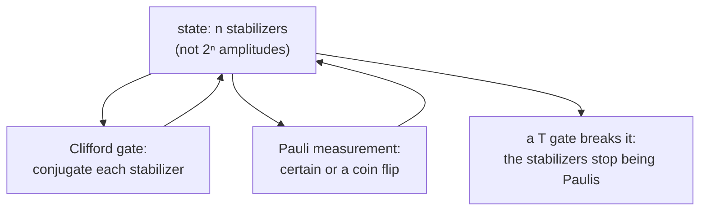

#extra #gottesman_knill #clifford #simulation
**extra** (not in the course yet): why a quantum circuit made only of [[Clifford group|Clifford gates]] can be simulated quickly on a normal computer, even when it makes lots of entanglement. it's the reason fault tolerance needs a non-Clifford gate ([[Fault-tolerant quantum computing#why Cliffords aren't enough]])
## the theorem
> [!important] Gottesman-Knill
> ==a quantum circuit that only uses==
> - preparing qubits in $|0\rangle$
> - Clifford gates ($H$, $S$, CNOT)
> - measuring Pauli operators (and classical control based on the results)
>
> ==can be simulated efficiently on a classical computer==

so these circuits can't give a quantum speed up, however entangled their states get
## the trick: track the stabilizers, not the state
an $n$ qubit state takes $2^n$ amplitudes to write down. but every state these circuits make is a **stabilizer state**: the unique state left alone by $n$ commuting Pauli products ([[Stabilizer codes]] with $k=0$). so store those $n$ Pauli products instead, and update them gate by gate with [[Clifford group#^clifford-table]]
$$
|\psi\rangle\text{ stabilized by }g\quad\Rightarrow\quad U|\psi\rangle\text{ stabilized by }UgU^\dagger
$$
^stabilizer-update

each gate only touches 1 or 2 qubits, so each update is $O(n)$ work. that's about $2n(2n+1)$ bits of memory (the "tableau") instead of $2^n$ complex numbers

![[Gottesman_Knill_memory.png]]

> [!eg] making a GHZ state
> start in $|000\rangle$, stabilized by $Z_1, Z_2, Z_3$
> $$
> \begin{aligned}
> &|000\rangle&&Z_1,\quad Z_2,\quad Z_3\\
> \xrightarrow{H_1}\ &&&X_1,\quad Z_2,\quad Z_3\\
> \xrightarrow{\text{CNOT}_{12}}\ &&&X_1X_2,\quad Z_1Z_2,\quad Z_3\\
> \xrightarrow{\text{CNOT}_{23}}\ &\tfrac{|000\rangle+|111\rangle}{\sqrt2}&&X_1X_2X_3,\quad Z_1Z_2,\quad Z_2Z_3
> \end{aligned}
> $$
> three Pauli strings describe a 3 qubit entangled state ([[GHZ state]]). for 1000 qubits it's still only 1000 strings, while the state vector would need $2^{1000}$ numbers
## measurements too
measuring a Pauli $P$ is just as easy
- if $P$ **commutes** with every stabilizer, the outcome is **certain**, and it can be worked out from the stabilizers
- if $P$ **anticommutes** with some, the outcome is a fair coin flip ($\pm1$, each with probability $\frac12$). replace one of the anticommuting stabilizers with $\pm P$ and fix up the others

eg. measure $Z_1$ on the Bell state (stabilizers $X_1X_2$, $Z_1Z_2$): it anticommutes with $X_1X_2$, so the result is random. say you get $+1$: the new stabilizers are $Z_1$, $Z_1Z_2$, which is $|00\rangle$ ✓
## what it tells us
- ==entanglement alone isn't what makes quantum computers powerful==: Clifford circuits make plenty of it and are still easy to simulate
- [[Teleportation]], [[Superdense coding]], the encoding and syndrome circuits of [[Stabilizer codes]] are **all** Clifford circuits, so they can all be checked quickly on a laptop. that's also how [[Randomized benchmarking]] finds the one Clifford that undoes a long random sequence
- a speed up needs something extra, like the $T$ gate. modern simulators run Clifford + a few $T$ gates, with a cost that grows exponentially only in the number of $T$s

> [!exercise] try these
> ① track the stabilizers of $|00\rangle$ through $H_1$ then CNOT$_{12}$. which Bell state is it?
> ② in the GHZ state, what do you get if you measure $Z_1Z_3$?
> ③ how many bits does the tableau need for 50 qubits? compare 50 qubits' state vector (16 bytes per amplitude)

> [!answer]-
> ① $Z_1,Z_2\xrightarrow{H_1}X_1,Z_2\xrightarrow{\text{CNOT}}X_1X_2,\ Z_1Z_2$: the state with $XX=+1$ and $ZZ=+1$, which is $|\Phi^+\rangle=\frac{|00\rangle+|11\rangle}{\sqrt2}$
> ② $Z_1Z_3=(Z_1Z_2)(Z_2Z_3)$ is a product of stabilizers, so it's certain: $+1$ (the bits always agree)
> ③ $2\cdot50\cdot101=10100$ bits, about 1.3 kB. the state vector is $16\times2^{50}\approx1.8\times10^{16}$ bytes, about 18 petabytes

see also [[Clifford group]], [[Stabilizer codes]], [[Solovay-Kitaev theorem]], [[Quantum simulation]], textbook: [[Measurement and the Gottesman-Knill theorem]]
