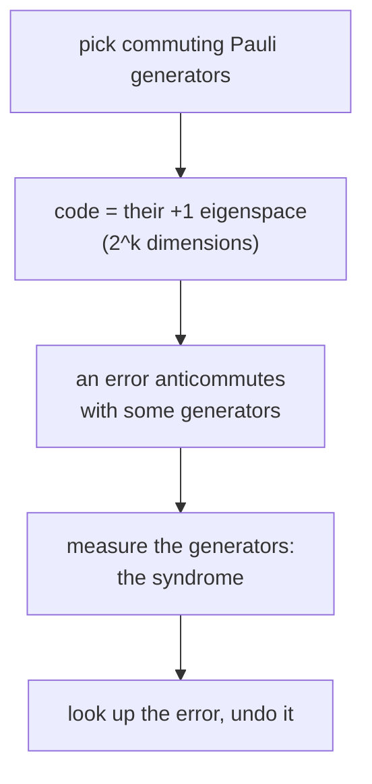

#extra #stabilizer_codes #quantum_error_correction
**extra** (not in the course yet): the language almost every quantum code is written in. instead of writing out the code words, list the Pauli operators that leave them alone. used all through [[Fault-tolerant quantum computing]]
## the idea
the bit flip code's code words $|000\rangle$ and $|111\rangle$ (and every superposition of them) are left alone by $Z_1Z_2$ and $Z_2Z_3$: both have eigenvalue $+1$ on them. and they're the **only** states with that property. so these two operators **define** the code

> [!important] the one idea
> ==a stabilizer code is the set of states that a group of commuting Pauli products all leave alone (eigenvalue $+1$)==. a few generators describe a code space that would take exponentially many numbers to write out
## the definition
on $n$ qubits, pick $n-k$ independent Pauli products $g_1,\dots,g_{n-k}$ that all **commute** with each other (and don't generate $-I$). the group they generate is the **stabilizer** $S$, and the code is
$$
C=\{\,|\psi\rangle\ :\ g\,|\psi\rangle=|\psi\rangle\ \text{ for all }g\in S\,\}\qquad\dim C=2^k
$$
^stabilizer-code

each generator cuts the space in half (its $+1$ eigenspace), so $n-k$ of them leave $2^n/2^{n-k}=2^k$ dimensions: room for $k$ logical qubits
## errors and syndromes
Pauli products either **commute** or **anticommute**. if an error $E$ anticommutes with a generator $g$, then on a code state
$$
g\,(E|\psi\rangle)=-E\,g|\psi\rangle=-E|\psi\rangle
$$
so measuring $g$ gives $-1$ instead of $+1$. ==the **syndrome** is the list of which generators anticommute with the error==: one bit per generator, measured without touching the encoded state ([[Parity measurement]], done fault tolerantly in [[Fault-tolerant measurement]])

> [!eg] the 5 qubit code
> generators $XZZXI,\ IXZZX,\ XIXZZ,\ ZXIXZ$ ([[Transversal gates on stabilizer codes#^five-qubit-generators]]). syndrome bit $j$ is 1 if the error anticommutes with generator $j$
>
> | qubit | $X$ | $Y$ | $Z$ |
> |---|---|---|---|
> | 1 | 0001 | 1011 | 1010 |
> | 2 | 1000 | 1101 | 0101 |
> | 3 | 1100 | 1110 | 0010 |
> | 4 | 0110 | 1111 | 1001 |
> | 5 | 0011 | 0111 | 0100 |
>
> all 15 single-qubit errors give **different** nonzero syndromes, and with "no error" (0000) that uses all $2^4=16$. so it corrects any one error, with nothing to spare: the "perfect" code from the [[Degenerate codes and the quantum Hamming bound|quantum Hamming bound]] (checked numerically)
## logical operators and distance
an operator that **commutes** with every generator but **isn't in** $S$ maps the code to itself without being the identity on it: it's a **logical** operator (it's in the normalizer, [[Fault-tolerant quantum computing#^normalizer]]). eg. $X_1X_2X_3$ for the bit flip code, or $X^{\otimes5}$ for the 5 qubit code

the **distance** $d$ is the weight (number of non-identity entries) of the smallest logical operator. an error that small is invisible to the syndrome **and** changes the logical state. a code with distance $d$ corrects any $t$ errors with $d\geq2t+1$, just like classical codes ([[Classical linear codes#^code-distance]]). written $[\![n,k,d]\!]$, with double brackets for quantum

| code | generators | $[\![n,k,d]\!]$ | note |
|---|---|---|---|
| [[Bit flip code]] | $Z_1Z_2,\ Z_2Z_3$ | $[\![3,1,1]\!]$ | $Z_1$ is a weight 1 logical: phase flips get through |
| [[Shor code]] | 6 $ZZ$ checks + 2 six-qubit $X$ checks | $[\![9,1,3]\!]$ | degenerate |
| 5 qubit code | 4 (above) | $[\![5,1,3]\!]$ | the smallest code for any one error |
| 7 qubit (Steane) code | 3 $X$ + 3 $Z$ checks | $[\![7,1,3]\!]$ | a [[CSS codes\|CSS code]], all Cliffords transversal |

^stabilizer-examples

> [!extra] why it's so useful
> stabilizer codes are the quantum version of classical **linear** codes: generators play the role of the parity check matrix. the states they describe, and the [[Clifford group|Clifford gates]] between them, can even be simulated efficiently on a normal computer ([[Gottesman-Knill theorem]])

> [!exercise] try these
> ① 4 independent generators on 6 qubits: how many logical qubits?
> ② find the syndrome of $X_2$ for the bit flip code (generators $Z_1Z_2$, $Z_2Z_3$)
> ③ why is the bit flip code's distance only 1?
> ④ the 7 qubit code has 6 generators. how many syndromes, and how many single-qubit Pauli errors?

> [!answer]-
> ① $k=6-4=2$
> ② $X_2$ anticommutes with both (they each have a $Z$ on qubit 2): syndrome 11, matching [[Syndrome diagnosis and recovery#^z-syndrome-table]]
> ③ $Z_1$ commutes with both generators but isn't in $S$, so it's a logical operator of weight 1: a single phase flip changes the logical state without being detected
> ④ $2^6=64$ syndromes, for $1+21=22$ cases. lots to spare: an $X$ error is read by the 3 $Z$ checks and a $Z$ error by the 3 $X$ checks separately

see also [[Transversal gates on stabilizer codes]], [[CSS codes]], [[Quantum error-correction conditions]], [[Parity measurement]], textbook: [[The stabilizer formalism]], [[Stabilizer code constructions]]
