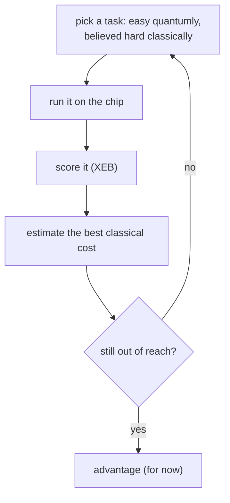

#extra #quantum_advantage #complexity #benchmark
**extra** (not in the course as its own topic): when a quantum computer does something **no classical computer can do in any reasonable time**. first called **quantum supremacy** (Preskill, 2012), now usually "advantage". the complexity side is in [[Quantum vs classical complexity]]
## three kinds of claim

| kind | what's shown | example |
|---|---|---|
| **proven** | a speed up you can prove, but only against a black box (oracle) | [[Bernstein-Vazirani algorithm]], [[Simon's algorithm]], [[Grover's algorithm]] (only quadratic) |
| **believed** | faster than every **known** classical algorithm for a real problem | [[Shor's algorithm]] for factoring: no one can prove factoring is hard ([[Complexity classes]]) |
| **demonstrated** | an actual machine beats actual supercomputers | random circuit sampling, boson sampling |

> [!important] the one idea
> ==quantum advantage is a race against the best **classical** method, not against a fixed number==: every claim so far has made classical people find cleverer simulations, so the line keeps moving

## why sampling problems
for a demonstration you want a task that's **easy** for today's noisy quantum chips and **provably hard-ish** classically
- **random circuit sampling**: run a random circuit on $n$ qubits and output measurement results ([[Promise, sampling and relation problems]]). a quantum chip just runs it. classically you'd need the $2^n$ amplitudes. if a classical computer could sample it exactly and efficiently, complexity theory would collapse in a way most people think impossible
- **boson sampling**: send photons through a big random [[Beamsplitters|beamsplitter]] network and record where they come out

checking the answer is the hard part, since nobody can compute the right distribution. the usual score is **linear cross-entropy benchmarking** (XEB): average the ideal probability of the bitstrings you got
$$
F_\text{XEB}=2^n\,\big\langle P_\text{ideal}(x_i)\big\rangle_i-1
$$
^xeb

pure noise gives $F=0$, a perfect device gives about 1. a tiny but clearly nonzero $F$ means the chip is really doing the quantum computation

## what happened

| year | who | claim | the classical answer |
|---|---|---|---|
| 2019 | Google, Sycamore (53 [[Superconducting qubits\|superconducting qubits]]) | random circuits in 200 s, "10 000 years" classically, $F_\text{XEB}\approx0.2\%$ | IBM said ~2.5 days; by 2022 [[Tensor networks]] did it in hours on GPUs |
| 2020 | USTC, Jiuzhang | Gaussian boson sampling with ~70 photons | partly matched by better classical methods later |
| 2023 | IBM, 127 qubits | "utility": a physics simulation with [[Quantum error mitigation\|error mitigation]] | classical tensor-network methods reproduced it within weeks |
| 2024 | Google, Willow (105 qubits) | random circuits in 5 minutes vs ~$10^{25}$ years | still standing (bigger, deeper circuits) |
| 2025 | Google | a verifiable physics measurement (echoes) ~13 000× faster than a supercomputer | being checked |

so the honest summary: sampling advantage looks real at the newest sizes, **useful** advantage (something people actually want to know) is just starting, and the big prizes ([[Shor's algorithm]], chemistry with [[VQE]]-like methods at scale) need [[Logical qubit|logical qubits]]

## why it's hard to pin down
- you can't **prove** classical hardness ($\text{BPP}\neq\text{BQP}$ is unproven: [[Complexity classes]])
- noise lowers $F_\text{XEB}$, and low fidelity makes classical spoofing easier
- classical algorithms improve too (tensor networks, GPUs, using the noise)

> [!exercise] try these
> **1** why is Grover not a good choice for showing advantage soon?
> **2** a device outputs uniformly random bitstrings. what's its $F_\text{XEB}$?
> **3** why can't we just check a random-circuit result directly?

> [!answer]-
> **1** only a quadratic speed up, which slow, noisy gates easily eat up
> **2** $\langle P\rangle=\frac1{2^n}$, so $F=2^n\cdot\frac1{2^n}-1=0$
> **3** checking needs the ideal probabilities, which is the same exponential classical computation

see also [[Computational complexity]], [[Quantum circuit evaluation]], [[Quantum volume]], [[NISQ]], [[Turing machine]]
