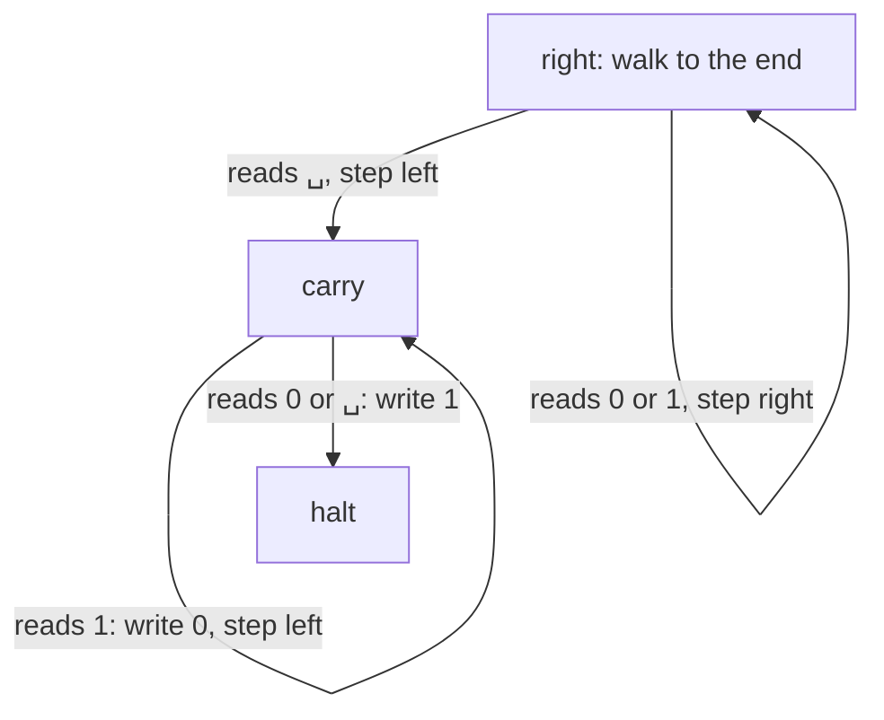

#extra #complexity #classical_computing #circuit_model
**extra** (not in the course as its own topic): Turing's 1936 model of "anything a computer can do". a model of computation next to the [[Circuit model]], and the thing complexity classes like P are usually defined with ([[Complexity classes]])
## the parts
- an endless **tape** of cells, each holding one symbol (0, 1, or blank ␣). the input starts on it
- a **head** that reads one cell, writes a symbol, and moves one step left or right
- a finite set of **states** (the machine's "mood"), including start, accept and reject
- a **rule table**: (current state, symbol read) → (new state, symbol to write, move L or R)

that's it. no memory except the tape, no instructions except the table

![[Turing_machine_tape.png]]

> [!important] the one idea
> ==a Turing machine is a tiny rule table plus unlimited scratch paper, and (as far as anyone knows) it can compute anything any physical computer can==. complexity just asks **how many steps** it needs

## eg. adding 1 to a binary number
start on the leftmost digit in state **right**

| state | reads | writes | moves | next state |
|---|---|---|---|---|
| right | 0 or 1 | same | R | right |
| right | ␣ | ␣ | L | carry |
| carry | 1 | 0 | L | carry |
| carry | 0 | 1 | – | halt |
| carry | ␣ | 1 | – | halt |

on 1011 (eleven): run right to the end, step back, turn the two trailing 1s into 0s, then the 0 into a 1: **1100** (twelve) ✓

## the big ideas
- **universal Turing machine**: one machine that reads another machine's rule table off the tape and runs it. that's a programmable computer, in 1936
- **the halting problem**: no Turing machine can decide, for every machine and input, whether it eventually stops. (if one did, build a machine that does the opposite of what it predicts about itself: contradiction.) [[Circuit model]] shows the funny twist that non-uniform circuit families can "solve" a version of it
- **Church–Turing thesis**: anything that can be computed by any physical process can be computed by a Turing machine. quantum computers **don't** break this: a Turing machine can simulate them, just exponentially slowly
- **strong (extended) Church–Turing thesis**: any reasonable computer can be simulated by a (randomized) Turing machine with only **polynomial** slowdown. ==quantum computers are the main reason to think this one is false== ([[Quantum vs classical complexity]], [[Quantum advantage]])

## Turing machines vs circuits

| | Turing machine | circuit family |
|---|---|---|
| input size | any length, one machine | one circuit per input length $n$ |
| cost | number of steps (time), cells used (space) | number of gates (size), depth |
| link | a machine running $T$ steps can be turned into a circuit of size about $T^2$ | a **uniform** circuit family (one a Turing machine can write down) is no stronger than a Turing machine |

so P = problems with polynomial time Turing machines = problems with polynomial size **uniform** circuits. the quantum version, the **quantum Turing machine**, was defined by Deutsch (1985) and shown to be equivalent to [[Quantum circuit evaluation|quantum circuits]], which is why everyone just uses circuits

> [!exercise] try these
> **1** run the adding-1 machine on 111. what's left on the tape?
> **2** how many steps does it take on an $n$-digit number, worst case?
> **3** does a quantum computer compute anything a Turing machine can't?

> [!answer]-
> **1** 1000: all three 1s become 0, then the blank becomes 1
> **2** about $2n+1$: $n$ steps right, then up to $n+1$ steps back left. linear time
> **3** no (Church–Turing). it may only be **faster** (strong Church–Turing)

see also [[Computational complexity]], [[Languages]], [[Randomized and quantum computation]], [[Nondeterminism]], [[Big O notation]]
