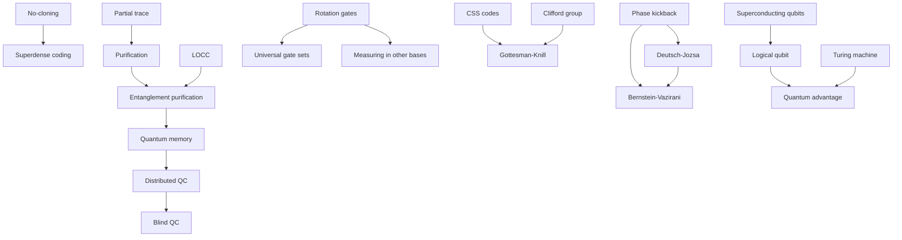

#extra
stuff that **isn't covered in the courses** but is still important or good to know. sorted by the course and week where it first comes up
## Course 1
- [[Fredkin gate]] → the controlled SWAP (and the swap test)
- [[Phase kickback]] → how a controlled gate changes the **control** qubit
- [[Rotation gates]] → $R_x$, $R_y$, $R_z$, every named gate as a rotation, the $ZYZ$ decomposition
- [[Measuring in other bases]] → rotate then measure: $X$ and $Y$ measurements, the Born rule, relative vs global phase
- [[Universal gate sets]] → why $H$, $T$, CNOT are enough, and why Cliffords aren't
- [[Deutsch-Jozsa algorithm]] → the first quantum speed up: constant or balanced in one call
## Course 2
- **week 1** → [[Diffie-Hellman key exchange]] (the other public-key system Shor breaks)
- **week 2** → [[No-cloning theorem]] (you can't copy an unknown state, and why that matters everywhere), [[Hong-Ou-Mandel effect]] (two identical photons always leave a beamsplitter together)
- **week 3** → [[Jordan-Wigner transformation]] (turning electrons into qubits for VQE)
- **week 4** → [[Amplitude amplification]] (Grover for any algorithm, and amplitude estimation)
## Course 3
- **week 1 (more channels)** → [[Pauli channel]] (the general one), [[Bit flip channel]], [[Bit-phase flip channel]], [[Phase damping channel]] (dephasing in disguise), [[Generalized amplitude damping channel]] (at a temperature), [[Erasure channel]] (lost, but you know it)
- **week 2 (entanglement and networks)** → [[LOCC]] (the rules entanglement is measured by), [[Superdense coding]], [[Entanglement purification]], [[Quantum memory]], [[Distributed quantum computing]], [[Blind quantum computing]]
- **week 3 (algorithms and simulation)** → [[Superconducting qubits]] (how the IBM/Google chips work), [[Bernstein-Vazirani algorithm]], [[GHZ state]], [[Solovay-Kitaev theorem]], [[Tensor networks]], [[Density functional theory]], [[HHL with 10 variables]] (with Qiskit code to simulate your own equations)
- **week 4 (maths behind fidelity)** → [[Purification]] (the [[Partial trace]] it uses is now in Course 3 Week 1, since the course covers it)

## Course 4
- **week 1 (error correction)** → [[Logical qubit]] (physical vs logical, code distance, how many qubits per logical qubit)
- **week 2 (behind quantum fault tolerance)** → [[CSS codes]] (two classical codes, one for bit flips and one for phase flips: the Steane code), [[Clifford group]] ($H$, $S$, CNOT: Paulis to Paulis, 24 on one qubit), [[Gottesman-Knill theorem]] (why Clifford circuits are easy to simulate). ([[Stabilizer codes]] is now in Course 4 Week 2, since the course covers it)
- **week 3 (error mitigation)** → [[Composite pulses]] (cancelling fixed pulse errors: BB1)
- **week 4 (complexity)** → [[Turing machine]], [[Quantum advantage]] (a.k.a. quantum supremacy: what's been shown and what hasn't)

(some rough "read this first" links)

see also [[Welcome]], [[Math]]
