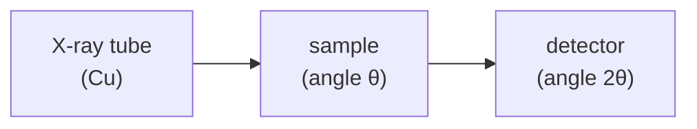

#vlsi #characterization #XRD #diffraction #crystal
## X-ray diffraction
shine X-rays on a crystal and see **at which angles** they diffract. the atoms in a crystal sit on regular planes, and the angles tell you the **spacing** of those planes, so it tells you **crystal structure, phase, orientation, strain and grain size**. part of [[Metrology and nano-characterization workshop]]

> [!important] the one idea
> ==a crystal is a pattern that repeats, so waves bouncing off it only add up in a few exact directions. measure those directions and you've measured the repeat distance==

![[Lattice_motif_crystal.png]]
## where the X-rays come from
an electron beam hits a metal anode (Cu is the usual one) inside an evacuated tube, and a small fraction of its energy comes out as X-rays

![[XRay_tube.png]]

two things make the X-rays: electrons slowing down near nuclei (a smooth **continuum**) and electrons knocking out inner shell electrons (sharp **characteristic lines**, same idea as [[EDS]]). XRD uses the Cu $K_\alpha$ line

![[XRay_spectrum.png]]

> [!eg] how much energy is a Cu $K_\alpha$ photon?
> the same photon energy formula as in [[UV-vis spectroscopy]]
> ![[UV-vis spectroscopy#^photon-energy]]
>
> with $\lambda=1.5406$ Å $=0.15406$ nm: $E=\frac{1240}{0.15406}=8049$ eV $\approx8.05$ keV. about 3000× a visible photon. ==same kind of particle, just a much shorter wavelength==, short enough to match the spacing of atoms

## Bragg's law
X-rays reflecting off neighbouring planes only add up (constructive interference) when the extra path they travel is a whole number of wavelengths
$$
n\lambda=2d\sin\theta
$$
^bragg

- $d$ → spacing between planes
- $\theta$ → angle between the beam and the planes
- $\lambda$ → X-ray wavelength, usually **Cu $K_\alpha$ = 1.5406 Å** (similar to atom spacing, that's why X-rays work)
- the detector sits at $2\theta$ from the incoming beam, so scans are plotted vs $2\theta$

![[Bragg_law.png]]

(the extra path is $d\sin\theta$ going in plus $d\sin\theta$ coming out, so $2d\sin\theta$. at any other angle the waves from the millions of planes cancel out)

### cubic crystals
$$
d_{hkl}=\frac{a}{\sqrt{h^2+k^2+l^2}}
$$
^d-spacing

$(hkl)$ = [[Miller indices]] of the plane

> [!eg] where's the Si (400) peak? ($a=5.431$ Å, Cu $K_\alpha$)
> $$
> \begin{aligned}
> d_{400}&=\frac{5.431}{\sqrt{4^2+0+0}}=\frac{5.431}4=1.358\ \text{Å}\\
> \sin\theta&=\frac{\lambda}{2d}=\frac{1.5406}{2\times1.358}=0.567\\
> \theta&=34.56^\circ\quad\Rightarrow\quad2\theta=69.13^\circ
> \end{aligned}
> $$
> that's the one peak a Si(100) wafer shows (see below)

![[Miller_indices.png]]

which planes actually give a peak depends on the cell (the structure factor)

![[Cubic_unit_cells.png]]
## the usual scan: θ–2θ
sample and detector rotate together, so you only see planes **parallel to the surface**
- **single crystal wafer** → just one family of peaks (eg. Si(100) only shows (400))
- **polycrystalline** or **powder** → a peak for each $(hkl)$ since grains point every way (the full "fingerprint")
- **amorphous** → no sharp peaks, just a broad hump
- compare peak positions to a database (ICDD / PDF cards) → **phase identification**

![[Crystallinity_patterns.png]]

(a [[TEM]] sees the same three cases in SAED: spots, rings, halo)

![[XRD_axes.png]]
## what each part of a peak tells you

| feature | tells you |
|---|---|
| **position** | lattice parameter $d$, strain (peak shifts to lower 2θ = bigger spacing = tensile) |
| **width** | crystallite size, microstrain |
| **height** | amount of phase, preferred orientation |

^peak-features

![[XRD_peak_parameters.png]]

### Scherrer equation
$$
D=\frac{K\lambda}{\beta\cos\theta}
$$
^scherrer

crystallite size $D$ from the peak width $\beta$ (FWHM in **radians**, after subtracting instrument broadening), $K\approx0.9$. ==smaller crystals → broader peaks==. only good below ~100–200 nm

> [!eg] a peak at $2\theta=40^\circ$ with FWHM $0.4^\circ$
> $$
> \begin{aligned}
> \beta&=0.4^\circ\times\frac{\pi}{180}=0.00698\ \text{rad}\qquad\theta=20^\circ\\
> D&=\frac{0.9\times0.15406\ \text{nm}}{0.00698\times\cos20^\circ}=\frac{0.1387}{0.00656}\\
> &\approx21\ \text{nm}
> \end{aligned}
> $$
> the classic mistake is putting $\beta$ in degrees: that gives $0.37$ nm, smaller than an atom

![[XRD_peak_broadening.png]]

(why broad? a small crystal has only a few repeats, and a pattern that repeats only a few times gives wider spikes in its Fourier transform, see [[#the quantum connection]])
## for thin films
- **GIXRD** (grazing incidence) → small fixed angle so the beam stays in the film instead of the substrate
- **rocking curve** (scan θ with 2θ fixed on a peak) → crystal **quality**, width = mosaicity or defects (eg. epitaxial layers)
- **XRR** (reflectivity at low angles) → film **thickness, density, roughness** from fringes, even for amorphous films
- **reciprocal space maps** → strain and relaxation in epitaxial layers (eg. SiGe on Si)

![[XRR_curve.png]]
## texture: pole figure
a polycrystal's grains can point every way (**random**) or mostly one way (**preferred orientation / fibre texture**). fix $2\theta$ on one peak (eg. Cu (111)), then tilt ($\chi$) and spin ($\phi$) the sample and map the intensity on a circle
- **uniform** intensity → random orientation
- **strong central maximum** at $\chi=0^\circ$ → the (111) planes lie parallel to the surface (eg. Cu film on Si)

![[Pole_figure.png]]
## strain and relaxation: reciprocal space map
a **reciprocal space map (RSM)** measures one film peak and the substrate peak in 2D, $Q_x$ (in-plane) against $Q_z$ (out-of-plane)

| what you see | what it means |
|---|---|
| same $Q_x$, different $Q_z$ | **coherent strain**: film matches the substrate in-plane, only the out-of-plane spacing changed |
| different $Q_x$ (and/or $Q_z$) | **partial or full relaxation**: the in-plane lattice parameter changed |
| broad or elongated peak | mosaicity, strain gradients, defects or finite size effects |
| two or more film peaks | several phases, domains or layers |

degree of relaxation
$$
R=\frac{a_{\parallel,film}-a_{sub}}{a_{film,relaxed}-a_{sub}}\times100\%
$$
^relaxation

> [!eg]- example (illustrative values from the lecture)
> $a_{sub}=3.90$ Å, $a_{film,relaxed}=4.00$ Å, $a_{\parallel,film}=3.94$ Å
> $$
> R=\frac{3.94-3.90}{4.00-3.90}\times100\%=40\%
> $$
> so the film is about **40% relaxed**

![[RSM_relaxation.png]]
## heating: in situ temperature XRD
heat or cool the sample while measuring (MNCF stage: **−150 °C to 500 °C**) to watch
- **phase evolution**: phase changes, crystallization and structure changes while heating and cooling
- **residual stress after annealing**: does annealing relax the stress? check the peak positions

![[InSitu_temperature_XRD.png]]
## in VLSI
- confirm the **crystal phase** of a film (eg. $\text{TiSi}_2$ C49 vs C54, HfO$_2$ monoclinic vs orthorhombic for ferroelectric)
- check epitaxial **strain** in SiGe channels
- **thickness** of ultra thin films with XRR
- grain size and texture of metal films (Cu, W)
- wafer orientation
## limits
- needs a decent volume of crystal (very thin films give weak signal)
- doesn't see light elements well, and amorphous stuff is basically invisible (including the damage layer an [[FIB#downsides|FIB]] leaves)
- averages over a big area (mm) → no local info, use [[TEM#Bragg's law in a TEM|TEM diffraction]] for that

> [!exercise] try these
> ① Cu is fcc with $a=3.615$ Å. at what $2\theta$ is its (111) peak?
> ② a Si film's (400) peak shows up at $2\theta=69.00^\circ$ instead of $69.13^\circ$. is it under tension or compression, and by how much?
> ③ a peak at $2\theta=30^\circ$ has FWHM $0.2^\circ$. how big are the crystallites?
> ④ why can't you do XRD with visible light?

> [!answer]-
> ① $d=\frac{3.615}{\sqrt3}=2.087$ Å, $\sin\theta=\frac{1.5406}{2\times2.087}=0.369$, $\theta=21.66^\circ$, so $2\theta=43.3^\circ$
> ② lower angle = bigger $d$ = **tension**. $d=\frac{1.5406}{2\sin34.50^\circ}=1.3600$ Å, so $a=4d=5.440$ Å vs $5.431$: $\frac{5.440-5.431}{5.431}=0.16\%$ tensile strain
> ③ $\beta=0.00349$ rad, $D=\frac{0.9\times0.15406}{0.00349\times\cos15^\circ}\approx41$ nm (half the width → twice the size)
> ④ Bragg needs $\lambda\le2d$, so $\sin\theta\le1$. visible light is ~500 nm, thousands of times bigger than the ~0.2 nm spacing, so no angle works

## the quantum connection
> [!extra] a diffraction pattern is a Fourier transform
> the pattern of diffracted X-rays is (the size of) the **Fourier transform** of the crystal's electron density. a crystal **repeats** every $d$, so its Fourier transform has **sharp spikes** at multiples of $\frac1d$: those spikes are the Bragg peaks. ==that's exactly the rule in [[Fourier Transform#Why it matters for quantum]], "repeating signals → sharp spikes"==
> - "reciprocal space" (as in the reciprocal space map above) just means **Fourier space**
> - more repeats → sharper spikes, so **small** crystals give **broad** peaks. that's the Scherrer equation, and it's the same reason [[Quantum Phase Estimation]] gets sharper with more counting qubits
> - a [[TEM#the quantum connection|TEM]] does the same Fourier transform with a lens, using electrons instead of X-rays

> [!extra] XRD and Shor's algorithm find periods the same way
> the same trick, done on a quantum computer with the [[Quantum Fourier Transform]], finds the hidden period in [[Shor's algorithm]] ([[Order finding algorithm]])
>
> | | XRD | Shor |
> |---|---|---|
> | the repeating thing | atoms, every $d$ | $a^x\bmod N$, every $r$ |
> | the Fourier transform | done by the waves interfering | done by the QFT |
> | you measure | peaks at multiples of $\frac1d$ | outcomes near multiples of $\frac{2^n}r$ |
> | then | Bragg's law → $d$ | continued fractions → $r$ |

see also [[TEM]] (electron diffraction, same Bragg idea), [[UV-vis spectroscopy]], [[FIB]], [[Raman spectroscopy]], [[XPS]] (chemistry of the top few nm), [[Metrology and nano-characterization workshop]]

formulas: [[Diffraction formulas]]
