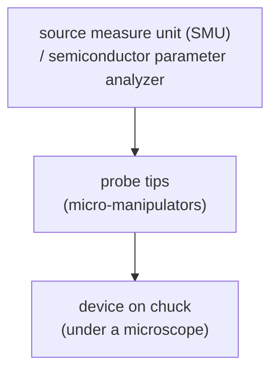

#vlsi #characterization #electrical #probe_station #IV
## electrical characterization
all the other techniques tell you what it looks like or what it's made of. this one tells you if the **device actually works**: apply voltages, measure currents. part of [[Metrology and nano-characterization workshop]]
- [[Sheet resistance and contacts]] → four-point probe, TLM, van der Pauw
- [[MOS capacitor C-V]] → oxide thickness, doping, interface traps

> [!important] the one idea
> ==sweep one voltage, measure one current (or capacitance), and read the device's physics off the shape of the curve==: a straight line is a resistor, an exponential is a diode, a curve that switches on is a transistor

## DC probe station

- **chuck** holds the wafer or chip (vacuum hold, sometimes temperature controlled)
- **micro-manipulators** move sharp **tungsten** probe tips (µm tip) onto the contact pads, watched through a microscope
- **SMU**: sources a voltage and measures the current (or the other way round), with fA to pA resolution
- sits in a **shielded, dark box** (light creates carriers, EM noise couples in), with coax / triax cables to cut leakage and noise ([[MOS capacitor C-V#cables matter]])
- "DC" because the sweeps are slow, not high frequency (RF probe stations are for GHz)
## standard measurements
### $I$–$V$ curves
sweep a voltage, record the current. gives resistance, diodes, leakage, breakdown
- **diode**: ideality factor $n$ and saturation current
- **resistor / contact**: linear (ohmic) vs curved (Schottky), see [[Sheet resistance and contacts#how contact formation can go wrong]]

$$
I=I_s\left(e^{qV/nk_BT}-1\right)\qquad\frac{k_BT}q=25.85\ \text{mV at 300 K}
$$
^shockley

> [!eg] how steep is a diode?
> for $V\gg\frac{k_BT}q$ the $-1$ doesn't matter, so $\ln I=\ln I_s+\frac{qV}{nk_BT}$. to make the current 10× bigger you need
> $$
> \Delta V=n\,\frac{k_BT}q\ln10=1\times25.85\times2.303=59.5\ \text{mV}
> $$
> for an ideal diode ($n=1$). so on a log plot an ideal diode climbs one decade every 60 mV, and ==a measured slope of 120 mV/decade means $n=2$== (recombination in the junction)

![[Diode_IV.png]]
### transistor (MOSFET)
- **transfer curve** $I_D$–$V_{GS}$ at fixed $V_{DS}$ (log scale on $I_D$)
- **output curve** $I_D$–$V_{DS}$ at several $V_{GS}$

linear region ($V_{DS}<V_{GS}-V_{th}$)
$$
I_D=\mu C_{ox}\frac WL\left[(V_{GS}-V_{th})V_{DS}-\frac{V_{DS}^2}{2}\right]
$$
^mosfet-linear

saturation
$$
I_D=\frac12\mu C_{ox}\frac WL(V_{GS}-V_{th})^2
$$
^mosfet-saturation

($C_{ox}$ here is per area, the same oxide capacitance as in [[MOS capacitor C-V#^oxide-capacitance]] divided by $A$)

> [!eg] a saturated nMOSFET
> 2 nm SiO₂: $C_{ox}=\frac{3.9\times8.854\times10^{-12}}{2\times10^{-9}}=1.73\times10^{-2}$ F/m². $\mu=400$ cm²/Vs $=0.04$ m²/Vs, $\frac WL=10$, $V_{GS}-V_{th}=0.6$ V
> $$
> I_D=\frac12(0.04)(1.73\times10^{-2})(10)(0.6)^2=1.25\times10^{-3}\ \text{A}=1.25\ \text{mA}
> $$
> double the overdrive to 1.2 V and the current goes ×4, the square law

what to pull out

| parameter | meaning |
|---|---|
| $V_{th}$ | threshold voltage (where it turns on) |
| $g_m=\partial I_D/\partial V_{GS}$ | transconductance (gain) |
| $\mu$ | carrier mobility |
| **SS** | subthreshold swing, mV of gate per decade of current |
| $I_{on}/I_{off}$ | on/off ratio |
| $I_{off}$ | leakage |
| DIBL | how much $V_{th}$ drops when $V_{DS}$ goes up (short channel effect) |

^mosfet-parameters

subthreshold swing has a **thermal limit** at room temp
$$
SS=\frac{k_BT}{q}\ln10\approx60\text{ mV/dec}
$$
^subthreshold-swing

(the same 59.5 mV as the ideal diode above, for the same reason: below threshold the current comes from electrons hopping **over** a barrier, and their energies follow the Boltzmann tail $e^{-E/k_BT}$)

![[MOSFET_curves.png]]
### $C$–$V$
needs an LCR meter (small AC signal on top of a DC sweep). for a **MOS capacitor** you get oxide thickness, $V_{FB}$, doping, interface trap density (accumulation / depletion / inversion). full note: [[MOS capacitor C-V]]

![[MOS_CV_curves.png]]
### four-point probe
four probes in a line, current through the outer two, voltage measured on the inner two. this kills the contact resistance

![[Sheet resistance and contacts#^four-point]]

sheet resistance of doped layers, metal films. resistivity $\rho=R_s\,t$. why four and not two probes, van der Pauw, TLM: see [[Sheet resistance and contacts]]

![[Four_point_probe.png]]
### others
- **TLM** (transfer length method) → contact resistance, see [[Sheet resistance and contacts#TLM: transfer length method]]
- **breakdown** / TDDB (time dependent dielectric breakdown) → oxide reliability
- **temperature sweeps**
- **c-AFM** maps leakage spot by spot ([[AFM#other AFM flavours]])
## things that go wrong
- **contact resistance** between probe and pad, scratching through native oxide
- **leakage** in cables and the chuck (use guarded / triax)
- **noise** and light → shield and measure in the dark
- ==**don't sweep too high or fast** → you destroy the device (always set a **compliance current**)==
- hysteresis from **traps** (sweep up, then down and compare)
- self-heating in power devices

> [!exercise] try these
> ① a diode's log $I$–$V$ plot climbs 1 decade per 90 mV. what's $n$?
> ② a transistor needs 300 mV of gate to go from $I_{off}=1$ nA to 1 µA below threshold. what's its SS? is it ideal?
> ③ why is the probe station kept dark?

> [!answer]-
> ① $n=\frac{90}{59.5}\approx1.5$
> ② 3 decades in 300 mV → SS $=100$ mV/dec, worse than the 60 mV ideal (the gate doesn't fully control the channel, $C_d/C_{ox}$ isn't zero)
> ③ light has enough energy to make electron-hole pairs ([[UV-vis spectroscopy#the quantum connection]]), which shows up as extra current, a disaster at pA levels

## the quantum connection
> [!extra] 60 mV/dec is a thermal limit, and quantum tunnelling can beat it
> carriers going over a barrier always need ~60 mV per decade at 300 K, it's set by temperature alone. a **tunnel FET** switches by letting electrons **tunnel** through a barrier instead of climbing over it ([[AFM#the quantum connection|the same tunnelling as an STM]]), and can in principle switch more steeply. tunnelling is also the enemy: a gate oxide under ~1.5 nm leaks by direct tunnelling, which is why chips moved to thicker high-k oxides ([[MOS capacitor C-V#oxide capacitance]])

> [!extra] cold electronics for quantum computers
> $SS=\frac{k_BT}q\ln10$ gets better as it gets colder: at 4 K it's $8.6\times10^{-5}\times4\times2.303=0.79$ mV/dec in theory (real devices saturate at a few mV/dec). ==quantum computers need thousands of control lines, so people put CMOS control chips right next to the qubits at 4 K== ("cryo-CMOS"), and characterize those transistors on cryogenic probe stations exactly like this

> [!extra] the same transistor becomes a qubit
> squeeze a MOSFET down until the channel holds only a few electrons and cool it below 1 K: the current comes through in single electrons, and a single trapped electron's spin can be a qubit ([[MOS capacitor C-V#the quantum connection]]). the transfer curve turns into a series of sharp peaks, one per electron added (Coulomb blockade)

see also [[Sheet resistance and contacts]], [[MOS capacitor C-V]], [[MSA]], [[Metrology and nano-characterization workshop]]

formulas: [[Electrical formulas]]
