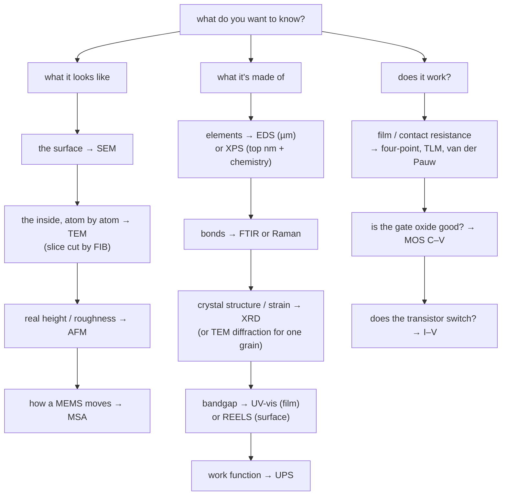

#vlsi #characterization #workshop
advanced workshop on **metrology & nano-characterization techniques**, CeNSE, IISc Bengaluru, 26–29 Oct 2026 (labs are in the **MNCF**, micro & nano characterization facility). how to **look at** a chip or a material and find out what's there

> [!important] the big question
> you made something tiny. how do you find out what it **looks like**, what it's **made of**, how its atoms are **arranged**, and whether it **works**? ==every technique is the same game: send in a probe (electrons, ions, photons, a tip or a voltage), see what comes out, and read the answer from it==

revise from: [[Technique comparison cheat sheet]], [[Glossary]]
## the notes

| folder | notes | formulas |
|---|---|---|
| Microscopy | [[Electron microscope]], [[SEM]], [[TEM]], [[FIB]], [[AFM]], [[MSA]] | [[Microscopy formulas]] |
| Spectroscopy | [[EDS]], [[FTIR]], [[Raman spectroscopy]], [[XPS]], [[UPS]], [[REELS and other XPS modes]], [[UV-vis spectroscopy]] | [[Spectroscopy formulas]] |
| Diffraction | [[XRD]] | [[Diffraction formulas]] |
| Electrical | [[Electrical characterization]], [[Sheet resistance and contacts]], [[MOS capacitor C-V]] | [[Electrical formulas]] |

- **microscopy** (beams of particles, scanned or transmitted, or a tip)
	- [[Electron microscope]] → why electrons, the shared basics
	- [[SEM]] → the surface, ~1 nm, easy prep
	- [[TEM]] → the inside, single atoms, very thin samples
	- [[FIB]] → an ion beam that cuts, deposits and makes TEM samples
	- [[AFM]] → feel the surface with a tip, real 3D height
	- [[MSA]] → how MEMS move, with light
- **spectroscopy** (which energies get absorbed, scattered or knocked out)
	- [[EDS]] → elements from X-rays, in the SEM/TEM
	- [[FTIR]] → bonds, from IR absorption
	- [[Raman spectroscopy]] → bonds, phase and stress, from scattered laser light
	- [[UV-vis spectroscopy]] → bandgaps, concentration, film thickness
	- [[XPS]] → which elements are in the top ~5–10 nm, and their chemical state
	- [[UPS]] → work function and valence band
	- [[REELS and other XPS modes]] → band gap from the surface, IPES, ISS, HAXPES, XPS imaging
- **diffraction** (which angles waves come out at)
	- [[XRD]] → crystal structure, phase, strain, grain size
- **electrical** (does it actually work?)
	- [[Electrical characterization]] → the probe station, I–V, transistors
	- [[Sheet resistance and contacts]] → four-point probe, TLM, van der Pauw
	- [[MOS capacitor C-V]] → oxide thickness, doping, flat band, interface traps
## by what they tell you

| question | techniques |
|---|---|
| what does it **look like**? | [[SEM]], [[TEM]], [[AFM]], [[MSA]] |
| what is it **made of**? (elements) | [[EDS]], [[XPS]], [[UPS]] (valence band, work function), [[REELS and other XPS modes]] |
| what **bonds / molecules** are there? | [[FTIR]], [[Raman spectroscopy]] |
| what **crystal structure**? | [[XRD]], [[TEM]] (diffraction), [[Raman spectroscopy]] |
| how does it **absorb light**, what's the bandgap? | [[UV-vis spectroscopy]], [[REELS and other XPS modes\|REELS]] |
| does it **work** electrically? | [[Electrical characterization]], [[Sheet resistance and contacts]], [[MOS capacitor C-V]] |
| cut it open / prep a sample | [[FIB]] |

## which one do I use?

## the probes

| in | out | technique | the probe's wavelength |
|---|---|---|---|
| electrons, 1–30 kV | secondary / backscattered e⁻ | [[SEM]] | 39–7 pm |
| electrons, 80–300 kV | transmitted e⁻ | [[TEM]] | 4–2 pm |
| electrons | X-rays | [[EDS]] | (X-rays out: ~0.1–1 nm) |
| electrons, ~1 keV | reflected e⁻ that lost energy | [[REELS and other XPS modes\|REELS]] | ~0.04 nm |
| Ga ions, 30 kV | sputtered atoms + electrons | [[FIB]] | ~0.00002 pm |
| a sharp tip | force | [[AFM]] | (no wave, ~nm tip) |
| laser / white light | Doppler shifted / interfering light | [[MSA]] | 633 nm, white |
| infrared light | absorbed IR | [[FTIR]] | 2.5–25 µm |
| visible laser | inelastically scattered light | [[Raman spectroscopy]] | 532–785 nm |
| UV / visible light | transmitted / absorbed light | [[UV-vis spectroscopy]] | 200–1100 nm |
| UV photons | valence electrons | [[UPS]] | 58 nm (He I) |
| X-rays | photoelectrons | [[XPS]] | 0.83 nm (Al $K_\alpha$) |
| X-rays | diffracted X-rays | [[XRD]] | 0.154 nm (Cu $K_\alpha$) |
| voltage | current, capacitance | [[Electrical characterization]] | (no wavelength) |

the photon wavelengths come from [[UV-vis spectroscopy#^photon-energy|E = 1240/λ]], the electron ones from the [[SEM#^de-broglie|de Broglie wavelength]]. ==to see something, your probe's wavelength has to be about its size or smaller== ([[Electron microscope#^resolution-limit|the resolution limit]]), which is why you need X-rays or electrons for atoms
## how they connect to each other
- [[FIB]] cuts the lamellae that [[TEM]] looks through, while an [[SEM]] watches (dual beam)
- [[TEM]] diffraction (SAED) and [[XRD]] use the same [[XRD#^bragg|Bragg's law]]: XRD averages over mm, TEM looks at one grain
- [[EDS]] makes the same Cu $K_\alpha$ X-rays that [[XRD]] uses, and measures the same atomic levels as [[XPS]] (as differences)
- [[UV-vis spectroscopy]], [[FTIR]], [[Raman spectroscopy]], [[UPS]] and [[XPS]] all use the same photon energy formula, just at different energies
- spots / rings / halo in TEM = sharp peaks / many peaks / hump in XRD = single crystal / polycrystal / amorphous
- FIB damage is amorphous, so it's invisible to XRD and blurs the TEM
- [[FTIR]] and [[Raman spectroscopy]] see the same vibrations with opposite selection rules
- XPS, UPS and REELS share one UHV machine. UPS gives the filled states, REELS/IPES the gap and empty ones, [[UV-vis spectroscopy]] the gap through the whole film
- work function: [[UPS]] (average) and KPFM in the [[AFM]] (a map)
- a bad contact in [[Sheet resistance and contacts|TLM]]? find the oxide with [[XPS]], the work function with [[UPS]], the voids with [[SEM]] / [[FIB]] + [[TEM]]
- a gate stack: thickness from [[MOS capacitor C-V|C–V]] and [[TEM]], composition from [[XPS]], work function from [[UPS]], leakage map with c-AFM
## the quantum connection
each note ends with a "the quantum connection" section. the big ones:

| idea | IISc note | quantum note |
|---|---|---|
| a diffraction pattern is a **Fourier transform** | [[XRD#the quantum connection\|XRD]], [[TEM#the quantum connection\|TEM]], [[Diffraction formulas#structure factor and allowed peaks\|structure factor]] | [[Fourier Transform]], [[Quantum Fourier Transform]], [[Shor's algorithm]] |
| particles are **waves** ($\lambda=\frac hp$) | [[Electron microscope#the quantum connection\|electron microscope]], [[SEM#the quantum connection\|SEM]] | [[Beamsplitters]], [[Bloch sphere]] |
| **quantum confinement** = a box | [[UV-vis spectroscopy#the quantum connection\|UV-vis]] | [[Particle in a box]] |
| exponential **absorption** | [[UV-vis spectroscopy#Beer–Lambert law\|UV-vis]] | [[Long-distance quantum communication#losing photons]] |
| **tunnelling** (STM, field emission, Josephson junctions) | [[AFM#the quantum connection\|AFM]], [[TEM#the quantum connection\|TEM]] | [[Superconducting qubits]] |
| placing **single atoms** as qubits | [[FIB#the quantum connection\|FIB]], [[AFM#the quantum connection\|AFM/STM]] | [[Superconducting qubits]] (the alternative) |
| the **photoelectric effect**, quantized levels, **spin** doublets | [[XPS#the quantum connection\|XPS]] | [[Single Photon making and detecting]], [[Hamiltonian]], [[Bloch sphere]] |
| **Bohr levels** give the X-ray lines | [[EDS#the quantum connection\|EDS]] | [[Particle in a box]] |
| energy lost in **quanta** (plasmons) | [[REELS and other XPS modes#the quantum connection\|REELS]] | [[Particle in a box]] |
| **phonons**, Raman transitions in trapped ions | [[Raman spectroscopy#the quantum connection\|Raman]], [[FTIR#the quantum connection\|FTIR]] | [[Bloch sphere]], [[Long-distance quantum communication]] |
| interferometers, resonator $Q$ | [[MSA#the quantum connection\|MSA]] | [[Beamsplitters]], [[Noise Processes]] |
| Pauli exclusion, the work function barrier | [[UPS#the quantum connection\|UPS]] | [[Superconducting qubits]] |
| the **resistance quantum** $\frac h{e^2}$, junction resistance → qubit frequency | [[Sheet resistance and contacts#the quantum connection\|sheet resistance]] | [[Superconducting qubits]] |
| a transmon is a **capacitor**, MOS spin qubits | [[MOS capacitor C-V#the quantum connection\|MOS C–V]] | [[Particle in a box]], [[Noise Processes]] |
| cryo-CMOS, the 60 mV/dec thermal limit | [[Electrical characterization#the quantum connection\|electrical]] | [[Superconducting qubits]] |

## schedule

| day | sessions |
|---|---|
| **Mon 26 Oct** | intro to MNCF → [[SEM]] → [[AFM]] → [[MSA]] → [[FTIR]] |
| **Tue 27 Oct** | [[FIB]] → [[TEM]] |
| **Wed 28 Oct** | [[Electrical characterization]] (DC probe station) → [[XPS]] |
| **Thu 29 Oct** | [[XRD]] → [[UV-vis spectroscopy]] → [[Raman spectroscopy]] → cleanroom corridor tour (NNfC) → PASF tour → feedback |

see also [[Technique comparison cheat sheet]], [[Glossary]], [[Welcome]]
