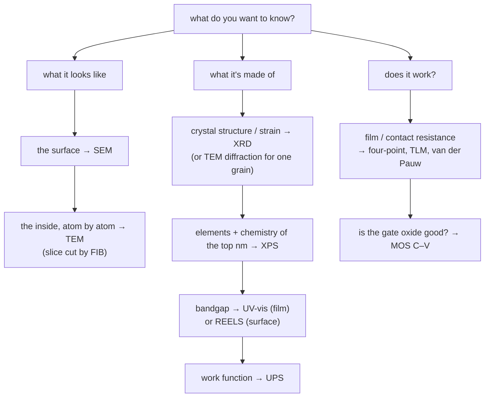

#vlsi #characterization
the IISc nano-characterization notes: how to **look at** a chip or a material and find out what's there. every technique is the same game: ==send in a probe (electrons, ions or photons), see what comes out, and read the answer from it==
## the notes
- **microscopy** (beams of particles, scanned or transmitted)
	- [[SEM]] → the surface, ~1 nm, easy prep
	- [[TEM]] → the inside, single atoms, very thin samples
	- [[FIB]] → an ion beam that cuts, deposits and makes TEM samples
- **spectroscopy** (which energies get absorbed or knocked out)
	- [[UV-vis spectroscopy]] → bandgaps, concentration, film thickness
	- [[XPS]] → which elements are in the top ~5–10 nm, and their chemical state
	- [[UPS]] → work function and valence band
	- [[REELS and other XPS modes]] → band gap from the surface, IPES, ISS, HAXPES, XPS imaging
- **diffraction** (which angles waves come out at)
	- [[XRD]] → crystal structure, phase, strain, grain size
- **electrical** (does it actually work?), hub: [[Electrical characterization]]
	- [[Sheet resistance and contacts]] → four-point probe, TLM, van der Pauw
	- [[MOS capacitor C-V]] → oxide thickness, doping, flat band, interface traps
## which one do I use?

## the probes

| probe | technique | its wavelength | what you read |
|---|---|---|---|
| visible / UV photons | [[UV-vis spectroscopy]] | 200–1100 nm | which **energies** are absorbed |
| X-ray photons | [[XRD]] | 0.154 nm (Cu $K_\alpha$) | which **angles** they diffract at |
| electrons, 1–30 kV | [[SEM]] | 39–7 pm | what comes **back out** of the surface |
| electrons, 80–300 kV | [[TEM]] | 4–2 pm | what goes **through** |
| Ga ions, 30 kV | [[FIB]] | ~0.00002 pm | what gets **knocked out** |
| X-ray photons → electrons | [[XPS]] | 0.83 nm (Al $K_\alpha$) | how much energy the **electrons** left with |
| UV photons → electrons | [[UPS]] | 58 nm (He I) | the same, for valence electrons |
| electrons → electrons | [[REELS and other XPS modes\|REELS]] | ~0.04 nm (1 keV) | how much energy the electrons **lost** |
| voltage and current | [[Sheet resistance and contacts]], [[MOS capacitor C-V]] | (no wavelength) | resistance and capacitance |

the photon wavelengths come from [[UV-vis spectroscopy#^photon-energy|E = 1240/λ]], the electron ones from the [[SEM#^de-broglie|de Broglie wavelength]]. ==to see something, your probe's wavelength has to be about its size or smaller==, which is why you need X-rays or electrons for atoms
## how they connect to each other
- [[FIB]] cuts the lamellae that [[TEM]] looks through, while an [[SEM]] watches (dual beam)
- [[TEM]] diffraction (SAED) and [[XRD]] use the same [[XRD#^bragg|Bragg's law]]: XRD averages over mm, TEM looks at one grain
- [[UV-vis spectroscopy]] and [[XRD]] use the same photon energy formula, just ~3000× apart in energy
- spots / rings / halo in TEM = sharp peaks / many peaks / hump in XRD = single crystal / polycrystal / amorphous
- FIB damage is amorphous, so it's invisible to XRD and blurs the TEM
- XPS, UPS and REELS share one UHV machine. UPS gives the filled states, REELS/IPES the gap and empty ones, [[UV-vis spectroscopy]] the gap through the whole film
- a bad contact in [[Sheet resistance and contacts|TLM]]? find the oxide with [[XPS]], the work function with [[UPS]], the voids with [[SEM]] / [[FIB]] + [[TEM]]
- a gate stack: thickness from [[MOS capacitor C-V|C–V]] and [[TEM]], composition from [[XPS]], work function from [[UPS]]
## the quantum connection
each note ends with a "the quantum connection" section. the big ones:

| idea | IISc note | quantum note |
|---|---|---|
| a diffraction pattern is a **Fourier transform** | [[XRD#the quantum connection\|XRD]], [[TEM#the quantum connection\|TEM]] | [[Fourier Transform]], [[Quantum Fourier Transform]], [[Shor's algorithm]] |
| particles are **waves** ($\lambda=\frac hp$) | [[SEM#the quantum connection\|SEM]], [[TEM]] | [[Beamsplitters]], [[Bloch sphere]] |
| **quantum confinement** = a box | [[UV-vis spectroscopy#the quantum connection\|UV-vis]] | [[Particle in a box]] |
| exponential **absorption** | [[UV-vis spectroscopy#Beer–Lambert law\|UV-vis]] | [[Long-distance quantum communication#losing photons]] |
| **tunnelling** (field emission, Josephson junctions) | [[TEM#the quantum connection\|TEM]] | [[Superconducting qubits]] |
| placing **single atoms** as qubits | [[FIB#the quantum connection\|FIB]] | [[Superconducting qubits]] (the alternative) |
| the **photoelectric effect**, quantized levels, **spin** doublets | [[XPS#the quantum connection\|XPS]] | [[Single Photon making and detecting]], [[Hamiltonian]], [[Bloch sphere]] |
| energy lost in **quanta** (plasmons) | [[REELS and other XPS modes#the quantum connection\|REELS]] | [[Particle in a box]] |
| Pauli exclusion, the work function barrier | [[UPS#the quantum connection\|UPS]] | [[Superconducting qubits]] |
| the **resistance quantum** $\frac h{e^2}$, junction resistance → qubit frequency | [[Sheet resistance and contacts#the quantum connection\|sheet resistance]] | [[Superconducting qubits]] |
| a transmon is a **capacitor**, MOS spin qubits | [[MOS capacitor C-V#the quantum connection\|MOS C–V]] | [[Particle in a box]], [[Noise Processes]] |

see also [[Electron microscope]], [[EDS]], [[AFM]], [[Raman spectroscopy]], [[FTIR]]
