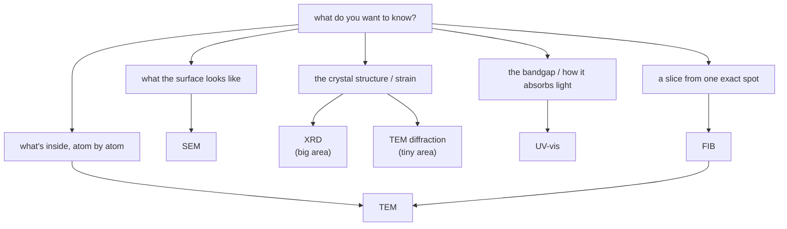

#vlsi #characterization
the IISc nano-characterization notes: how to **look at** a chip or a material and find out what's there. every technique is the same game: ==send in a probe (electrons, ions or photons), see what comes out, and read the answer from it==
## the notes
- **microscopy** (beams of particles, scanned or transmitted)
	- [[SEM]] → the surface, ~1 nm, easy prep
	- [[TEM]] → the inside, single atoms, very thin samples
	- [[FIB]] → an ion beam that cuts, deposits and makes TEM samples
- **spectroscopy** (which energies get absorbed)
	- [[UV-vis spectroscopy]] → bandgaps, concentration, film thickness
- **diffraction** (which angles waves come out at)
	- [[XRD]] → crystal structure, phase, strain, grain size
## which one do I use?

## the probes

| probe | technique | its wavelength | what you read |
|---|---|---|---|
| visible / UV photons | [[UV-vis spectroscopy]] | 200–1100 nm | which **energies** are absorbed |
| X-ray photons | [[XRD]] | 0.154 nm (Cu $K_\alpha$) | which **angles** they diffract at |
| electrons, 1–30 kV | [[SEM]] | 39–7 pm | what comes **back out** of the surface |
| electrons, 80–300 kV | [[TEM]] | 4–2 pm | what goes **through** |
| Ga ions, 30 kV | [[FIB]] | ~0.00002 pm | what gets **knocked out** |

the photon wavelengths come from [[UV-vis spectroscopy#^photon-energy|E = 1240/λ]], the electron ones from the [[SEM#^de-broglie|de Broglie wavelength]]. ==to see something, your probe's wavelength has to be about its size or smaller==, which is why you need X-rays or electrons for atoms
## how they connect to each other
- [[FIB]] cuts the lamellae that [[TEM]] looks through, while an [[SEM]] watches (dual beam)
- [[TEM]] diffraction (SAED) and [[XRD]] use the same [[XRD#^bragg|Bragg's law]]: XRD averages over mm, TEM looks at one grain
- [[UV-vis spectroscopy]] and [[XRD]] use the same photon energy formula, just ~3000× apart in energy
- spots / rings / halo in TEM = sharp peaks / many peaks / hump in XRD = single crystal / polycrystal / amorphous
- FIB damage is amorphous, so it's invisible to XRD and blurs the TEM
## the quantum connection
each note ends with a "the quantum connection" section. the big ones:

| idea | IISc note | quantum note |
|---|---|---|
| a diffraction pattern is a **Fourier transform** | [[XRD#the quantum connection\|XRD]], [[TEM#the quantum connection\|TEM]] | [[Fourier Transform]], [[Quantum Fourier Transform]], [[Shor's algorithm]] |
| particles are **waves** ($\lambda=\frac hp$) | [[SEM#the quantum connection\|SEM]], [[TEM]] | [[Beamsplitters]], [[Bloch sphere]] |
| **quantum confinement** = a box | [[UV-vis spectroscopy#the quantum connection\|UV-vis]] | [[Particle in a box]] |
| exponential **absorption** | [[UV-vis spectroscopy#Beer–Lambert law\|UV-vis]] | [[Long-distance quantum communication#losing photons]] |
| **tunnelling** (field emission, Josephson junctions) | [[TEM#the quantum connection\|TEM]] | [[Superconducting qubits]] |
| placing **single atoms** as qubits | [[FIB#the quantum connection\|FIB]] | [[Superconducting qubits]] (the alternative) |

see also [[Electron microscope]], [[EDS]], [[AFM]], [[Raman spectroscopy]], [[FTIR]], [[XPS]]
