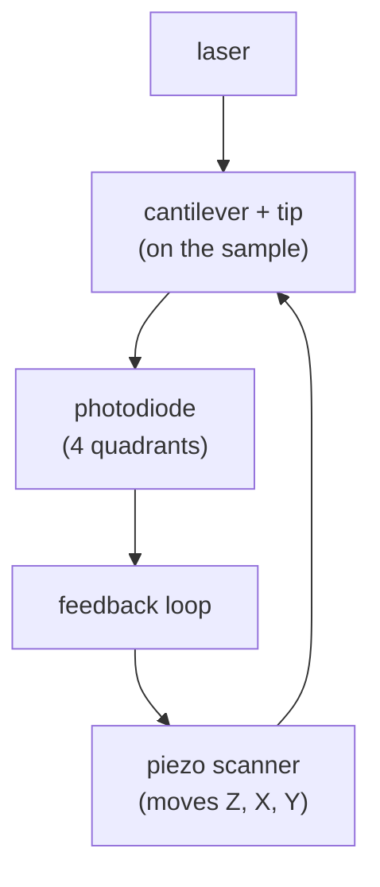
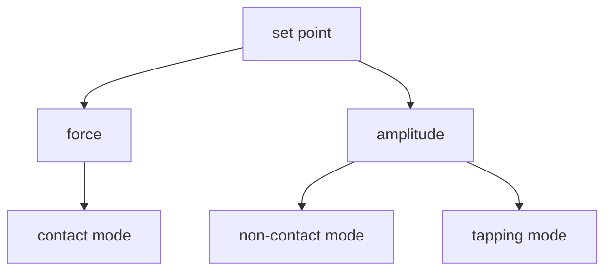

#vlsi #characterization #AFM #scanning_probe
## atomic force microscope
feel the surface with a **very sharp tip** on a tiny cantilever, like a record player needle. no lens, no beam, you're measuring **force**. part of [[Metrology and nano-characterization workshop]]
- gives true **3D topography** (height at every point)
- vertical resolution <0.1 nm (sub-atom), lateral resolution = about the tip radius (~2–10 nm)
- works in **air, liquid or vacuum**, on conductors **and insulators**, no coating needed

> [!important] the one idea
> ==the AFM doesn't look at the surface at all: a feedback loop moves the sample up and down to keep the force on the tip constant, and that up-and-down movement **is** the height map==

## a bit of history
spectacles in Italy (14th century) → first microscope by Hans and Zacharias Janssen (1590) → Hooke's *Micrographia* (1667) → bacteria seen by van Leeuwenhoek (1675) → Abbe links resolution to the light wavelength (1878, [[Electron microscope#^resolution-limit|the resolution limit]]) → scanning electron microscope (1937) → **scanning tunneling microscope** (Binnig and Rohrer, 1981, Nobel prize 1986) → **atomic force microscope** (Binnig, Quate and Gerber, 1985)
## how it works

1. tip is brought close to the surface, forces bend the cantilever
2. a laser bounces off the back of the cantilever onto a **position sensitive photodiode**, a tiny bend becomes a big spot movement
3. the **feedback** loop moves the sample up/down with a **piezo** to keep the bend (or amplitude) constant
4. that Z movement is recorded at each (x, y) as the height map

the cantilever acts like a spring
$$
F=-kx
$$
^hooke

$k$ ~ 0.1–50 N/m depending on mode

> [!eg] how big are the forces?
> a contact cantilever $k=0.2$ N/m bent by 1 nm: $F=0.2\times10^{-9}=0.2$ nN. a stiff tapping one, $k=40$ N/m, bent by the same 1 nm: 40 nN. ==a soft cantilever feels tiny forces, a stiff one doesn't stick to the surface==

![[AFM_optical_lever.png]]
### components
probe/tip, cantilever, detector (photodiode), feedback system, X–Y–Z scanner (piezo), controller and PC. the laser on a 4-quadrant **position sensitive photodetector (PSPD)**: $(A+B)-(C+D)$ gives the vertical bend, a side-to-side signal gives torsion. the sample is scanned in a **line by line raster** (forward and backward scan)
### feedback (PID)
a **PID** loop (proportional, integral, derivative) compares the signal with the **set point** and drives the Z piezo so the interaction stays constant. when the tip meets a step the error is nonzero, the scanner moves, and the error goes back to zero

![[AFM_feedback_loop.png]]
## the force
the tip-sample force is like the Lennard-Jones potential
$$
V(r)=4\varepsilon\left[\left(\frac\sigma r\right)^{12}-\left(\frac\sigma r\right)^6\right]\qquad F=-\frac{dV}{dr}
$$
^lennard-jones

- far away → weak **attractive** (van der Waals, the $-r^{-6}$ term)
- very close → strong **repulsive** (electron clouds / Pauli, the $r^{-12}$ term)

![[AFM_force_vs_distance.png]]
the range of each interaction

![[AFM_force_ranges.png]]
- **repulsive regime** (net force positive, atoms in "contact", ~1–2 Å apart, F ~ $10^{-6}$–$10^{-9}$ N) → used in **contact AFM**
- **attractive regime** (F ~ $10^{-9}$–$10^{-12}$ N) → used in **non-contact AFM**
## modes

| mode | tip | notes |
|---|---|---|
| **contact** | touches, dragged along | high resolution, but can damage the sample and tip (lateral forces) |
| **tapping** (intermittent contact) | cantilever **oscillates** at resonance, taps the surface | the most common. gentle, little lateral force. feedback keeps oscillation **amplitude** constant |
| **non-contact** | oscillates just above the surface | gentlest, but harder in air |

^afm-modes

### contact mode, step by step
the cantilever scans with a constant force on the surface. once engaged it bends upwards in proportion to the imaging force. as the tip passes a higher feature the cantilever bends further, the laser spot on the PSPD moves, and the feedback moves the **Z scanner** to restore the original deflection. the **Z-scanner displacement map is the topography**
### non-contact mode, step by step
- the safest method: the tip does **not** touch the sample, so no damage to the tip or sample and the result is repeatable (roughness stays the same after 15 000 scans)
- as tip atoms approach sample atoms an **attractive force** pulls them closer. but when the tip is close the attractive force is **too small to bend** the cantilever
- so the cantilever is **oscillated near its resonance frequency** $f_0$. the force gradient shifts the resonance to a **lower** frequency, and since the driving frequency is fixed, the **amplitude changes**
- closer → stronger attraction → amplitude **decreases**, farther → amplitude **increases**
- a **set point** (reference amplitude) is chosen. the feedback raises or lowers the Z scanner to hold that amplitude. Z moves → topography

the resonance of a cantilever is a mass on a spring
$$
f_0=\frac1{2\pi}\sqrt{\frac k{m^*}}
$$
^cantilever-resonance

($m^*$ the effective mass). an attractive force gradient acts like a **softer** spring, $k\to k-\frac{\partial F}{\partial z}$, so $f_0$ drops

![[AFM_noncontact_resonance.png]]
### tapping mode
the tip oscillates near resonance and **lightly taps** the surface: high-resolution images, little damage, good for soft, sticky or loosely bound surfaces. gives topography **and phase** at the same time (a lock-in compares drive and detected phase; two materials give different phase, eg. 90° vs 110°)

![[AFM_tapping_phase.png]]

the **phase image** (the delay between drive and response) shows stiffness / adhesion differences, so it tells materials apart even on a flat surface

![[AFM_modes.png]]
### the mode tree (operation)

## other AFM flavours
- **conductive AFM (c-AFM)** → current map through a biased tip (leakage in thin oxide, the same oxides as in [[MOS capacitor C-V]])
- **KPFM** (Kelvin probe force microscopy) → surface potential / work function, see [[UPS#cross-check with KPFM]]
- **MFM** (magnetic force microscopy) → magnetic domains
- **PFM** (piezoresponse force microscopy) → ferroelectric domains
- **nanoindentation** → hardness
## advanced capabilities (MNCF Park system)
KPFM (AM and sideband), PFM (DART, high voltage, PFM lithography), temperature-controlled measurements, torsional resonance, MFM, nanoindentation, nanolithography (scratch, **anodic oxidation**, AC bias), liquid imaging, **conductive AFM**, PFQNM, sidewall measurement with a tilt wedge
- **MFM** example: a magnetic recording tape, height map plus a phase map of the magnetic domains (labyrinth pattern)
- **c-AFM** example: a device surface with a leakage current area seen on the **bad device** (marked yellow) that is not in the good one → finds bad plugs
- **step height** example: an array of square wells and line profiles giving depth and width
## numbers you get
- **roughness**: $R_a$ (average) and $R_q$ (RMS) of the height map

$$
R_a=\frac1N\sum_{i}\left|z_i-\bar z\right|\qquad R_q=\sqrt{\frac1N\sum_{i}\left(z_i-\bar z\right)^2}
$$
^roughness

> [!eg] four heights: 1, 3, 2, 6 nm
> $$
> \begin{aligned}
> \bar z&=\frac{1+3+2+6}4=3\ \text{nm}\\
> R_a&=\frac{2+0+1+3}4=1.5\ \text{nm}\\
> R_q&=\sqrt{\frac{4+0+1+9}4}=\sqrt{3.5}=1.87\ \text{nm}
> \end{aligned}
> $$
> $R_q\ge R_a$ always: squaring weights the big bumps more, so one spike pushes $R_q$ up

- step heights, film thickness (scratch the film and measure the step)
- grain size, line profiles
## limits
- **tip convolution** → the image is the surface "dilated" by the tip. narrow deep trenches look wrong, sharp features look rounded
- **small scan area** (~100 µm × 100 µm max) and shallow range (~10 µm in Z)
- **slow** (minutes per image)
- drift and piezo creep, tips wear or get dirty (tips can be sharpened with an [[FIB#case studies (from the lecture)|FIB]])
## vs [[SEM]]

| | AFM | SEM |
|---|---|---|
| gives | real height | 2D image that looks 3D |
| environment | air OK | vacuum |
| insulators | fine | charging |
| speed / area | slow, small | fast, large |

## in VLSI
- surface roughness of wafers and films (after [[CMP]], deposition)
- thickness of thin films and steps
- 2D materials (graphene layers, check with [[Raman spectroscopy]])
- line edge roughness of resist patterns

> [!exercise] try these
> ① a tapping cantilever has $k=40$ N/m and $f_0=350$ kHz. what's its effective mass?
> ② why use non-contact mode on a soft polymer?
> ③ a 20 nm wide, 100 nm deep trench comes out looking only 30 nm deep. why?

> [!answer]-
> ① $m^*=\frac{k}{(2\pi f_0)^2}=\frac{40}{(2\pi\times350\,000)^2}=\frac{40}{4.84\times10^{12}}=8.3\times10^{-12}$ kg, about 8 ng
> ② contact drags the tip sideways and scratches it, non-contact never touches
> ③ **tip convolution**: the tip is too fat to reach the bottom of a narrow trench

## the quantum connection
> [!extra] the AFM's parent runs on tunnelling
> the **scanning tunnelling microscope** (STM) holds a sharp metal tip ~1 nm above a conducting surface. classically no current can flow across the vacuum gap, but electrons **tunnel** through it, and the current falls off exponentially with the gap
> $$
> \begin{aligned}
> I&\propto e^{-2\kappa d}\qquad\kappa=\frac{\sqrt{2m_e\phi}}\hbar\\
> \phi=4.5\ \text{eV}:\quad\kappa&=\frac{\sqrt{2(9.11\times10^{-31})(4.5\times1.602\times10^{-19})}}{1.055\times10^{-34}}=10.9\ \text{nm}^{-1}\\
> d\to d+0.1\ \text{nm}:\quad\frac{I}{I'}&=e^{2(10.9)(0.1)}=e^{2.17}\approx9
> \end{aligned}
> $$
> ==move the tip back by one tenth of an atom and the current drops ~9×==. that's why an STM sees single atoms. ($\phi$ is the work function from [[UPS]], and it's the same tunnelling as in a qubit's Josephson junction, [[TEM#the quantum connection]])

> [!extra] the repulsion is Pauli exclusion
> the steep $r^{-12}$ wall in the Lennard-Jones force isn't electric: two electron clouds can't overlap because ==no two electrons can be in the same quantum state== ([[UPS#the quantum connection]]). contact mode AFM literally feels the Pauli principle

> [!extra] placing atoms for qubits
> an STM tip can also **move** atoms. in silicon, it can strip hydrogen atoms off a surface one by one to make a pattern, and then a single phosphorus atom sticks exactly there. that's how some groups build qubits from **single donor atoms** in silicon, much more precisely than the [[FIB#the quantum connection|ion implantation]] route

see also [[SEM]], [[MSA]], [[UPS]], [[FIB]], [[Metrology and nano-characterization workshop]]

formulas: [[Microscopy formulas]]
