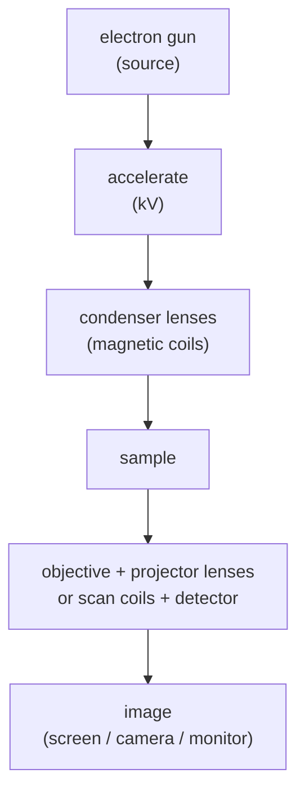

#vlsi #microscopy #electron_microscope #SEM #TEM
## the idea
use a beam of **electrons** instead of light to look at really small things. the shared basics for the [[SEM]] and the [[TEM]]. part of [[Metrology and nano-characterization workshop]]

why? a microscope can't resolve anything much smaller than the **wavelength** it uses, and electrons have a *tiny* wavelength
$$
d\approx\frac{0.61\,\lambda}{n\sin\alpha}
$$
^resolution-limit

- $\lambda$ → wavelength, $n\sin\alpha$ → numerical aperture (how wide a cone of light the lens collects)
- visible light: $\lambda\sim400\text{–}700\text{ nm}$ → limit about $200\text{ nm}$
- electrons: $\lambda$ is a few **picometres** → atoms become visible

> [!important] the one idea
> ==electrons are waves with a wavelength thousands of times shorter than light, and because they're charged, magnets can focus them==. those two facts together make the electron microscope

> [!eg] the best a light microscope can do
> green light 550 nm, a top oil-immersion lens with $n\sin\alpha=1.4$
> $$
> d\approx\frac{0.61\times550}{1.4}=240\ \text{nm}
> $$
> a modern transistor gate is a few nm. you'd see nothing

## why electrons have a short wavelength
electrons are matter waves, so they have a de Broglie wavelength $\lambda=h/p$. accelerate them through a voltage $V$ and they pick up energy $eV$ ([[SEM#why electrons? they're waves]])

![[SEM#^de-broglie]]

(at high voltages you need a relativistic correction, it makes $\lambda$ a bit smaller, see [[TEM#the wavelength]])

| accelerating voltage | $\lambda$ |
|---|---|
| 30 kV (typical SEM) | ≈ 7 pm |
| 100 kV | ≈ 3.7 pm |
| 200 kV (typical TEM) | ≈ 2.5 pm |

> [!note] the wavelength is NOT the limit
> ==$\lambda$ is way smaller than an atom, but real resolution is only ~0.05–1 nm. the **lenses** are the problem== (spherical aberration, chromatic aberration), and electron lenses are bad lenses. they can only use a tiny aperture $\alpha$ to keep the aberrations down

> [!eg] the TEM, with a realistic aperture
> 200 kV ($\lambda=2.51$ pm) but only $\alpha\approx10$ mrad (electron lenses can't take a wide cone), $n=1$ in vacuum
> $$
> d\approx\frac{0.61\times2.51\ \text{pm}}{0.01}=153\ \text{pm}=0.15\ \text{nm}
> $$
> about the spacing of atoms, so a TEM just about sees atomic columns. light microscopes use $n\sin\alpha\approx1$, electron microscopes ~0.01: they throw away a factor of 100 to keep the aberrations down (aberration-corrected TEMs win some of it back, to ~0.05 nm)

![[Electron_wavelength_vs_voltage.png]]

![[Wavelength_comparison.png]]

## how it's built

- **everything is in a high vacuum**, otherwise electrons scatter off air molecules and the gun burns out
- **lenses are magnetic coils**, not glass. the magnetic field bends the electrons. change the current → change the focal length
- electron guns ([[TEM#electron sources]])
	- **thermionic** (tungsten, $\text{LaB}_6$) → heat it till electrons boil off
	- **field emission** (FEG) → a very sharp tip + strong E field pulls electrons out. brighter and narrower beam → better resolution
## what happens when the beam hits the sample
the beam knocks things out of the sample, and each signal tells you something different

| signal | where from | tells you about |
|---|---|---|
| **secondary electrons (SE)** | top few nm | surface **topography** ([[SEM]]) |
| **backscattered electrons (BSE)** | deeper, bounced back | **composition** (heavy atoms = brighter) |
| **characteristic X-rays** | inner shell knocked out | which **elements** → [[EDS]] |
| **transmitted electrons** | go through a thin sample | internal structure → [[TEM]] |

## SEM vs TEM
### SEM, scanning electron microscope
- a fine beam **scans** across the surface (raster), a detector collects SE / BSE at each point
- image is built up **point by point**, brightness = signal strength
- gives a 3D looking picture of the **surface**
- typical beam 1–30 kV, resolution ~1 nm
- sample can be thick, but needs to be conductive (or coated in a thin gold / carbon layer) or it **charges up**
### TEM, transmission electron microscope
- beam goes **through** the sample, like light through a slide
- sample has to be **super thin** (<100 nm or the electrons can't get through)
- contrast comes from how much the electrons are scattered by the sample
- typical 100–300 kV, resolution down to <0.1 nm → you can see **atomic columns**
- also does diffraction → crystal structure
### side by side

![[TEM#^sem-vs-tem]]

## why this matters for VLSI
transistors are now **way** below what light can see (the gate and fin are a few nm), so electron microscopes are how you check the chip actually came out right
- **CD-SEM** → measures **critical dimensions** (line widths) on the wafer, after [[Photolithography]]
- **cross-section TEM** → look at the gate oxide, fins, thin film layers atom by atom
- **EDS** → check what the material actually is (contamination, interconnect layers)
- **failure analysis** → find the defect when a chip fails
- **FIB** (focused ion beam) → cuts out a thin slice at the exact spot you want, to make the TEM sample

> [!question]- why can't you just use a really short wavelength light instead (like X-rays)?
> you can't focus it. there are no good lenses for X-rays (they pass straight through almost everything), but electrons are charged so a magnetic field can bend and focus them easily. that's why [[XRD]] measures the diffraction pattern instead of an image: it does the Fourier transform but has no lens to undo it

> [!exercise] try these
> ① what resolution could a UV microscope (λ = 250 nm, $n\sin\alpha=0.9$) get?
> ② roughly what wavelength does a 5 kV SEM beam have?
> ③ why does the SEM's resolution (~1 nm) come nowhere near its wavelength?

> [!answer]-
> ① $d=\frac{0.61\times250}{0.9}=169$ nm. better, but still no use for transistors
> ② $\frac{1.226}{\sqrt{5000}}=0.0173$ nm $=17$ pm
> ③ the lens aberrations and the size of the interaction volume set the limit, not $\lambda$ ([[SEM#what hits the sample, what comes out]])

## the quantum connection
> [!extra] matter waves
> ==every particle is also a wave, with $\lambda=\frac hp$==. de Broglie proposed it in 1924 and electron diffraction proved it in 1927, and an electron microscope uses it every day. the same wave–particle nature is what lets a qubit be in a superposition: a photon going **both ways** through a [[Beamsplitters|beamsplitter]], or an electron interfering with itself in a [[TEM#the quantum connection|TEM]]

> [!extra] the resolution limit is a Fourier limit
> a lens only collects waves within the angle $\alpha$, so it only gets the part of the object's [[Fourier Transform]] with spatial frequencies up to about $\frac{\sin\alpha}\lambda$. finer detail lives at higher frequencies and is simply lost. that's $d\approx\frac{0.61\lambda}{n\sin\alpha}$: you can't rebuild what you didn't collect, the same reason a [[Quantum Phase Estimation]] with too few counting qubits can't resolve two close phases

see also [[SEM]], [[TEM]], [[EDS]], [[FIB]], [[XRD]], [[Photolithography]], [[Metrology and nano-characterization workshop]]

formulas: [[Microscopy formulas]]
