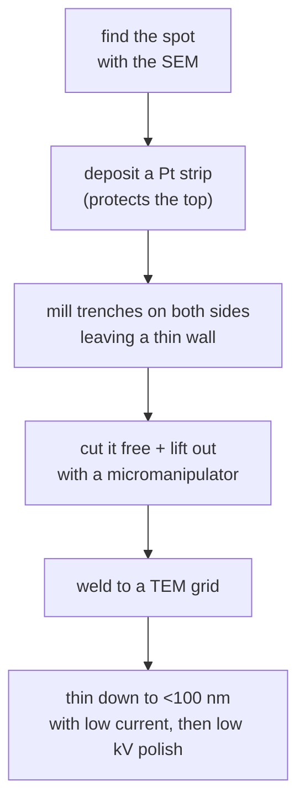

#vlsi #characterization #FIB #ion_beam
## focused ion beam
like a [[SEM]] but the beam is **ions** (usually gallium, $\text{Ga}^+$) instead of electrons. ions are ~100,000× heavier than electrons, so instead of just bouncing off they **knock atoms out** of the sample. it's a microscopic **knife**. part of [[Metrology and nano-characterization workshop]]

> [!important] the one idea
> ==an electron beam looks, an ion beam cuts==. same scanning idea as the SEM, but a heavy ion carries enough momentum to kick atoms out of the surface, so the FIB can image, mill, deposit and edit

## why ions cut and electrons don't
in a head-on collision, a moving mass $m_1$ with energy $E$ can hand at most this much energy to a resting atom of mass $m_2$
$$
E_{\max}=\frac{4m_1m_2}{(m_1+m_2)^2}\,E
$$
^max-energy-transfer

it takes roughly **15–25 eV** to knock a Si atom out of its place (the displacement energy)

> [!eg] 30 keV Ga ion vs 30 keV electron hitting Si ($m_{\text{Ga}}=69.7$ u, $m_{\text{Si}}=28.1$ u, $m_e=0.00055$ u)
> $$
> \begin{aligned}
> \text{Ga:}\quad E_{\max}&=\frac{4(69.7)(28.1)}{(69.7+28.1)^2}\times30\ \text{keV}=0.82\times30\ \text{keV}\approx24.6\ \text{keV}\\
> \text{electron:}\quad E_{\max}&\approx\frac{4(0.00055)}{28.1}\times30\ \text{keV}\approx2.3\ \text{eV}
> \end{aligned}
> $$
> the ion can hand over **a thousand times** the energy needed to knock an atom loose. the electron can't even reach the 15 eV, so an SEM looks without cutting (mostly. at a few hundred kV a [[TEM]] beam can start doing damage)

## the source

![[FIB_LMIS_source.png]]
**liquid metal ion source (LMIS)**: a sharp tungsten needle wetted with liquid Ga. a strong electric field pulls the Ga into a tiny cone and ionizes it, giving a very small bright source (it's the ion version of the [[TEM#electron sources|field emission gun]])
- Ga because it's liquid near room temp (melts at ~30 °C), low volatility, low melting point
- lenses are **electrostatic** (ions are too heavy for magnetic ones to be convenient)
## what the beam can do

| use | how |
|---|---|
| **imaging** | scan with a small current, collect ion induced secondary electrons |
| **milling** | high current, sputters atoms away → cut trenches, cross sections, holes |
| **deposition** | inject a precursor gas (eg. Pt, W, C) next to the beam, the beam cracks it and leaves a metal / insulator patch (**ion beam induced deposition**) |
| **circuit edit** | cut a metal line or add a wire to fix or probe a chip |

^fib-uses

- beam current ranges from a few pA (imaging, fine polish) to tens of nA (fast bulk milling)
- imaging with ions always does a bit of damage, so you usually look with the electron beam (next section)
## dual beam (FIB-SEM)
the standard machine has **both** columns pointing at the same spot (at an angle, usually 52°)
- ion beam cuts, electron beam **watches the cut live** without damaging the sample
- tilt the stage to look at the cross section face

![[FIB_dual_beam.png]]

![[FIB_beam_induced_deposition.png]]
## making a TEM lamella
==the most common job: cutting a <100 nm slice from an exact spot so a [[TEM#sample has to be thin|TEM]] can look through it==

![[FIB_lamella_steps.png]]
## what the ion does to the sample
the ion hits, starts a **collision cascade**, atoms near the surface get knocked out (**sputtering**) and the ion ends up implanted
- **ion dose** = number of ions that reached the sample
- **fluence** = ions that pass through an area before the sample interaction
- **ion dose rate** = ions going through a specific area per unit time

![[FIB_collision_cascade.png]]
### which ion?
at the same energy a heavier ion stops shallower and sputters more atoms per ion (sputter yield, SY)

![[FIB_ion_species_range.png]]
### parameters affecting sputtering
incidence angle, acceleration voltage and the surface binding energy of the material. yield peaks around 70–80° from the normal then collapses

![[FIB_sputter_yield.png]]
## downsides
- **Ga implantation** → Ga ends up in the surface
- **amorphous damage layer** → the top few nm of the surface get wrecked. fix with low kV final polish
- **redeposition** → sputtered material lands back nearby
- **curtaining** → vertical streaks from uneven material (protect with Pt, rock the sample)
- Ga can **react** with some materials (eg. Al, forms alloys)
- alternatives: **Xe plasma FIB** (much faster for big cross sections), He / Ne ion microscopes (imaging)

> [!warning] the damage layer shows up in other techniques
> a few nm of amorphous surface is invisible in an SEM, but it's a big deal for [[TEM]] (it blurs the lattice fringes) and it gives no peaks in [[XRD#the usual scan: θ–2θ|XRD]]. that's why the last polish is done at low kV

![[FIB_damage_and_curtaining.png]]
## artefacts and troubleshooting

![[FIB_artefacts.png]]
## case studies (from the lecture)
- **cross-section + TEM prep** of SiC MOSFETs (cracks between poly gate and Al source), dielectric breakdown spots, GaN HEMT failure (IDSS leakage from thermomechanical stress)
- **circuit edit** for rapid prototyping and failure correction (FIB nano-surgery, probe pads)

![[FIB_circuit_edit_flow.png]]
- **3D FIB-SEM tomography**: serial slicing and imaging, then reconstruct (eg. 3D NAND channel holes)
- **FIB-modified AFM probes** for trench profiles: sharpened tips for CD-AFM of fins and trenches, MEMS/NEMS sidewalls, 2D material steps
## Helios 5 UX dual beam specs (CeNSE)
- electron column: Elstar, field emission, magnetic immersion lens, 0.6 nm at 30 kV (STEM), 0.7 nm at 1 kV, 0.8 pA–100 nA, 350 V–30 kV
- ion column: Phoenix, Ga, 1 pA–65 nA, 500 V–30 kV, 4.0 nm resolution at 30 kV
- detectors: in-lens SE/BSE (TLD, ICD, MD), Everhart-Thornley (ETD), in-chamber ICE (secondary ions and electrons), retractable STEM 3+ (BF/DF/HAADF)
## in VLSI
- cross sections to look at layers inside a chip, **exactly where** a defect is
- [[TEM]] sample prep
- **failure analysis** and **circuit edit** → fix a design on silicon without remaking the masks
- 3D reconstruction (slice and view)

> [!exercise] try these
> ① why is the ion column's resolution (4 nm) worse than the electron column's (0.7 nm), even though a Ga ion's wavelength is tiny?
> ② you need a lamella from one failed transistor among millions. why FIB and not an ultramicrotome?
> ③ use $E_{\max}$ to explain why a He ion microscope is gentler than a Ga FIB ($m_{\text{He}}=4.0$ u)

> [!answer]-
> ① a 30 keV Ga ion has $\lambda=\frac h{\sqrt{2mE}}\approx2\times10^{-5}$ nm, so the wavelength is irrelevant. the limit is the **spot size**: the source's energy spread and the electrostatic lenses' aberrations, plus the ion spreading out in the sample
> ② the FIB cuts from **exactly** the spot you found in the SEM. a microtome slices blindly (and is for soft materials)
> ③ $\frac{4(4.0)(28.1)}{(32.1)^2}=0.44$, about half Ga's 0.82, and a light ion also goes deeper instead of sputtering at the surface, so it sputters far less

## the quantum connection
> [!extra] making qubits atom by atom
> a focused ion beam can also **implant** ions into a chosen spot, down to single ions. ==that's one way people place the atoms that act as qubits==, eg. defect centres in diamond (a nitrogen next to a missing carbon) or single phosphorus donor atoms in silicon, where the qubit is the [[Spin|spin]] of one electron or nucleus. an alternative to the [[Superconducting qubits]] used by IBM and Google. the collision cascade above is exactly why it's hard: the ion stops at a **random** depth and leaves damage around it

> [!extra] fixing and inspecting quantum chips
> FIB cuts the thin lamellae that let a [[TEM#the quantum connection|TEM]] look inside a qubit's Josephson junction, and its circuit edit tricks (cut a line, deposit a new one) work on quantum chips the same way as on normal ones. the Ga it leaves behind matters more there though: stray atoms and damage are [[Noise Processes|noise]] sources for qubits

see also [[SEM]], [[TEM]], [[XRD]], [[Metrology and nano-characterization workshop]]

formulas: [[Microscopy formulas]]
