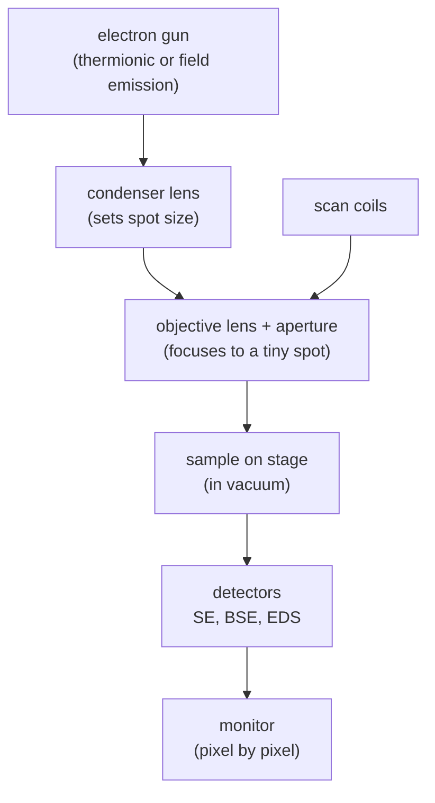

#vlsi #characterization #SEM #electron_microscope
## scanning electron microscope
a fine beam of electrons is **scanned** over the surface (raster, like an old CRT TV) and a detector records the signal at each point. brightness at a pixel = signal at that point. part of [[Metrology and nano-characterization workshop]]
- images the **surface**, with great **depth of field** so it looks 3D
- resolution ~1 nm, magnification from ~10× to 500,000×+
- the basics (vacuum, magnetic lenses) are in [[Electron microscope]]

> [!important] the one idea
> ==an SEM never forms an image with a lens: it builds the picture one pixel at a time from whatever comes out where the beam lands==. so the **spot size** sets the resolution, and the **signal you collect** sets what the contrast means

## why electrons? they're waves
a microscope can't see things much smaller than the wavelength it uses. visible light is ~400–700 nm, way too big for a chip. electrons are **waves** too ([[Electron microscope]]), with a de Broglie wavelength set by the accelerating voltage $V$
$$
\lambda=\frac hp=\frac h{\sqrt{2m_e eV}}\approx\frac{1.226}{\sqrt{V}}\ \text{nm}\qquad(V\text{ in volts})
$$
^de-broglie

> [!eg] the wavelength at 10 kV
> $$
> \begin{aligned}
> \lambda&\approx\frac{1.226}{\sqrt{10\,000}}\ \text{nm}=\frac{1.226}{100}\ \text{nm}\\
> &=0.0123\ \text{nm}=12.3\ \text{pm}
> \end{aligned}
> $$
> green light is ~500 nm, so that's $\frac{500}{0.0123}\approx41\,000$ times shorter

in an SEM the wavelength isn't what limits you though: the lenses aren't perfect, and the spot size and interaction volume (below) set the ~1 nm resolution. the wavelength gets close to mattering in a [[TEM]]
## parts

![[SEM_column.png]]

(field emission guns are brighter and sharper, and they work by [[TEM#electron sources|quantum tunnelling]])
## what hits the sample, what comes out
the beam spreads into a teardrop shaped **interaction volume** under the surface, and different signals come from different depths

| signal | depth | gives |
|---|---|---|
| **SE** secondary electrons (<50 eV) | top ~1–10 nm only | **topography**. edges and tilted bits look brighter (more SE escape) |
| **BSE** backscattered electrons | up to ~µm | **composition contrast**: backscatter goes up with atomic number $Z$ so heavy = bright |
| characteristic X-rays | ~µm | **elements** → [[EDS]] |

^sem-signals

so ==SE images are the sharpest (they only come from right where the beam lands), BSE and X-rays come from a bigger volume so they're blurrier==

![[SEM_interaction_volume.png]]

![[SEM_contrast_and_kV.png]]
## settings that matter
- **accelerating voltage** (kV)
	- high → more penetration, bigger interaction volume, more X-rays, but washes out surface detail
	- low (~1–5 kV) → surface detail, less charging, good for insulators and thin films
- **spot size / probe current**
	- small spot → sharp but noisy (fewer electrons)
	- big spot → more signal but blurrier
- **working distance** → short = better resolution, long = more depth of field
- **scan speed** → slow = less noise but more drift and beam damage

> [!tip] the trade-off behind all of them
> every setting trades **signal** against **sharpness**. fewer electrons per pixel = sharper spot but more noise, the same counting noise as measuring a qubit a finite number of shots (see the spread in [[IBM Q single-qubit tomography#how good was it? (extra, not in the course)]])

## problems
- **charging** → insulators collect electrons and go bright / streaky. fixes: coat with thin Au / Pt / C, low kV, conductive tape
- **beam damage** → polymers and resists shrink or burn
- **contamination** → hydrocarbons get cracked onto the scanned area and leave a dark square
- **vacuum** → no wet samples (unless it's an environmental SEM)
## sample prep
mount on a stub with carbon tape, make it conductive, blow off dust, load. much easier than [[TEM#sample has to be thin|TEM]]
## in VLSI
- **CD-SEM** → measure line widths after [[Photolithography]] (low kV so you don't wreck the resist)
- cross sections of films and trenches (cleave the wafer or use [[FIB]])
- **voltage contrast** → find opens and shorts in a chip
- inspect for defects and particles
- combine with [[EDS]] for chemistry

> [!exercise] which signal?
> ① you want to see if a Pt contact sits on top of a Si pad, and the surface is flat
> ② you want to see the sidewall roughness of a resist line
> ③ you want to know if there's Cu contamination
> ④ why does a TEM need 200 kV but a CD-SEM uses ~1 kV?

> [!answer]-
> ① **BSE**: flat surface means no topography, but Pt ($Z=78$) is much heavier than Si ($Z=14$) so it's bright
> ② **SE** at low kV: topography and edges, from only the top few nm
> ③ characteristic **X-rays** ([[EDS]]): Cu has its own lines
> ④ a TEM needs electrons to go **through** the sample (and a short wavelength, 2.5 pm at 200 kV), a CD-SEM only needs the surface and mustn't damage or charge the resist

## the quantum connection
> [!extra] electrons are quantum waves
> the formula above is the whole reason electron microscopes work: ==a particle with momentum $p$ behaves like a wave with $\lambda=\frac hp$==. the same wave–particle nature is what qubits use, eg. a photon going both ways through [[Beamsplitters|a beamsplitter]], or a state being a point on the [[Bloch sphere]]. heavier or faster particles → shorter wavelength, which is why the [[FIB#the quantum connection|ions in an FIB]] have a wavelength that's basically zero

> [!extra] SEM is how qubit chips get checked
> the tiny Josephson junctions and wiring of [[Superconducting qubits]] are imaged by SEM during fabrication (CD-SEM for the junction size), and small defects there show up later as noise ([[Noise Processes]], [[Rabi oscillation]]). the barrier inside the junction is too thin for an SEM, that needs a [[TEM#the quantum connection|TEM]]

see also [[Electron microscope]], [[TEM]], [[FIB]], [[AFM]], [[EDS]], [[XRD]], [[Metrology and nano-characterization workshop]]

formulas: [[Microscopy formulas]]
