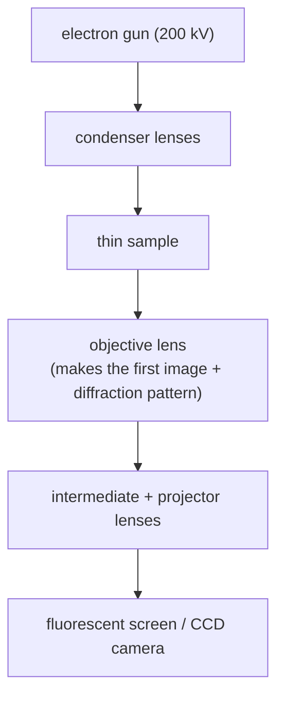

#vlsi #characterization #TEM #electron_microscope
## transmission electron microscope
a high energy electron beam goes **through** a very thin sample, and you image what comes out the other side. it's the closest thing to a light microscope but with electrons, see [[Electron microscope]]. part of [[Metrology and nano-characterization workshop]]
- typical 80–300 kV → $\lambda\approx2$–$4$ pm
- resolution <0.1 nm → you can see **individual atomic columns**
- gives a 2D **projection** of the inside, not the surface

> [!important] the one idea
> ==a TEM has a real lens after the sample, so it can show you either the image of the sample or its diffraction pattern (its Fourier transform), just by changing one lens==. that's what makes it both a microscope and a mini [[XRD]]

## the wavelength
the same de Broglie wavelength as in the [[SEM]]

![[SEM#^de-broglie]]

at TEM voltages the electrons move at more than half the speed of light, so you need the **relativistic** version (the extra bracket makes $\lambda$ a bit shorter)
$$
\lambda\approx\frac{1.226}{\sqrt{V\,(1+0.9785\times10^{-6}\,V)}}\ \text{nm}
$$
^relativistic-wavelength

> [!eg] the wavelength at 200 kV
> $$
> \begin{aligned}
> V\,(1+0.9785\times10^{-6}\,V)&=200\,000\times(1+0.1957)=239\,140\\
> \sqrt{239\,140}&=489.0\\
> \lambda&\approx\frac{1.226}{489.0}=0.00251\ \text{nm}=2.51\ \text{pm}
> \end{aligned}
> $$
> without the correction you'd get $\frac{1.226}{\sqrt{200\,000}}=2.74$ pm, about 9% too long. and it's ~60× shorter than the X-rays in [[XRD]] (154 pm)

## parts

![[TEM_column.png]]

the **intermediate lens** decides what you see, switch it one way and you see the **image**, another way and you see the **diffraction pattern**
### electron sources
field emission is ~1000× brighter with a 10× smaller energy spread than tungsten, but needs a far better vacuum

![[TEM_electron_sources.png]]

(thermionic = boil electrons off a hot filament. field emission = pull them out with a huge electric field, which is really **quantum tunnelling**, see [[#the quantum connection]])
## sample has to be thin

![[TEM_sample_prep_methods.png]]
- thickness **<100 nm** (for atomic resolution <~50 nm) or the electrons get absorbed or scatter multiple times
- how to make a thin enough slice
	- [[FIB#making a TEM lamella|FIB lamella]] (the standard for chips, you pick the exact spot)
	- ultramicrotome (diamond knife, for soft stuff)
	- ion milling / dimple grinding
	- or just drop nanoparticles on a carbon coated copper grid
- ==sample prep is the hard and slow part of TEM==, much harder than for an [[SEM#sample prep|SEM]]
## scattering inside the specimen
elastic scattering in a thin crystalline specimen is mostly coherent and forward (that's what makes diffraction), inelastic is almost always incoherent

![[TEM_scattering_types.png]]
## contrast, why do you see anything
- **mass-thickness contrast** → thick or heavy parts scatter more, so look darker
- **diffraction contrast** → crystals scatter strongly at certain angles (Bragg, see [[XRD#Bragg's law]])
- **phase contrast** → **interference** between the electron waves, this is what gives the atomic lattice fringes in HRTEM

![[TEM_contrast_tree.png]]
## modes

| mode | what you do | you get |
|---|---|---|
| **bright field** | aperture lets only the unscattered beam through | scattering regions dark |
| **dark field** | aperture picks a diffracted beam | only the grains satisfying that diffraction light up |
| **SAED** (selected area electron diffraction) | select an area, view the back focal plane | spot pattern → crystal structure and orientation (rings = polycrystal, halo = amorphous) |
| **HRTEM** | big aperture, phase contrast | lattice fringes, atomic arrangement, interfaces |
| **STEM** | scan a small probe through the sample | with HAADF detector, brightness $\sim Z^2$ so you get atomic number contrast |
| **EDS / EELS** in STEM | analyze X-rays / energy lost | element maps at the atomic scale |

^tem-modes

![[TEM_image_vs_diffraction.png]]

(spots / rings / halo is the same single crystal / polycrystal / amorphous story as the [[XRD#the usual scan: θ–2θ|XRD patterns]]. and EELS can measure a bandgap too, like [[UV-vis spectroscopy#Tauc plot (finding the bandgap)|UV-vis]], but from a tiny spot)
## Bragg's law in a TEM
the same law as in XRD

![[XRD#^bragg]]

$\lambda$ is so short that the Bragg angles are under a degree, so $\sin\theta\approx\theta$

> [!eg] the Si (111) planes at 200 kV
> $d_{111}=\frac{5.431}{\sqrt3}=3.136$ Å and $\lambda=0.0251$ Å (from above)
> $$
> \begin{aligned}
> \theta&\approx\frac{\lambda}{2d}=\frac{0.0251}{2\times3.136}=0.0040\ \text{rad}\\
> &=0.23^\circ
> \end{aligned}
> $$
> the same planes in [[XRD]] with Cu $K_\alpha$ diffract at $\theta=14.2^\circ$. so in a TEM all the diffracted beams go almost straight on, and the pattern on the screen is a flat picture of the crystal's **reciprocal lattice**

![[TEM_bragg_electron_angles.png]]
![[TEM_SAED_patterns.png]]

![[TEM_bright_dark_field.png]]

![[TEM_HRTEM_STEM.png]]

## vs [[SEM]]

| | SEM | TEM |
|---|---|---|
| electrons | scattered back / emitted | transmitted |
| sample | thick OK | <100 nm |
| resolution | ~1 nm | <0.1 nm |
| tells you | surface | inside, crystal structure |
| effort | easy prep | hard prep, costly |

^sem-vs-tem

## in VLSI
- **gate stack** → measure gate oxide thickness (a few atoms of high-k)
- **fins / nanosheets** → exact shape and width
- **interfaces** → epitaxy quality, interlayer, defects, dislocations
- thin film layers in [[Interconnects]] (barrier, seed, Cu)
- failure analysis at the nm scale

> [!warning]- beam damage
> the beam is powerful. soft materials (polymers, organics) and some oxides get damaged or amorphize. use lower kV or less dose, or cryo-TEM

> [!exercise] try these
> ① find $\lambda$ at 300 kV
> ② a lamella is 250 nm thick. what goes wrong?
> ③ an SAED pattern shows sharp rings. what does the film look like?
> ④ which mode would you use to see if a 2 nm gate oxide is crystalline or amorphous?

> [!answer]-
> ① $300\,000\times(1+0.2936)=388\,070$, $\sqrt{\cdot}=623.0$, $\lambda=\frac{1.226}{623.0}=1.97$ pm
> ② too thick: electrons scatter many times or get absorbed, so the image is dark and blurry. thin it more in the [[FIB]]
> ③ **polycrystalline**: many small grains pointing every way, each ring is one $(hkl)$ (single crystal = spots, amorphous = halo)
> ④ **HRTEM**: lattice fringes = crystalline, no fringes = amorphous

## the quantum connection
> [!extra] the lens does a Fourier transform
> the diffraction pattern in the back focal plane (what you see in SAED mode) is the **Fourier transform** of the specimen, done by the objective lens itself. a crystal repeats, so the pattern is a grid of sharp spots, the same "repeating signals → sharp spikes" rule as in [[Fourier Transform#Why it matters for quantum]] and [[XRD#the quantum connection]]
>
> ==switching between image and diffraction mode is switching between "real space" and "Fourier space"==, just like a [[Quantum Fourier Transform]] switches a qubit register between the computational basis and the Fourier basis

> [!extra] interference of one electron at a time
> phase contrast (HRTEM) is **interference** of electron waves. the beam current is so low that usually there's only one electron in the column at a time, so each electron interferes **with itself**, the same as a single photon in a [[Beamsplitters|Mach–Zehnder interferometer]]

> [!extra] field emission is quantum tunnelling
> a strong electric field makes the energy barrier at the tip so thin (~nm) that electrons **tunnel** straight through it, with no heating. a classical particle could never cross a barrier higher than its energy. the chance of getting through drops **exponentially** with the barrier's thickness, which is why the field has to be so strong

> [!extra] checking qubits
> the heart of a [[Superconducting qubits|superconducting qubit]] is a **Josephson junction**: two superconductors separated by an oxide barrier only ~1–2 nm thick that electron pairs **tunnel** through. cross-section TEM (on a lamella cut by [[FIB#the quantum connection|FIB]]) is how that barrier is measured. because tunnelling is exponential in the thickness, a tiny change in the barrier changes the junction a lot, and that sets the qubit's frequency

see also [[Electron microscope]], [[FIB]], [[SEM]], [[EDS]], [[XRD]], [[UV-vis spectroscopy]], [[Metrology and nano-characterization workshop]]

formulas: [[Microscopy formulas]]
