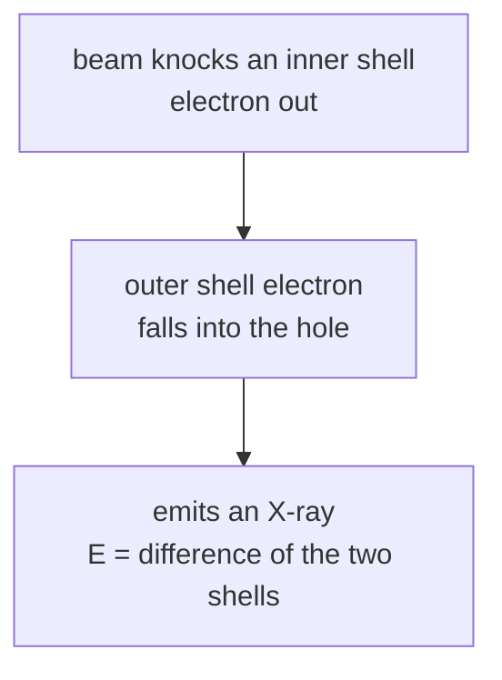

#vlsi #characterization #EDS #EDX
## energy dispersive X-ray spectroscopy
find out **which elements** are in a spot, using the X-rays that an electron beam makes. it's an add-on to a [[SEM]] or [[TEM]], not a microscope on its own. part of [[Metrology and nano-characterization workshop]]

> [!important] the one idea
> ==knock out an inner electron and an outer one falls into the hole, giving off an X-ray whose energy is the gap between the two shells. every element has its own gaps, so the X-ray energy names the element==

## how it works

- the energy difference between shells is **unique to each element** (Moseley's law), so the X-ray energy is a fingerprint
- lines are named by the shell the hole was in: **K**, **L**, **M**, and which one filled it ($K_\alpha$, $K_\beta$...)
- a detector (silicon drift detector, SDD) sorts the X-rays by **energy** → spectrum with a peak per element
- peak height ~ how much of that element

$$
\sqrt\nu=a(Z-\sigma)\qquad E_{K\alpha}\approx10.2\ \text{eV}\times(Z-1)^2
$$
^moseley

> [!eg] where's the $K_\alpha$ line?
> $$
> \begin{aligned}
> \text{Si }(Z=14):&\quad10.2\times13^2=1724\ \text{eV}\approx1.72\ \text{keV}\quad(\text{real }1.74)\\
> \text{Cu }(Z=29):&\quad10.2\times28^2=7997\ \text{eV}\approx8.0\ \text{keV}\quad(\text{real }8.05)
> \end{aligned}
> $$
> the Cu one is the **same** X-ray as the Cu $K_\alpha$ that [[XRD#where the X-rays come from|XRD]] uses. an X-ray tube is just EDS run on purpose: electrons hit copper and it glows at its $K_\alpha$ line

![[EDS_principle.png]]

(the same "fill the hole" step can instead throw out a second electron, the **Auger** electron seen in [[XPS#photoelectron vs Auger electron]]. light elements mostly do Auger, heavy ones mostly give X-rays, another reason EDS is bad at light elements)
## what you can do
- **point** → spectrum from one spot
- **line scan** → how composition changes along a line (across an interface)
- **map** → colour map of where each element is
- semi-quantitative: atomic % within a few %

![[EDS_spectrum_and_modes.png]]
## limits
- bad for **light elements** (Li, Be; B, C, N, O are hard and not very accurate)
- spatial resolution in SEM ~ **1 µm** since X-rays come from the whole interaction volume ([[SEM#what hits the sample, what comes out]]), much better in thin [[TEM]] samples
- ==energy resolution ~130 eV, so peaks can **overlap**== (eg. $\text{Si}\ K_\alpha$ and $\text{W}\ M$ lines)
- detection limit ~0.1–1 wt%
- only tells you the **element**, not how it's bonded. for that use [[XPS]]

> [!eg] why ~130 eV? counting statistics
> each X-ray makes a cloud of electron-hole pairs in the silicon detector, one per $\varepsilon=3.8$ eV. a 5.9 keV X-ray makes $N=\frac{5900}{3.8}\approx1550$ pairs, and that number fluctuates randomly (softened by the Fano factor $F\approx0.115$)
> $$
> \begin{aligned}
> \text{FWHM}&\approx2.355\sqrt{F\varepsilon E}=2.355\sqrt{0.115\times3.8\times5900}\\
> &=2.355\times50.8\approx120\ \text{eV}
> \end{aligned}
> $$
> plus electronic noise → ~125–130 eV. [[XPS]] resolves ~0.5 eV, so it can see chemical shifts that EDS can't

## in VLSI
- identify contamination or particles on a wafer
- composition of silicides, barrier layers and alloys
- check a film is the right material ($\text{SiN}$ vs $\text{SiO}_2$)
- find stray Ga left behind by an [[FIB#downsides|FIB]]

> [!exercise] try these
> ① estimate the $K_\alpha$ energy of iron ($Z=26$)
> ② a peak at 1.74 keV, and the sample has W in it. can you be sure it's Si?
> ③ you want to know if Si on a surface is oxidized. EDS or XPS?

> [!answer]-
> ① $10.2\times25^2=6375$ eV $\approx6.4$ keV (real 6.40)
> ② no: W $M$ lines sit at ~1.78 keV, within the ~130 eV resolution. check another line or use a higher-resolution method
> ③ **XPS**: EDS gives the element only, XPS sees the Si$^{4+}$ chemical shift ([[XPS#what you get]])

## the quantum connection
> [!extra] Moseley's law is the Bohr atom
> the hydrogen atom's levels are $E_n=-\frac{13.6\ \text{eV}}{n^2}$, quantized like a [[Particle in a box]]. for an inner electron in an atom with $Z$ protons, the one other 1s electron screens one proton, so it sees a charge $Z-1$, and the energies scale by $(Z-1)^2$. a $K_\alpha$ X-ray is the jump from $n=2$ to $n=1$
> $$
> E_{K\alpha}=13.6\ \text{eV}\,(Z-1)^2\left(\frac1{1^2}-\frac1{2^2}\right)=13.6\times\frac34\,(Z-1)^2=10.2\ \text{eV}\,(Z-1)^2
> $$
> ==that's where the 10.2 comes from==. Moseley used it in 1913 to put the periodic table in order of $Z$, one of the first big wins of quantum theory

> [!extra] EDS and XPS measure the same levels
> XPS measures each level's binding energy, EDS measures the **difference** between two levels. for copper: 1s at 8979 eV minus 2p$_{3/2}$ at 932.7 eV ([[XPS#the energy levels]]) gives 8046 eV, the Cu $K_\alpha$ line ✅. and only certain jumps happen (2p → 1s yes, 2s → 1s no) because the photon carries away one unit of angular momentum, the same spin–orbit bookkeeping as the [[XPS#the quantum connection|XPS doublets]]

see also [[SEM]], [[TEM]], [[XPS]], [[XRD]], [[Metrology and nano-characterization workshop]]

formulas: [[Spectroscopy formulas]]
