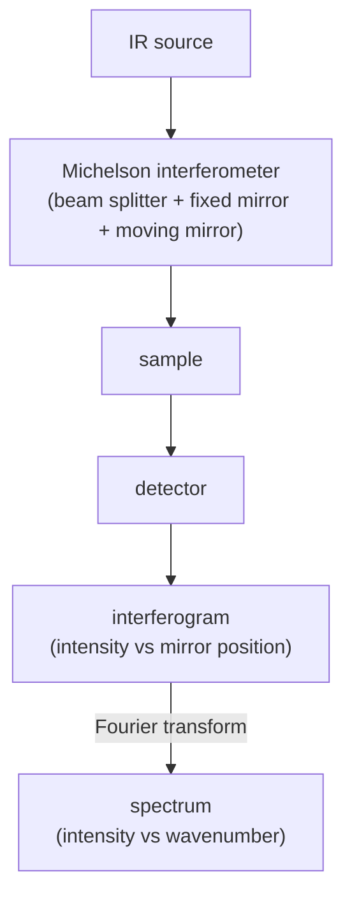

#vlsi #characterization #FTIR #spectroscopy #infrared
## Fourier transform infrared spectroscopy
shine infrared light on a sample, see **which wavelengths it absorbs**. molecules absorb IR at the frequencies their **bonds vibrate** at, so the absorption spectrum is a fingerprint of the bonds (functional groups) in there. part of [[Metrology and nano-characterization workshop]]

> [!important] the one idea
> ==a bond is a spring, and it absorbs IR light whose frequency matches its vibration==. FTIR measures all the frequencies at once with an interferometer, then a Fourier transform sorts them out

## the idea
- a bond is like a spring between two atoms (stiffer bond or lighter atoms → higher frequency)
- IR photon has the same frequency → gets absorbed → bond vibrates more
- **selection rule**: the vibration has to **change the dipole moment** (so $\text{H}_2$, $\text{N}_2$ don't show up, but $\text{CO}_2$, $\text{H}_2\text{O}$ do)
- axis is **wavenumber** $\tilde\nu=1/\lambda$ in $\text{cm}^{-1}$, typically **4000 → 400**

$$
\nu=\frac1{2\pi}\sqrt{\frac k\mu}\qquad\tilde\nu=\frac1{2\pi c}\sqrt{\frac k\mu}\qquad\mu=\frac{m_1m_2}{m_1+m_2}
$$
^bond-vibration

> [!eg] the C=O stretch ($k\approx1200$ N/m)
> $$
> \begin{aligned}
> \mu&=\frac{12\times16}{12+16}=6.86\ \text{u}=6.86\times1.66\times10^{-27}=1.14\times10^{-26}\ \text{kg}\\
> \tilde\nu&=\frac{1}{2\pi(3\times10^{10}\ \text{cm/s})}\sqrt{\frac{1200}{1.14\times10^{-26}}}\approx1720\ \text{cm}^{-1}
> \end{aligned}
> $$
> right where the strong C=O peak sits (~1700). ($c$ in cm/s so the answer comes out in cm⁻¹)

> [!eg] swap H for D (heavy hydrogen), same spring ($k\approx500$ N/m)
> $$
> \begin{aligned}
> \text{C–H:}\quad\mu&=\tfrac{12\times1}{13}=0.92\ \text{u}\ \Rightarrow\ \tilde\nu\approx3030\ \text{cm}^{-1}\\
> \text{C–D:}\quad\mu&=\tfrac{12\times2}{14}=1.71\ \text{u}\ \Rightarrow\ \tilde\nu\approx2220\ \text{cm}^{-1}
> \end{aligned}
> $$
> the chemistry (the spring) is identical, only the mass changed, and the peak moved by a factor $\sqrt{1.71/0.92}=1.36$. ==mass and stiffness are all that set the frequency==

### the energy scale
different transitions sit in different regions: rotational 1–20 cm$^{-1}$, vibrational ~400–4000 cm$^{-1}$ (mid IR), electronic 10 000–50 000 cm$^{-1}$ ([[UV-vis spectroscopy]]). near IR is 700–2500 nm, mid IR 2500–25 000 nm, far IR 25 000 nm to 1 cm

![[FTIR_energy_scales.png]]

(to compare: 1000 cm⁻¹ is $\lambda=10$ µm, a photon of $\frac{1240}{10\,000}=0.124$ eV with [[UV-vis spectroscopy#^photon-energy|E = 1240/λ]]. electronic jumps take eV, vibrations ~0.1 eV, rotations ~0.001 eV)
## vibrations that absorb
bonds are **not rigid**. stronger bonds have a higher spring constant and absorb at higher wavenumber (C–H ~2900 cm$^{-1}$ vs the weaker C–C ~1200 cm$^{-1}$). quantization means only particular frequencies are absorbed, and only vibrations that **change the dipole moment** are seen (H$_2$O, asymmetric stretch of CO$_2$, C–Cl, C=O, NH$_3$)

![[FTIR_vibration_modes.png]]
## why "Fourier transform"
older machines used a prism / grating and measured one wavelength at a time. FTIR measures **all wavelengths at once**

- the moving mirror changes the path difference, so different wavelengths interfere constructively at different mirror positions
- detector sees the sum = the **interferogram**
- a [[Fourier Transform]] turns it into the spectrum
- a **HeNe laser** tracks the mirror position super accurately

$$
I(\delta)=\int_0^\infty B(\tilde\nu)\cos(2\pi\tilde\nu\delta)\,d\tilde\nu\ \xrightarrow{\text{FT}}\ B(\tilde\nu)
$$
^interferogram

$\delta$ → optical path difference = 2 × mirror displacement. each wavenumber adds its own cosine wave, and the Fourier transform pulls them apart again

the resolution is set by how far the mirror travels
$$
\Delta\tilde\nu=\frac1{\delta_{max}}
$$
^ftir-resolution

> [!eg] 4 cm⁻¹ resolution
> $\delta_{max}=\frac14=0.25$ cm $=2.5$ mm of path difference, so the mirror moves 1.25 mm. to split two peaks closer together, scan further (more repeats of the slow cosines = sharper peaks, the same reason as [[XRD#Scherrer equation|broad XRD peaks from small crystals]])

### advantages
- **Fellgett (multiplex)** → all wavelengths measured at once, so faster and better signal to noise
- **Jacquinot (throughput)** → no narrow slits, more light gets to the detector
- **Connes** → laser calibration gives very accurate wavenumbers

![[FTIR_interferometer.png]]
## light source and detectors
- **source**: silicon carbide (SiC) lamp ("globar"), electrically heated to ~1200 K, 1.7–28 µm, ~2000 h life
- **TGS** (triglycine sulphate): pyroelectric/thermal detector, **room temperature**, linear response, used for routine and micro-region work
- **MCT** (mercury cadmium telluride): photovoltaic, needs **liquid nitrogen** cooling, very sensitive and fast (kinetic measurements), loses linearity at high throughput
- the machine in the lab is a **PerkinElmer Frontier**
## measuring: take a background first
1. run a **background** (no sample, to remove $\text{CO}_2$, water vapour, optics)
2. run the **sample**
3. ratio → **transmittance** $T$ or **absorbance**, the same Beer–Lambert law as UV-vis

![[UV-vis spectroscopy#^beer-lambert]]

![[FTIR_interferogram_to_spectrum.png]]
## sampling modes
four main methods (all roughly 400–4000 cm$^{-1}$; ATR from ~650)

![[FTIR_sampling_methods.png]]
- **transmission** → IR goes through (thin films on IR transparent substrates like Si, KBr pellet)
- **ATR** (attenuated total reflectance) → sample pressed on a crystal (diamond / Ge), IR evanescent wave goes ~µm in. almost no prep. super common
- **reflection** → for films on mirror like substrates
- **DRIFTS** (diffuse reflectance) → rough surfaces and powders, diluted in KBr
- **specular reflectance** → smooth, mirror-like samples, signal can be weak

how far the ATR wave reaches into the sample
$$
d_p=\frac{\lambda}{2\pi n_1\sqrt{\sin^2\theta-(n_2/n_1)^2}}
$$
^atr-depth

> [!eg] diamond ($n_1=2.4$), sample $n_2=1.5$, 45°, $\lambda=10$ µm
> $$
> d_p=\frac{10}{2\pi\times2.4\times\sqrt{0.5-0.391}}=\frac{10}{4.99}\approx2\ \text{µm}
> $$
> so ATR only sees the top ~2 µm, deeper at longer wavelengths

## reading a spectrum
- $\sim4000$–$1500$: **functional group** region (O–H ~3300 broad, C–H ~2900, C=O ~1700 strong)
- $\sim1500$–$400$: **fingerprint** region, complex but unique to the molecule

![[IR_spectrum_regions.png]]
### worked example: ethanol vs isopropanol
both show a broad **O–H stretch** (~3300), but IPA is a **secondary** alcohol (–OH on a carbon bonded to two other carbons, branched) and ethanol a **primary** one (straight chain). so the O–H is slightly lower in IPA, slightly higher in ethanol, and IPA shows a distinct C–H bend from the isopropyl group while ethanol shows a simpler one from the ethyl group. the structure difference changes reactivity, boiling point and solvent behaviour
### where peaks are (4000–3000 cm$^{-1}$)

| range | strength | group | assignment |
|---|---|---|---|
| 3700–3584 | medium, sharp | O–H stretch | free alcohol |
| 3550–3200 | strong, broad | O–H stretch | intermolecular bonded alcohol |
| 3500–3400 | medium | N–H stretch | primary amine |
| 3300–2500 | strong, broad | O–H stretch | carboxylic acid (centred ~3000) |

databases: ChemLibre IR spectrum tables, NIST Chemistry WebBook.
### other applications (lecture)
counterfeit pharmaceutical tablets (ATR), semiconductor contamination (find organics from the process), cable insulation ageing (carbonyl growth), petroleum fuel adulteration, fibre-optic water-in-oil sensors, milk adulteration
## in VLSI

| material | peak |
|---|---|
| $\text{SiO}_2$ Si–O–Si stretch | ~1080 $\text{cm}^{-1}$ |
| $\text{Si}_3\text{N}_4$ Si–N | ~830 $\text{cm}^{-1}$ |
| Si–H | ~2100 $\text{cm}^{-1}$ |
| interstitial oxygen in Si | ~1107 $\text{cm}^{-1}$ |

- film **composition and bonding** (hydrogen content in nitrides / low-k)
- photoresist and polymer chemistry, curing
- contamination, organics on surfaces (then the top few nm with [[XPS]])
## vs [[Raman spectroscopy]]
==both measure vibrations, but they follow **different selection rules**: IR needs a change in **dipole**, Raman needs a change in **polarizability**==. so they complement each other

> [!exercise] try these
> ① what wavelength (in µm) is the Si–O–Si peak at 1080 cm⁻¹?
> ② O–H ($\mu\approx0.94$ u) absorbs at ~3600 cm⁻¹. estimate the O–D stretch
> ③ why is the CO₂ in the air a problem, and how do you fix it?

> [!answer]-
> ① $\lambda=\frac{10^4}{1080}=9.26$ µm
> ② $\mu_{OD}=\frac{16\times2}{18}=1.78$ u, so $3600\times\sqrt{\frac{0.94}{1.78}}=3600\times0.727\approx2620$ cm⁻¹
> ③ CO₂ (and water vapour) absorb IR themselves, so they show up in every spectrum. the background scan records them and dividing by it removes them

## the quantum connection
> [!extra] vibrations are quantized
> a bond isn't a classical spring: its vibration energy comes in steps, $E_v=\left(v+\frac12\right)hf$ (the quantum harmonic oscillator, more in [[Raman spectroscopy#quantum picture]]). absorbing one IR photon of energy $hf$ lifts it from $v=0$ to $v=1$. that's why ==a bond absorbs one sharp frequency, not a smear==. and even at $v=0$ it still jiggles with $\frac12hf$, the zero-point energy, like the ground state of a [[Particle in a box]] that can never be still

> [!extra] the selection rule is angular momentum
> a photon carries one unit of angular momentum, and it can only be absorbed if the vibration can "take" it, ie. if the charges move to make an oscillating dipole. no dipole change ($\text{N}_2$ stretching), no absorption. the same kind of rule picks which X-ray lines exist in [[EDS#the quantum connection|EDS]]

> [!extra] Fourier transforms and interferometers again
> FTIR is a Michelson interferometer, the same idea as the Mach–Zehnder in [[Beamsplitters]], followed by a [[Fourier Transform]]. a spectrum hidden in a signal that's a sum of cosines is exactly what the [[Quantum Fourier Transform]] pulls out in [[Quantum Phase Estimation]]: there the "frequencies" are the phases of the eigenvalues

see also [[Raman spectroscopy]], [[UV-vis spectroscopy]], [[XPS]], [[Metrology and nano-characterization workshop]]

formulas: [[Spectroscopy formulas]]
