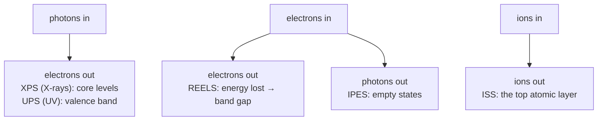

#vlsi #characterization #REELS #XPS #spectroscopy
## REELS and the other modes of XPS
the same UHV system as [[XPS]] can do more than XPS. these are the extra modes from the lecture. part of [[Metrology and nano-characterization workshop]]

> [!important] the one idea
> ==every mode is the same game with a different probe in and a different particle out==: photons in → electrons out (XPS, UPS), electrons in → electrons out (REELS), electrons in → photons out (IPES), ions in → ions out (ISS)

## REELS: reflection electron energy loss spectroscopy
a beam of **electrons** (known energy $E_0$) hits the surface, and you measure how much energy the **reflected** electrons lost. it is a surface-analysis technique (like [[XPS]]) but the probe is an electron beam
1. a primary electron arrives at the surface
2. it transfers energy to the material: it can **excite an electron** across the band gap (interband transition), or excite a plasmon
3. the scattered electron escapes with less energy

$$
\Delta E=E_0-E
$$
^energy-loss

### why would we want the band gap?
the band gap decides how a device behaves electrically and optically: carrier generation, leakage, transistor operation, photon absorption in LEDs and solar cells. defects and disorder add states in the gap, and process or failure analysis (etching, contamination) can change it
- silicon's gap is **1.12 eV** at room temperature, indirect
- REELS sees the **onset of the energy loss** (zero-loss peak, then the first loss at $E_g$, then plasmon loss peaks)
- ==[[UV-vis spectroscopy]] gets the gap from absorption through the whole film, REELS gets it from the surface only==

> [!eg] reading a REELS spectrum ($E_0=1000$ eV)
> - the big **zero-loss peak** at 1000 eV: electrons that bounced off without losing anything
> - nothing until **998.88 eV**, then the loss starts: $E_g=1000-998.88=1.12$ eV, silicon
> - a big bump at **~983 eV**: a loss of ~17 eV, the Si **plasmon** (all the valence electrons sloshing together)
>
> no electron can lose an amount of energy smaller than the gap, because there's no empty state for the excited electron to go to

> [!eg] where REELS beats UV-vis
> the gap of $\text{SiO}_2$ is ~8.9 eV. the light that could measure it has $\lambda=\frac{1240}{8.9}=139$ nm ([[UV-vis spectroscopy#^photon-energy|E = 1240/λ]]), vacuum UV that air absorbs and that a UV-vis machine (≥200 nm) can't make. REELS doesn't care: the electron beam has 1000 eV to spare. same for high-k oxides like HfO₂ (5.7 eV, 218 nm, right at the edge)

## other modes

| mode | what it does | use |
|---|---|---|
| **IPES** (inverse photoemission) | shoot electrons in, detect photons out → **empty states** (LUMO, energy level diagram) | solar cells, thin films |
| **XPS imaging** | map **elements or chemical states** across the surface | non-homogeneous materials |
| **ISS** (ion scattering spectroscopy) | low-energy He⁺ or Ar⁺ ions scatter off the top atoms | **extremely** surface sensitive (outermost atomic layer), microelectronics |
| **HAXPES** (hard X-ray) | Ag $L_\alpha$ (2984.2 eV) as the X-ray source → deeper information depth | oxides, perovskites, buried interfaces |
| [[UPS]] | UV photons → valence band, work function | band alignment |

^xps-modes

(UPS sees the **filled** states below the Fermi level, IPES sees the **empty** ones above it. put them together and you get the whole band gap, the "transport gap")
### ISS: billiard balls
an ion bouncing straight back off a surface atom is a simple collision. it loses the most energy when it hits something light, the same rule as the [[FIB#why ions cut and electrons don't|FIB]]

![[FIB#^max-energy-transfer]]

for an ion bouncing straight back (180°), with $\mu=\frac{m_{atom}}{m_{ion}}$, the energy it keeps is
$$
\frac{E_1}{E_0}=\left(\frac{\mu-1}{\mu+1}\right)^2
$$
^iss-kinematic

> [!eg] 1 keV He⁺ ions ($m=4.0$ u) bouncing back
> $$
> \begin{aligned}
> \text{off O }(\mu=4.0):&\quad\left(\tfrac{3}{5}\right)^2=0.36\ \Rightarrow\ 360\ \text{eV}\\
> \text{off Si }(\mu=7.02):&\quad\left(\tfrac{6.02}{8.02}\right)^2=0.56\ \Rightarrow\ 563\ \text{eV}\\
> \text{off Au }(\mu=49.2):&\quad\left(\tfrac{48.2}{50.2}\right)^2=0.92\ \Rightarrow\ 922\ \text{eV}
> \end{aligned}
> $$
> so each element shows up at its own energy. and a He⁺ that goes any deeper than the first layer almost always gets neutralized and isn't counted, which is why ==ISS only sees the very top atomic layer==, much less than XPS's ~5–10 nm

### HAXPES: deeper
a harder X-ray gives the photoelectrons more kinetic energy, so they travel further before losing energy ([[XPS#why it's so surface sensitive]])

> [!eg] Si 2p ($BE\approx99$ eV) with Al vs Ag
> $$
> \begin{aligned}
> KE_{Al}&\approx1486.6-99=1388\ \text{eV}\qquad KE_{Ag}\approx2984.2-99=2885\ \text{eV}\\
> \frac{\lambda_{Ag}}{\lambda_{Al}}&\approx\left(\frac{2885}{1388}\right)^{0.75}=2.08^{0.75}\approx1.7
> \end{aligned}
> $$
> (the mean free path grows roughly as $KE^{0.75}$ at these energies). so HAXPES sees about **1.7× deeper**, ~15 nm instead of ~9: deep enough to see an interface under a thin film without sputtering it

## the vacuum system
the lab system is split into chambers with their own pressure
- **sample analysis chamber (SAC)** ~ $3\times10^{-9}$ Torr
- **fast entry load lock** ~ $3\times10^{-8}$ Torr, so samples go in without venting the SAC
- **UPS line**: He gas leaked in through a valve (~ $10^{-4}$ Torr in the lamp region), differentially pumped
- **ion gun** (Ar) for sputtering ([[XPS#depth profiling]]), with its own differential pump
- pumps: turbo molecular, ion pump, backing pumps. **N₂** is used for venting

> [!exercise] try these
> ① a REELS spectrum with $E_0=1500$ eV has its loss onset at 1494.3 eV. what's the gap, and what could the film be?
> ② you want to know if a 3 nm film on a wafer is uniform in the **top layer** of atoms. ISS or XPS?
> ③ which mode would you use to find the conduction band (empty states) of an organic solar cell film?
> ④ in ISS with He⁺, a peak at 794 eV (from 1000 eV). which element? (hint: try Ga, 69.7 u)

> [!answer]-
> ① $E_g=1500-1494.3=5.7$ eV, eg. HfO₂
> ② **ISS**: XPS averages over ~5–10 nm, so it would see right through the 3 nm film into the wafer
> ③ **IPES** (empty states), together with [[UPS]] for the filled ones
> ④ $\mu=\frac{69.7}{4.0}=17.4$, $\left(\frac{16.4}{18.4}\right)^2=0.79$ → 794 eV ✅, gallium (eg. left behind by an [[FIB#downsides|FIB]])

## the quantum connection
> [!extra] energy is lost in quanta
> a REELS electron can't lose **any** amount of energy: it can only hand over chunks that match a jump the material can make. less than $E_g$ is impossible, exactly like a photon in [[UV-vis spectroscopy#the quantum connection|UV-vis]] that's too red to be absorbed. the plasmon peak is the same idea: the collective sloshing of the electrons is **quantized**, and one quantum of it (a **plasmon**, ~17 eV in Si) is a quasiparticle, the way a photon is one quantum of light
>
> (a rough check: treat Si's 4 valence electrons per atom as a free gas, $n=2.0\times10^{29}$ m⁻³, then $\hbar\omega_p=\hbar\sqrt{\frac{ne^2}{\varepsilon_0m_e}}=16.6$ eV, right where the peak is)

> [!extra] IPES is the photoelectric effect backwards
> XPS and UPS: a photon in, an electron out. IPES: an electron in, it drops into an empty state, and the extra energy comes out as **one photon**. the same packet-of-energy rule as in [[XPS#the quantum connection]], run in reverse. it's also how [[Single Photon making and detecting|single photon sources]] work: an excited electron drops down and gives out exactly one photon

see also [[XPS]], [[UPS]], [[UV-vis spectroscopy]], [[FIB]], [[Metrology and nano-characterization workshop]]

formulas: [[Spectroscopy formulas]]
