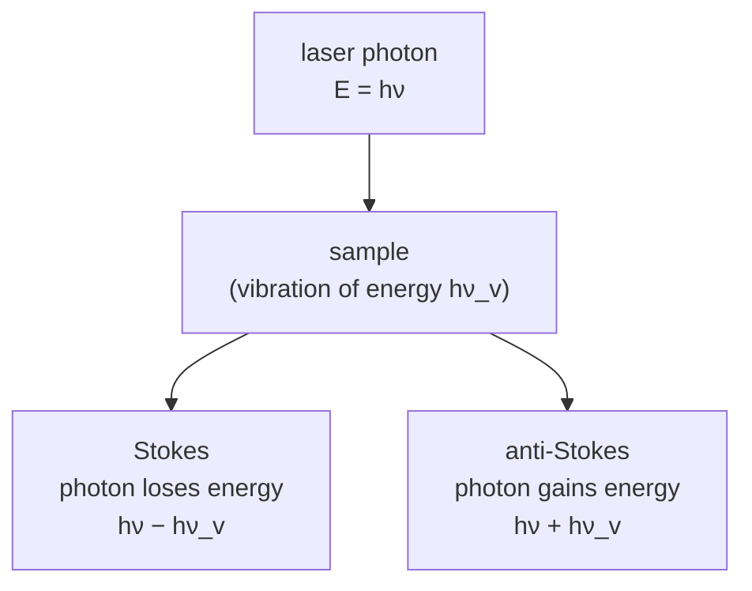

#vlsi #characterization #raman #spectroscopy
## Raman spectroscopy
shine a **laser** on the sample, look at the light that scatters off with a **different colour**. the energy difference = the energy of a **vibration** (phonon) in the material. like [[FTIR]], gives bond and structure info, but using scattering instead of absorption. part of [[Metrology and nano-characterization workshop]]

> [!important] the one idea
> ==a photon bounces off the sample and leaves behind (or picks up) exactly one quantum of vibration, so the colour change measures the vibration's energy==

## the idea
most scattered light has the same colour as the laser (**Rayleigh**, elastic). a tiny fraction (about 1 in $10^6$–$10^8$ photons) is **inelastic**

- **Stokes**: the molecule takes energy from the photon, so scattered light is **redder**. stronger, since most molecules start in the ground state
- **anti-Stokes**: molecule was already vibrating, gives energy to the photon, **bluer**. weaker (ratio depends on temperature, so it can be used as a thermometer)
- plot intensity vs **Raman shift** $\Delta\tilde\nu$ in $\text{cm}^{-1}$ (difference from the laser, so it doesn't depend on which laser you use)
- **selection rule**: vibration must change the **polarizability**. complementary to [[FTIR]] (eg. symmetric stretches that are IR invisible are Raman active)

$$
\Delta\tilde\nu[\text{cm}^{-1}]=10^7\left(\frac1{\lambda_0[\text{nm}]}-\frac1{\lambda_s[\text{nm}]}\right)
$$
^raman-shift

> [!eg] where does the Si peak (520.7 cm⁻¹) actually come out?
> $$
> \begin{aligned}
> \text{532 nm laser:}\quad\frac{10^7}{532}&=18\,797\ \text{cm}^{-1}\\
> 18\,797-520.7&=18\,276\ \text{cm}^{-1}\ \Rightarrow\ \lambda_s=\frac{10^7}{18\,276}=547.2\ \text{nm}
> \end{aligned}
> $$
> with a 633 nm laser the same peak lands at 654.6 nm, with 785 nm at 818.5 nm. three different colours, ==one Raman shift==: that's why spectra are plotted in shift

![[Raman_scattering.png]]
### classical picture: why polarizability matters
the laser's electric field pulls the electron cloud and **induces a dipole** $p=\alpha E$. as the atoms vibrate the cloud gets easier or harder to distort, so $\alpha$ oscillates at the vibration frequency and the scattered light gets **sidebands** at $\nu_0\pm\nu_v$ (Stokes and anti-Stokes). if the vibration does not change $\alpha$ there is no modulation and **no Raman scattering**
$$
\Delta\alpha=\alpha'(\Delta r_1+\Delta r_2)
$$
^polarizability-change

![[Raman_selection_rules.png]]
- **symmetric stretch** → cloud swells and shrinks, $\Delta\alpha\neq0$, **Raman active**
- **asymmetric stretch** → one bond grows, the other shrinks, net $\Delta\alpha=0$, inactive (but IR active, see [[FTIR]])
- **bending** → bond lengths barely change, inactive

(the sidebands are just maths: $\cos(\omega_0t)\cos(\omega_vt)=\frac12[\cos(\omega_0-\omega_v)t+\cos(\omega_0+\omega_v)t]$, the same mixing as in the [[MSA#LDV|LDV]] beat)
### quantum picture
vibrational energy is quantized, evenly spaced (harmonic oscillator)
$$
E_v=\left(v+\tfrac12\right)hf\qquad f=\frac1{2\pi}\sqrt{\frac k\mu}
$$
^vibrational-levels

- the photon takes the molecule to a short-lived **virtual state** and it drops back down. back to the same level = Rayleigh, to $v=1$ = Stokes, from $v=1$ to $v=0$ = anti-Stokes
- most molecules sit at $v=0$ → **Stokes > anti-Stokes**
- ($f$ is the same spring formula as [[FTIR#^bond-vibration]])

![[Raman_energy_levels.png]]
### Stokes vs anti-Stokes spectrum
the two sides are **mirror images** around the Rayleigh line (CCl$_4$: 218, 314, 459 cm$^{-1}$ either side), but anti-Stokes is much weaker because few molecules are in $v=1$

![[Raman_Stokes_antiStokes_CCl4.png]]

$$
\frac{I_{AS}}{I_S}=\left(\frac{\tilde\nu_0+\tilde\nu_v}{\tilde\nu_0-\tilde\nu_v}\right)^4\exp\!\left(-\frac{hc\tilde\nu_v}{k_BT}\right)
$$
^stokes-ratio

$hc/k_B=1.4388$ cm K. the exponential is how many molecules are already in $v=1$ (Boltzmann), the 4th power is the $\frac1{\lambda^4}$ scattering law

> [!eg] Si at 300 K, 532 nm laser
> $$
> \begin{aligned}
> \left(\frac{18\,797+520.7}{18\,797-520.7}\right)^4&=\left(\frac{19\,318}{18\,276}\right)^4=1.25\\
> \exp\!\left(-\frac{520.7\times1.4388}{300}\right)&=e^{-2.50}=0.082\\
> \frac{I_{AS}}{I_S}&\approx1.25\times0.082=0.10
> \end{aligned}
> $$
> the anti-Stokes peak is ~10× weaker. heat the spot with the laser and the ratio goes up: a **thermometer** that needs no contact

why use anti-Stokes anyway?
1. **thermometry**: the anti-Stokes/Stokes intensity ratio depends on temperature (the phonon population)
2. **less fluorescence**: anti-Stokes lines sit on the blue side of the laser, fluorescence appears on the red side
## which laser?
the Raman **shift** is a property of the material, it does **not** depend on the laser wavelength (a vibration of 520 cm$^{-1}$ gives 520 cm$^{-1}$ with any laser). so you choose the laser for practical reasons: signal strength, fluorescence, sample sensitivity, detector response

| laser | when |
|---|---|
| **473 nm** | strong scattering (the signal goes like $1/\lambda^4$), but can increase fluorescence |
| **532 nm** | common choice, good signal for many materials |
| **633 nm** | useful when green causes too much fluorescence |
| **785 nm** | often reduces fluorescence in many samples |
| **1064 nm** | reduces fluorescence further, weaker signal, needs suitable detectors (InGaAs) |

**why monochromatic?** one wavelength gives clear, separate Raman peaks. a broadband source smears every peak into a blur. Raman is also very weak (about 1 in $10^7$ photons), so you need a strong narrow line, tightly focused to ~1 µm, and a narrow line is easy to block with a filter

> [!eg] the price of going red
> 532 → 785 nm loses $\left(\frac{532}{785}\right)^4=0.21$, ~5× less signal, in exchange for much less fluorescence

## setup
laser (532 nm green, 633, 785 nm) → microscope objective focuses on the sample → **notch / edge filter** blocks the huge Rayleigh signal → grating → CCD
- **backscattering (180°)** geometry: the same objective focuses the laser and collects the Raman light. same-side access, works on opaque wafers, high collection efficiency, no extra alignment. forward (0°) and side (90°) need separate collection optics
- confocal microscope → spot ~1 µm ([[Electron microscope#^resolution-limit|the resolution limit]]: $\frac{0.61\times532}{0.9}=0.36$ µm), so you can **map** a sample
- no sample prep, through glass or plastic windows, non-destructive (if you keep the power low)
- water is a weak Raman scatterer so works on wet samples (unlike IR)
## what to look for in a spectrum
- **peak position** → which bond / phase / material
- **shift** → strain / stress, temperature
- **width** → crystallinity (sharper = more crystalline, broad = amorphous or defective)
- **intensity** → amount, thickness (for 2D layers)

(the same three things a peak tells you in [[XRD#what each part of a peak tells you|XRD]]: position, width, height)
## classic examples

| material | peak | tells you |
|---|---|---|
| crystalline Si | sharp at **520.7** $\text{cm}^{-1}$ | it's crystalline Si |
| amorphous Si | broad around ~480 $\text{cm}^{-1}$ | disordered |
| strained Si | 520 peak **shifts**: tensile → lower, compressive → higher (~2 $\text{cm}^{-1}$ per GPa) | stress in strained-Si channels |
| graphene | **G** ~1580, **2D** ~2700, **D** ~1350 ($\text{cm}^{-1}$) | layer count (2D/G ratio and shape), defects (D peak) |
| $\text{MoS}_2$ | $E_{2g}$ ~383 and $A_{1g}$ ~408 | layer thickness from their spacing |

^raman-examples

> [!eg] how much stress?
> the Si peak in a channel sits at 519.7 cm⁻¹ instead of 520.7: shifted down 1 cm⁻¹, at ~2 cm⁻¹ per GPa that's ~0.5 GPa **tensile**. [[XRD#what each part of a peak tells you|XRD]] would see the same strain as a peak shift, but averaged over mm instead of 1 µm

## the MNCF system

| | |
|---|---|
| instrument | **HORIBA Jobin Yvon LabRAM HR** ("Lab RAM HR") |
| detectors | CCD (1024 × 256 pixels) and InGaAs (NIR photoluminescence, 900–1500 nm) |
| scanning range | 300–1500 nm |
| spectral range | 60–4000 cm$^{-1}$ |
| spectral resolution | 0.35 cm$^{-1}$/pixel at 532 nm with an 1800 gr/mm grating |
| spatial resolution | ~1 µm |
| excitation | 266 nm, 532 nm, 785 nm |

## key features of a spectrum
![[Raman_key_features.png]]
## problems
- very **weak** signal, so need a long integration and a good detector
- **fluorescence** can swamp it (see below)
- **laser heating** burns or changes the sample (keep power low)
- **SERS** (surface enhanced) → put it on rough Au / Ag nanostructures for a $10^6$+ boost (the plasmons from [[UV-vis spectroscopy#other things it shows|UV-vis]] concentrate the light)
### fluorescence: the most frustrating problem
fluorescence can be $10^6$ times stronger than Raman and buries the peaks. ==**how to tell**: change the laser. the Raman peak stays at the same cm$^{-1}$, the fluorescence hump moves with the laser==
![[Raman_fluorescence.png]]
try in order: (1) switch to 785 nm, (2) **photo-bleach** (focus the laser on the spot for minutes first), (3) clean the surface (solvents, films, fingerprints), (4) switch to 1064 nm, (5) subtract a polynomial **baseline** in software
### improving the data quality

| knob | do |
|---|---|
| clean surface | less background |
| integration time | raise it until the peak is clear but not saturated |
| laser power | start low and raise slowly, stop if the peaks shift or burn |
| average scans | less random noise |

other practical problems: non-uniform sample (measure several spots), the substrate signal (subtract a reference)
## reading a spectrum
1. gather the context: sample, acquisition (laser, power, time), instrument, environment (the same peak can mean different things, 520 cm$^{-1}$ is Si in semiconductors)
2. assemble references: spectral databases (RRUFF, SDBS), correlation charts, literature, reference standards
3. quality checks: flat baseline, signal-to-noise (main peaks above 10:1), **cosmic ray spikes** (sharp random peaks, repeat the accumulation), calibration (check a known peak within ±2 cm$^{-1}$)
## what else a Raman can do
- **mapping**: scan the spot over a grid (stress, crystallinity, layer maps)
- **polarization-resolved** Raman: crystal symmetry and orientation
- **temperature dependent**: peaks shift with temperature and self-heating
- **SERS**: metal nanostructures boost the signal; **TERS**: a sharp tip ([[AFM]]) gives nanoscale resolution; **resonance Raman**: laser matches an electronic transition and boosts those modes
### polarization
isotropic samples (liquids, powders) scatter the same whatever the polarization, **anisotropic** ones (crystals, polymers) do not. so a polarized measurement tells you the symmetry of the vibrations and the orientation of the sample (and strain, defects, 2D materials). (polarization is the same property used to store qubits in photons, see [[Polarization]])
## case studies (from the lecture)
1. **stress and strain**: GaN epitaxial layers on sapphire after laser dicing (laser ablation vs scribing): the $E_2$(high) peak shifts across the chip, so Raman maps the residual stress near the cut
2. **material identification**: Co-doped GaN: red shift, broadening and weakening of the $E_2$(high) mode compared with pure GaN → structural defects and lattice distortion from doping; extra modes show up at higher doping
3. **polarization**: Si (100) at 520.7 cm$^{-1}$: intensity changes with the laser polarization angle, highest near 0° and 180°, lowest near 90° and 270°
4. **temperature, graphene**: as T rises the C–C bond length and thermal expansion change, so the **G peak shifts** (≈1587 → 1580 cm$^{-1}$ from low T to 300 K)

![[Raman_polarization_and_temperature.png]]
## in VLSI
- stress in Si (strained channels, around TSVs)
- crystal quality of films, annealing of implant damage (eg. after an [[FIB]])
- 2D materials characterization (graphene, $\text{MoS}_2$)
- identify phases (eg. $\text{TiSi}_2$ C49 vs C54, also seen in [[XRD#in VLSI|XRD]])
- hidden defects, localized damage from laser dicing, etching, annealing
- multilayer stacks where materials and phases coexist

> [!exercise] try these
> ① a 633 nm laser, a peak at 690 nm. what's the Raman shift?
> ② the anti-Stokes/Stokes ratio of the 520 cm⁻¹ peak went up when you raised the laser power. what happened?
> ③ the asymmetric stretch of CO₂ shows in FTIR but not Raman. why?
> ④ a graphene peak at 1580 cm⁻¹: at 300 K, about what fraction of those vibrations are already excited?

> [!answer]-
> ① $10^7\left(\frac1{633}-\frac1{690}\right)=15\,798-14\,493=1305$ cm⁻¹ (near graphene's D peak)
> ② the laser **heated** the spot: more phonons already in $v=1$, so more anti-Stokes ([[#^stokes-ratio]])
> ③ it changes the dipole (IR active) but the polarizability change of the two bonds cancels, $\Delta\alpha=0$
> ④ $e^{-1580\times1.4388/300}=e^{-7.58}=0.0005$, about 1 in 2000. stiff, high-frequency modes are almost all in their ground state at room temperature

## the quantum connection
> [!extra] phonons are quanta, just like photons
> the vibration energy in [[#^vibrational-levels]] comes in steps of $hf$. one step is called a **phonon**, a quantum of vibration the way a photon is a quantum of light. Raman scattering is a photon handing one phonon to the crystal (Stokes) or taking one (anti-Stokes). Si's 520.7 cm⁻¹ phonon is $520.7\times1.24\times10^{-4}=0.065$ eV. ==the Stokes/anti-Stokes ratio is literally counting how many phonons are already there== (the Boltzmann factor), and that only works because the energy is quantized

> [!extra] Raman transitions drive trapped-ion qubits
> in a trapped-ion quantum computer the two qubit levels are often too close together to drive with one laser. so two lasers are used whose **difference** in frequency matches the qubit gap: the ion absorbs from one and gets pushed down by the other, through a virtual state, exactly the Stokes picture above. these **stimulated Raman transitions** make the single-qubit rotations (the [[Bloch sphere]] rotations) and, using the ions' shared vibrations (phonons again), the entangling gates

> [!extra] Raman light is noise in quantum networks
> sending single photons for QKD down a fibre that also carries normal internet traffic: the bright classical laser Raman-scatters off the glass and makes stray photons at nearby wavelengths, some landing right on the quantum channel ([[Long-distance quantum communication]]). that's one reason quantum and classical signals are kept far apart in wavelength

see also [[FTIR]], [[XRD]], [[UV-vis spectroscopy]], [[AFM]], [[Metrology and nano-characterization workshop]]

formulas: [[Spectroscopy formulas]]
