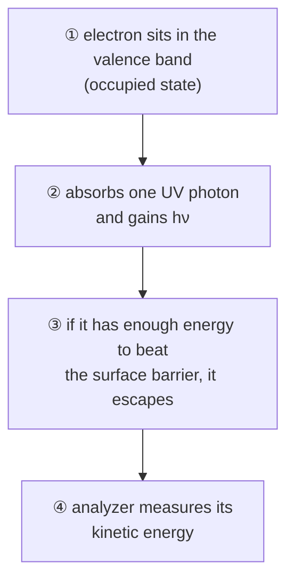

#vlsi #characterization #UPS #spectroscopy #work_function
## ultraviolet photoelectron spectroscopy
same idea as [[XPS]] but with **ultraviolet photons** instead of X-rays. UV photons only have enough energy to kick out the **outer, valence** electrons, so UPS tells you about the **occupied electronic states** and the **work function** of the surface. part of [[Metrology and nano-characterization workshop]]

> [!important] the one idea
> ==the slowest electrons that just make it out and the fastest ones from the very top of the filled states mark the two ends of the spectrum, and the gap between them is the photon energy minus the work function==. so one spectrum gives you the work function directly

## what is the source
a **helium discharge lamp** (+ monochromator to pick the line), inside a UHV chamber with a hemispherical analyzer

| line | photon energy | wavelength |
|---|---|---|
| **He I** | 21.22 eV | 58.4 nm |
| **He II** | 40.81 eV | 30.4 nm |

^ups-lines

(wavelengths from [[UV-vis spectroscopy#^photon-energy|E = 1240/λ]]. that's **vacuum** UV, way below the 200 nm where [[UV-vis spectroscopy]] stops: air absorbs it, which is one more reason it all happens in UHV. and ~70× less energy than the Al $K_\alpha$ X-rays in XPS)

He II reaches deeper into the band structure. the relative intensities of spectral features change between He I and He II because the ionization probabilities depend on the photon energy
## the process

it does **not** stop in the conduction band, it goes directly into vacuum. the energy bookkeeping is the same as XPS, with $BE$ now the depth $E_B$ below the Fermi level of a **valence** state

![[XPS#^xps-energy]]

> [!eg] Si with He I
> electron from a valence band state 2 eV below the Fermi level, work function 4.5 eV
> $$
> E_K=21.22-2.00-4.50=14.72\ \text{eV}
> $$

## what UPS measures
- the **kinetic energy distribution** of the emitted electrons
- occupied **valence band** states, valence band maximum relative to the Fermi level
- the surface **work function** $\phi$
## work function from the spectrum
the spectrum starts at the **secondary electron cutoff** (electrons that only just made it out, $KE\approx0$) and ends at the **Fermi edge** (the highest occupied state). the **width** of the spectrum is $h\nu-\phi$
$$
\phi=h\nu-(E_F-E_{cutoff})
$$
^ups-work-function

![[UPS_work_function.png]]

(why: the fastest electron comes from the Fermi level, $BE=0$, so it leaves with $h\nu-\phi$. the slowest has $KE=0$. the width between them is $h\nu-\phi$, and $\phi$ falls out)

> [!eg]- example: silver (Ag) with He I
> width $=16.72$ eV
> $$
> \phi=21.22-16.72=4.5\ \text{eV}
> $$
> **with a −2 V sample bias** (often used so the lowest energy electrons can overcome the analyzer's own work function): the cutoff and the Fermi edge **both shift by the same amount**, so ==the width is unchanged and $\phi$ is still 4.5 eV==. always correct for the bias before calculating $\phi$

> [!eg]- example: silicon
> cutoff and Fermi edge from the plot
> $$
> \begin{aligned}
> \text{width}&=16.94-0.365=16.575\ \text{eV}\\
> \phi&=21.22-16.575=4.645\ \text{eV}
> \end{aligned}
> $$
> in the literature the silicon work function ranges from **4.5 to 4.9 eV** (doping, surface condition, native oxide)

## cross-check with KPFM
[[AFM]] in **Kelvin probe force microscopy (KPFM)** also gives a work function, as a **map**. it measures the contact potential difference (CPD) between the tip and the sample, so the tip must be calibrated on a known sample first (HOPG, 4.65 eV)
$$
\phi_{sample}=\phi_{tip}-CPD
$$
^kpfm

> [!eg]- example (from the lecture)
> $$
> \begin{aligned}
> \text{HOPG:}\quad\phi_{tip}&=4.65+0.151=4.801\ \text{eV}\\
> \text{Si/SiO}_2\text{ spot 1:}\quad\phi&=4.801-0.762=4.039\ \text{eV}\\
> \text{spot 2:}\quad\phi&=4.801-0.459=4.342\ \text{eV}
> \end{aligned}
> $$
> two spots on the same sample give different values: **surface condition affects the measured electronic properties**

UPS is an **average over the spot** and needs UHV, KPFM is local and works in air but is relative to the tip
## in VLSI
- work function of **gate metals** and contacts. it sets the threshold voltage (the flat band voltage in [[MOS capacitor C-V#what you extract|C–V]]) and the Schottky barrier height ([[Sheet resistance and contacts#how contact formation can go wrong|contacts]])
- band alignment at heterojunctions (with [[REELS and other XPS modes#REELS: reflection electron energy loss spectroscopy|REELS]] for the band gap)
- how surface cleaning, oxidation or storage change the surface

> [!eg] work function → Schottky barrier
> the simplest model: a metal on n-type Si has a barrier $\phi_B=\phi_m-\chi$, with Si's electron affinity $\chi\approx4.05$ eV
> $$
> \begin{aligned}
> \text{Al }(\phi_m\approx4.28\ \text{eV}):&\quad\phi_B\approx0.23\ \text{eV}\ \ (\text{small, almost ohmic})\\
> \text{Pt }(\phi_m\approx5.65\ \text{eV}):&\quad\phi_B\approx1.6\ \text{eV}\ \ (\text{big, rectifying})
> \end{aligned}
> $$
> real barriers are squeezed together by interface states (Fermi level pinning), but the trend is why UPS work functions matter for contacts

> [!exercise] try these
> ① with He II, a spectrum is 36.3 eV wide. what's $\phi$?
> ② the same sample with He I gives a width of 16.72 eV. does it agree?
> ③ why does XPS see core levels but UPS doesn't?
> ④ KPFM, with a tip calibrated at 4.80 eV, reads $CPD=0.30$ V on a gold pad. what's gold's work function, and is it clean?

> [!answer]-
> ① $\phi=40.81-36.3=4.51$ eV
> ② $21.22-16.72=4.50$ eV. yes: $\phi$ belongs to the surface, not the lamp
> ③ a core level like Si 2p needs ~99 eV to free. a 21 eV photon simply doesn't have enough, so only electrons within ~21 eV of the vacuum level come out
> ④ $\phi=4.80-0.30=4.50$ eV. clean gold is ~5.1 eV, so it's probably covered in contamination (check with [[XPS]])

## the quantum connection
> [!extra] the Fermi edge is Pauli exclusion
> electrons are fermions: ==no two can be in the same quantum state== (Pauli exclusion). so in a metal they fill the states one by one, from the bottom up, to the **Fermi level**. that's why the UPS spectrum has a sharp top edge: above $E_F$ there's nobody to kick out. the edge isn't perfectly sharp at room temperature, it's smeared by the Fermi–Dirac distribution over a few $kT$ (~0.1 eV)

> [!extra] the work function is a barrier, and electrons can tunnel through it
> the work function is the energy wall that keeps electrons inside a metal. UPS gives them enough energy to go **over** it. a strong electric field instead makes the wall so thin they go **through** it: that's the field emission gun in a [[TEM#the quantum connection|TEM]]. and the barrier between two metals with a thin oxide in between is a Josephson junction, the heart of [[Superconducting qubits]]

see also [[XPS]], [[REELS and other XPS modes]], [[AFM]], [[Sheet resistance and contacts]], [[Metrology and nano-characterization workshop]]

formulas: [[Spectroscopy formulas]]
