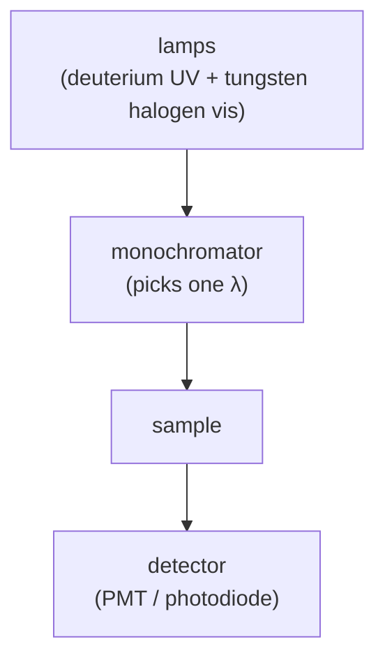

#vlsi #characterization #UV_vis #spectroscopy #bandgap
## UV-visible spectroscopy
shine light from the ultraviolet through the visible (~200–800 nm, often out to ~1100 nm or more) on a sample and measure **how much is transmitted, absorbed or reflected** at each wavelength. part of [[Metrology and nano-characterization workshop]]
- photons with enough energy excite **electrons** to higher levels (electronic transitions), unlike [[FTIR]] and [[Raman spectroscopy]] which are about vibrations
- in a semiconductor, a photon is absorbed once $E_{photon}\ge E_g$ → there's an **absorption edge**

each photon carries one packet of energy
$$
E\,[\text{eV}]=\frac{1240}{\lambda\,[\text{nm}]}
$$
^photon-energy

> [!eg] where's the edge?
> Si, $E_g=1.12$ eV: $\lambda=\frac{1240}{1.12}=1107$ nm, in the infrared. visible light (400–700 nm) has more energy than that, so ==Si absorbs all visible light (looks opaque) but lets IR through==
>
> ZnO, $E_g=3.3$ eV: $\lambda=\frac{1240}{3.3}=376$ nm, in the UV. visible light can't excite it, so ZnO looks **transparent**

> [!important] the one idea
> ==a photon is absorbed only if its energy matches a jump the electrons can make==. so the wavelength where absorption switches on tells you the size of the energy gap

## the setup

- **double beam**: the light is split into a sample beam and a **reference** beam, which cancels out lamp drift
- always measure a **baseline** (blank / bare substrate) first
## Beer–Lambert law
$$
A=-\log_{10}T=\varepsilon\,l\,c
$$
^beer-lambert

- $A$ → absorbance, $T$ → transmittance ($I/I_0$)
- $\varepsilon$ → molar absorptivity, $l$ → path length, $c$ → concentration
- so you can find concentration of a solution from a calibration curve
- works best for $A<1$ or so (above that too little light reaches the detector)

the log means the light dies away **exponentially** with distance: every extra bit of path takes away the same **fraction**

> [!eg] reading absorbance
> $$
> \begin{aligned}
> A=0.5:&\quad T=10^{-0.5}=0.316\ \ (31.6\%\text{ gets through})\\
> A=1:&\quad T=10^{-1}=0.1\ \ (10\%)\\
> A=2:&\quad T=10^{-2}=0.01\ \ (1\%)
> \end{aligned}
> $$
> double the concentration (or the path length) and $A$ doubles, but $T$ **squares**: $0.316\to0.1$

## for solids and films
- **transmittance** for transparent films on glass or quartz
- **reflectance** (with an integrating sphere for diffuse reflectance, powders)
- **interference fringes** in transmission / reflection of a thin film → thickness and refractive index
- for films, the absorption coefficient $\alpha$ from the film thickness $t$

$$
\alpha=\frac{1}{t}\ln\frac1T
$$
^absorption-coefficient

> [!eg] a 200 nm film lets 25% through
> $$
> \begin{aligned}
> \alpha&=\frac{1}{200\ \text{nm}}\ln\frac1{0.25}=\frac{\ln4}{200\times10^{-7}\ \text{cm}}\\
> &=\frac{1.386}{2\times10^{-5}\ \text{cm}}=6.9\times10^4\ \text{cm}^{-1}
> \end{aligned}
> $$
> (semiconductors above their gap are usually $10^4$–$10^5$ cm⁻¹, so this is strongly absorbing. for a real film, correct for reflection first)

## Tauc plot (finding the bandgap)
plot $(\alpha h\nu)^{1/n}$ against $h\nu$ and extend the straight line part down to the x-axis, the intercept is $E_g$
$$
(\alpha h\nu)^{1/n}=A\,(h\nu-E_g)
$$
^tauc

| $n$ | transition |
|---|---|
| $\frac12$ | **direct** allowed (eg. GaAs, ZnO) |
| $2$ | **indirect** allowed (eg. Si, Ge) |

for diffuse reflectance use **Kubelka–Munk**, $F(R)=\frac{(1-R)^2}{2R}$, in place of $\alpha$
> [!warning] pick the right $n$
> ==a wrong choice of direct / indirect gives a different $E_g$==. know what you're measuring

![[UV_vis_bandgap.png]]

(where the line hits zero: below $E_g$ the right side would be negative, which can't happen, so no absorption. that's the photon energy rule from the top)
## other things it shows
- **plasmon resonance** peaks in metal nanoparticles (Au ~520 nm)
- **excitons** in quantum dots and 2D materials (size dependent, smaller dot → bluer, quantum confinement, see [[#the quantum connection]])
- colour, optical transparency of coatings (eg. ITO)
## in VLSI / nano
- bandgap of new semiconductors, oxides and 2D materials
- transparency and thickness of films (ITO, dielectrics)
- solar cell materials ([[Photovoltaics]])
- nanoparticle size and concentration
- (to check a film's **crystal structure** too, pair it with [[XRD]]. eg. amorphous vs crystalline TiO₂ have different gaps)

> [!exercise] try these
> ① a solution has $A=0.8$. what fraction of light gets through? what if you use a cuvette twice as long?
> ② a film's Tauc plot (with $n=\frac12$) crosses zero at $h\nu=2.4$ eV. what's the gap, and what colour is the edge?
> ③ good optical fibre loses $0.2$ dB per km. a dB is $10\log_{10}\frac{P_{in}}{P_{out}}$, so what absorbance is that per km, and what's left after 100 km?

> [!answer]-
> ① $T=10^{-0.8}=0.158$ (15.8%). twice the path: $A=1.6$, $T=10^{-1.6}=0.025$ (2.5%)
> ② direct gap $E_g=2.4$ eV, edge at $\frac{1240}{2.4}=517$ nm, green. it absorbs blue/violet, so it looks yellow-orange
> ③ dB $=10\times A$, so $A=0.02$ per km. 100 km: $A=2$, $T=10^{-2}=1\%$ ([[Long-distance quantum communication#losing photons]])

## the quantum connection
> [!extra] quantum confinement is a particle in a box
> an electron squeezed into a dot of size $a$ is a [[Particle in a box]]
> ![[Particle in a box#^energy-levels]]
>
> ==make the dot smaller and the levels spread out ($E\propto\frac1{a^2}$), so the gap grows and the absorption edge moves to shorter, bluer wavelengths==
>
> eg. CdSe (bulk gap 1.74 eV, edge 713 nm, deep red). a dot with 0.3 eV of confinement energy: gap 2.04 eV, edge $\frac{1240}{2.04}=608$ nm (orange). halve its size → 4× the confinement, 1.2 eV: gap 2.94 eV, edge $\frac{1240}{2.94}=422$ nm (violet). same material, different colour, just from the size of the box

> [!extra] Beer–Lambert is the same law as fibre loss
> light dies away exponentially as it travels through the sample, just like photons in an optical fibre in [[Long-distance quantum communication#losing photons]] (exercise ③ above). that's why QKD in fibre stops at ~100 km and needs [[Quantum repeaters|repeaters]] further than that

> [!extra] it's counting single photons
> $E=\frac{1240}{\lambda}$ is **one** photon's energy, and the PMT detector works one photon at a time: the same particles of light used in [[Single Photon making and detecting|photonic quantum computing and QKD]]. the same formula gives the energy of the X-rays in [[XRD#where the X-rays come from|XRD]] (8 keV)

see also [[XRD]], [[REELS and other XPS modes|REELS]] (band gap from the surface), [[TEM]] (EELS also measures gaps), [[FTIR]], [[Raman spectroscopy]], [[Metrology and nano-characterization workshop]]

formulas: [[Spectroscopy formulas]]
