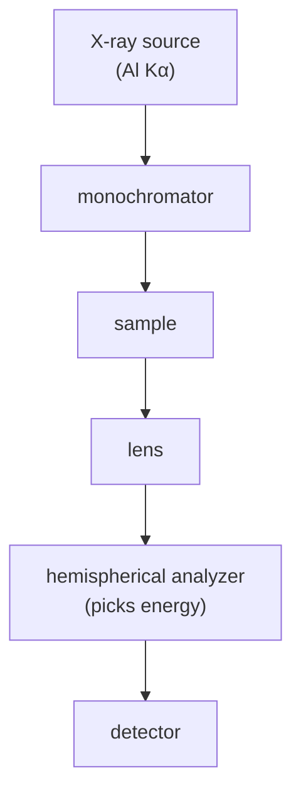

#vlsi #characterization #XPS #ESCA #spectroscopy
## X-ray photoelectron spectroscopy
shine **X-rays** on the surface, X-rays knock **electrons** out (photoelectric effect), measure the electrons' **kinetic energy** → tells you which element, and what **chemical state** it's in. also called ESCA. part of [[Metrology and nano-characterization workshop]]

> [!important] the one idea
> ==every electron in an atom sits at a fixed, quantized binding energy, so measuring how hard it was to pull one out tells you which atom it came from, and a small shift tells you what that atom is bonded to==

> [!tip] why bother
> a wafer can **look clean** and still have a chemical contamination or an oxide only a **few nm** thick. that thin layer can change contact resistance ([[Sheet resistance and contacts]]), interface quality ([[MOS capacitor C-V]]), process behaviour or even kill the device. XPS is the tool that sees exactly that layer

## where it comes from
- **Röntgen** found X-rays in 1895 (cathode rays hitting a heavy metal target)
- **Einstein** explained the photoelectric effect in 1905, which is the idea XPS is built on
- **Kai Siegbahn** and his group developed XPS in the 1960s, Nobel prize in Physics 1981

XPS = **photoelectric effect + the shell model** of the atom
## the physics
$$
KE=h\nu-BE-\phi
$$
^xps-energy

- $h\nu$ → X-ray photon energy (known)
- $BE$ → **binding energy** of the electron in its shell (this is what we want)
- $\phi$ → spectrometer work function (calibrated)
- measure $KE$, work out $BE$. each element has its own set of binding energies (1s, 2s, 2p...) so it's a fingerprint

![[XPS_principle.png]]

(it's energy bookkeeping: the photon's energy pays to free the electron from its shell ($BE$), then to get it out of the material ($\phi$), and whatever is left over is the electron's speed ($KE$))
### the energy levels
sample and spectrometer share the same **Fermi level** (they are electrically connected)
- **Fermi level** $E_F$ → the energy where the occupation probability is ½ (Fermi–Dirac, above 0 K)
- **vacuum level** → energy of a free electron at rest
- **work function** $\phi$ = vacuum level − Fermi level (measured directly with [[UPS#work function from the spectrum|UPS]])
- **binding energy** $BE$ = core level − Fermi level

![[XPS_energy_levels.png]]

> [!eg] two peaks with Al $K_\alpha$ ($h\nu=1486.6$ eV)
> Cu $2p_{3/2}$, $BE\approx932.6$ eV (before the work function correction)
> $$
> KE\approx1486.6-932.6=554.0\ \text{eV}
> $$
> Si 2p in $\text{SiO}_2$, $BE\approx103.5$ eV, with $\phi\approx4$ eV
> $$
> KE\approx1486.6-103.5-4\approx1379\ \text{eV}
> $$
> ==the deeper (more tightly bound) the electron, the slower it comes out==

### photoelectron vs Auger electron
after the photoelectron leaves there is a **vacancy**. an outer electron falls in and the released energy ejects a **second** electron (the **Auger electron**, eg. Cu LMM). its energy is set by the atom's own levels, **not by the X-ray energy**, so
- **photoelectron** peaks move when you change the X-ray source (fixed $BE$)
- **Auger** peaks stay at the same $KE$ (they look like they move on the $BE$ axis)

![[XPS_photoelectron_Auger.png]]

(the same "fill the hole, release the difference" happens in [[EDS]], except there the energy comes out as an X-ray)
## the X-ray source

| source | photon energy | notes |
|---|---|---|
| **Al $K_\alpha$** | 1486.6 eV | the standard. narrow line, good coverage of core levels, good surface sensitivity |
| **Mg $K_\alpha$** | 1253.6 eV | traditional alternative, lower energy → different core levels accessible, more surface sensitive |
| **Ag $L_\alpha$** | ≈2984 eV | **HAXPES**: deeper information depth ([[REELS and other XPS modes]]) |

^xps-sources

> [!eg] same peak, different source
> Si 2p ($BE\approx99$ eV), before the work function correction
> $$
> \begin{aligned}
> \text{Al:}\quad KE&\approx1486.6-99=1387.6\ \text{eV}\\
> \text{Mg:}\quad KE&\approx1253.6-99=1154.6\ \text{eV}
> \end{aligned}
> $$
> lower $KE$ means a shorter escape length, so the sampling depth changes too. (these are the same kind of X-rays as in [[XRD#where the X-rays come from|XRD]], just from an Al anode instead of Cu. with [[UV-vis spectroscopy#^photon-energy|E = 1240/λ]]: $\lambda=\frac{1240}{1486.6}=0.834$ nm, longer than Cu $K_\alpha$'s 0.154 nm)

## setup
![[XPS_instrument.png]]

- **ultra high vacuum** (~$10^{-9}$–$10^{-10}$ mbar) because the electrons must reach the detector and the surface must stay clean
- **monochromator** (a crystal) → narrows the X-ray line, removes satellites and Bremsstrahlung (it picks one wavelength with [[XRD#^bragg|Bragg's law]])
- **electron lens** collects the electrons, the analyzer lets only a chosen energy through (the **pass energy**)
- **load lock / fast entry** → change samples without breaking the UHV in the main chamber
- **flood gun** → low energy electrons (0–20 eV) to neutralize charging
- the machine in the lab is a Kratos **AXIS Supra**
## why it's so surface sensitive
X-rays go in microns, but the photoelectrons **can't get out** from deep. they lose energy to the material (inelastic mean free path ~1–3 nm), so only the top **~1–10 nm** counts

the probability that an electron from depth $z$ escapes **without losing energy**
$$
P(z)=e^{-z/(\lambda\cos\theta)}
$$
^escape-probability

$\theta$ is the emission angle measured from the surface normal. at normal emission, $P=e^{-z/\lambda}$

![[XPS_escape_depth.png]]
- at $z=\lambda$ → 37% left, at $3\lambda$ → **5%** left. that's why ==the information depth is ~3λ ≈ 5–10 nm==
- "10 nm" is not a hard wall: electrons from deeper can still escape, their peak is just very weak
- it's the same exponential as [[UV-vis spectroscopy#Beer–Lambert law|Beer–Lambert]], just for electrons instead of light

> [!eg] how much signal comes from the top 1 nm? ($\lambda=3$ nm, normal emission)
> $$
> \begin{aligned}
> \text{fraction from }0\text{ to }1\text{ nm}&=1-e^{-1/3}=1-0.717=0.28
> \end{aligned}
> $$
> so **28%** of the whole signal comes from the top 1 nm, about 3 atomic layers. ($\int_0^{d}e^{-z/\lambda}dz$ divided by $\int_0^\infty e^{-z/\lambda}dz$ is $1-e^{-d/\lambda}$)

## what you get
- **survey / wide scan** (eg. 0–1200 eV) → which elements are there (everything except **H and He**), ~0.1–1 atomic % detection. use it to find **which regions to zoom into**
- **high resolution scan** of one peak → the **chemical state**
- **chemical shift** → the same element at a different oxidation state sits at a different BE (more positive charge on the atom → higher BE)
	- Si 2p: elemental Si ~99.3–99.4 eV, $\text{SiO}_2$ ~103.3–103.5 eV
	- C 1s: C–C ~284.8, C–O ~286, C=O ~288, O–C=O ~289
- **quantification** → peak area ÷ sensitivity factor → atomic %
- **spin-orbit splitting** → p, d, f peaks come in **doublets** (eg. Si 2p$_{3/2}$ / 2p$_{1/2}$) with a fixed area ratio (p: 2:1, d: 3:2). why: see [[#the quantum connection]]

> [!eg] quantification (made-up peak areas, Kratos sensitivity factors)
>
> | peak | area | sensitivity factor | area ÷ factor | atomic % |
> |---|---|---|---|---|
> | O 1s | 3900 | 0.78 | 5000 | 41.7 |
> | Si 2p | 1640 | 0.328 | 5000 | 41.7 |
> | C 1s | 556 | 0.278 | 2000 | 16.7 |
>
> divide each by the total (12000). the raw O peak is 7× the C peak, but there's only 2.5× as much O: each element gives off electrons with a different efficiency

### worked example: a silicon wafer in air
![[XPS_survey_and_Si2p.png]]
- survey: **Si** (substrate), **O** (native oxide), **C** (dirt from the air), plus an Auger group (O KLL)
- ==there is **no peak called "SiO₂"**==. it's a compound, not an element. the wide scan only shows Si 2p and O 1s. the oxide only shows up as a shifted component in the **Si 2p high resolution** scan (Si$^0$, Si$^{1+}$, Si$^{2+}$, Si$^{3+}$, Si$^{4+}$)
- **why carbon on a wafer?** adventitious carbon, a thin layer of carbon-containing molecules that sticks to anything exposed to air. detecting C 1s does **not** mean there is carbon inside the wafer, XPS is so surface sensitive that a tiny bit of contamination shows up clearly
- **after an Ar⁺ etch**: C 1s and O 1s drop, Si 2p goes up, and the SiO$_x$ shoulder shrinks (you removed the top layer)
## resolution
the measured peak width is a combination of several things
$$
\Delta E_{total}\approx\sqrt{\Delta E_{source}^2+\Delta E_{natural}^2+\Delta E_{analyzer}^2}
$$
^xps-resolution

- **X-ray source linewidth**: Al $K_\alpha$ unmonochromated ~0.85 eV (also has $K_{\alpha1,2}$ and satellite lines), Mg $K_\alpha$ ~0.70 eV, **monochromated Al ~0.25–0.30 eV**
- **natural linewidth** of the core level and the chemical environment
- **analyzer**: lower **pass energy** → better resolution but less signal (200 eV → ~1 eV, 10 eV → ~0.3 eV)

> [!eg] does the monochromator matter? (natural 0.3 eV, analyzer 0.4 eV)
> $$
> \begin{aligned}
> \text{no monochromator:}\quad\Delta E&\approx\sqrt{0.85^2+0.3^2+0.4^2}=\sqrt{0.9725}\approx0.99\ \text{eV}\\
> \text{monochromated:}\quad\Delta E&\approx\sqrt{0.27^2+0.3^2+0.4^2}=\sqrt{0.3229}\approx0.57\ \text{eV}
> \end{aligned}
> $$
> the biggest term wins in a square root sum, so shrink the biggest one first. 0.57 eV easily separates Si$^0$ and Si$^{4+}$ (~4 eV apart), and starts to separate the Si 2p doublet (0.6 eV apart)

![[XPS_resolution.png]]

monochromated Al $K_\alpha$ is the popular combination: narrow line, good signal, practical
## angle resolved XPS (ARXPS)
how thick is the **native oxide** on silicon **without sputtering**? tilt the sample and change the emission angle $\theta$
- Si 2p comes from two places: **Si⁴⁺** in the oxide and **Si⁰** in the substrate
- at $\theta=0^\circ$ the path through the oxide is the shortest ($L=d$), many substrate electrons escape
- at larger $\theta$ the path is $L=d/\cos\theta$, the substrate peak is **attenuated more** → the measurement is more surface sensitive

| emission angle | path through a 2 nm oxide |
|---|---|
| 0° | $2/\cos0^\circ=2$ nm |
| 60° | $2/\cos60^\circ=4$ nm |
| 75° | $2/\cos75^\circ=7.73$ nm |

attenuation is exponential, with $\lambda$ the **effective attenuation length (EAL)** (~3 nm for Si 2p in $\text{SiO}_2$; NIST has a database)
$$
I_{Si^0}(\theta)=I_{Si^0,0}\,e^{-d/(\lambda\cos\theta)}
$$
**method 1: substrate peak ratio**
$$
R=\frac{I(60^\circ)}{I(0^\circ)}=e^{-d/\lambda}\ \Rightarrow\ d=-\lambda\ln R
$$
^arxps-ratio

> [!eg]- example
> $R=0.513$, $\lambda=3$ nm
> $$
> d=-3\ln(0.513)=-3\times(-0.668)\approx2.00\ \text{nm}
> $$
> (why $e^{-d/\lambda}$: at 0° the exponent is $\frac d\lambda$, at 60° it's $\frac{d}{\lambda\cos60^\circ}=\frac{2d}\lambda$, so the ratio is $e^{-2d/\lambda}/e^{-d/\lambda}=e^{-d/\lambda}$)

**method 2: oxide-to-substrate ratio** (uses both peaks, plot a straight line)
$$
\ln\!\left(1+\frac R{R_\infty}\right)=\frac d\lambda\cdot\frac1{\cos\theta}\qquad R=\frac{I_{SiO_2}}{I_{Si^0}}
$$
^arxps-overlayer

slope $m=d/\lambda$. a line through the origin means a **uniform** oxide, a curved line means rough or graded layers

![[XPS_ARXPS.png]]
> [!eg]- example
> $m=0.57$, $\lambda=3.5$ nm → $d=0.57\times3.5\approx2.0$ nm

## depth profiling
alternate **sputtering** (Ar$^+$ ion beam etches the surface a bit) and scanning → composition vs depth through a film stack. can damage / change the chemistry (the same collision cascade as in an [[FIB#what the ion does to the sample|FIB]]), so use cluster ($\text{Ar}_n^+$) sources for delicate stuff. or [[#angle resolved XPS (ARXPS)]] for the top few nm without sputtering

![[XPS_depth_profile.png]]
> [!example]- case study: is a 100 nm ITO film uniform?
> acquire at **each etch step**: a survey (In, Sn, O, Si, Na, Ca, C) plus high resolution scans of In 3d, Sn 3d, O 1s, C 1s. the profile shows **surface carbon**, a flat plateau for In/Sn/O, then Si, Na and Ca rise at the **glass interface**
> - Ar⁺ can **preferentially sputter** O or Sn and change the measured composition
> - calibrate sputter time to depth with a profilometer or a cross-section [[TEM]]
> - interpret trends carefully, check for ion damage

> [!example]- case study: gold (why gold manufacturers use XPS)
> - **Au electrodes**: survey before and after UV-ozone cleaning shows how much surface contamination was removed
> - **Au thin films**: thermal evaporation vs sputtering give different **interdiffusion** at the Au/substrate interface (the depth profile shows it) → adhesion and device performance
> - **unexpected elements**: eg. **sodium** (Na 1s ~1071 eV) found on gold, traced to handling, the crucible or the source

## practical stuff
- **charging** on insulators → peaks shift. use a **flood gun** (low energy electrons) and then calibrate by setting adventitious carbon C 1s to 284.8 eV
- Auger peaks also appear in the spectrum (see above)
- sample must be vacuum compatible
## other modes
[[UPS]] (UV light, valence band + work function), REELS, IPES, XPS imaging, ISS and HAXPES are covered in [[REELS and other XPS modes]]
## vs [[EDS]]

| | XPS | EDS |
|---|---|---|
| excitation | X-rays | electrons |
| depth | ~1–10 nm | ~µm |
| chemical state | yes | no |
| spatial resolution | ~10 µm (up to ~few µm) | ~1 µm in [[SEM]] |
| light elements | yes (except H, He) | poor |

## in VLSI
- gate oxide / high-k composition and thickness (then check it electrically with [[MOS capacitor C-V]])
- native oxide on Si, surface cleaning checks
- interface chemistry in a film stack
- contamination after etch (polymer residue), barrier layers
- unexplained poor contact resistance ([[Sheet resistance and contacts#how contact formation can go wrong]]) or a delaminating coating
- work function / band alignments (with [[UPS]])

> [!exercise] try these
> ① with Mg $K_\alpha$ you see a peak at $KE=964.3$ eV ($\phi=4.5$ eV). what's its binding energy, and what element could it be?
> ② you switch from Al to Mg and a peak stays at the same $KE$. what is it?
> ③ what fraction of the signal comes from deeper than 6 nm, if $\lambda=2$ nm?
> ④ a Si 2p spectrum has peaks at 99.4 eV and 103.4 eV. what's on the surface?
> ⑤ ARXPS gives $R=0.70$ with $\lambda=3$ nm. how thick is the oxide?

> [!answer]-
> ① $BE=1253.6-964.3-4.5=284.8$ eV: C 1s, the adventitious carbon that's on everything
> ② an **Auger** peak: its $KE$ only depends on the atom
> ③ $e^{-6/2}=e^{-3}=0.05$, so 5% ([[#^escape-probability]])
> ④ silicon (99.4) with a native $\text{SiO}_2$ on top (103.4, the Si$^{4+}$ state, shifted +4 eV)
> ⑤ $d=-3\ln0.70=-3\times(-0.357)=1.07$ nm

## the quantum connection
> [!extra] the photoelectric effect is where photons came from
> Einstein's 1905 explanation was that light comes in **packets**: one photon gives all its energy $h\nu$ to **one** electron, and if $h\nu$ is too small nothing comes out, however bright the light. that's exactly $KE=h\nu-BE-\phi$. ==XPS is the photoelectric effect used as a measuring tool==, and those packets are the same photons used in [[Single Photon making and detecting|photonic quantum computing]]

> [!extra] binding energies are quantized energy levels
> an electron in an atom can only sit at certain energies (1s, 2s, 2p...), like the levels of a [[Particle in a box]] ($E_n\propto n^2$) but for the atom's own potential. the energy of a state is an **eigenvalue** of the [[Hamiltonian]], and XPS measures it directly. a chemical shift is the Hamiltonian changing a little because the neighbours pulled some charge away

> [!extra] the doublets are spin
> an electron has **spin ½**, a two-level system just like a qubit ([[Bloch sphere]]). in a p orbital ($l=1$) the spin can line up with the orbital motion or against it, giving total $j=l\pm\frac12$: $\frac32$ or $\frac12$. those have slightly different energies (spin-orbit coupling), so the peak splits in two. the area ratio is just **how many states** each has ($2j+1$)
> $$
> \begin{aligned}
> p:&\quad\frac{2(\tfrac32)+1}{2(\tfrac12)+1}=\frac42=2:1\\
> d:&\quad\frac{2(\tfrac52)+1}{2(\tfrac32)+1}=\frac64=3:2\\
> f:&\quad\frac{2(\tfrac72)+1}{2(\tfrac52)+1}=\frac86=4:3
> \end{aligned}
> $$
> s orbitals have $l=0$, so no orbital motion to couple to, so **no** doublet. some qubits (single donor atoms in silicon, see [[FIB#the quantum connection]]) store information in exactly this electron spin

see also [[UPS]], [[REELS and other XPS modes]], [[EDS]], [[XRD]], [[UV-vis spectroscopy]], [[Metrology and nano-characterization workshop]]

formulas: [[Spectroscopy formulas]]
