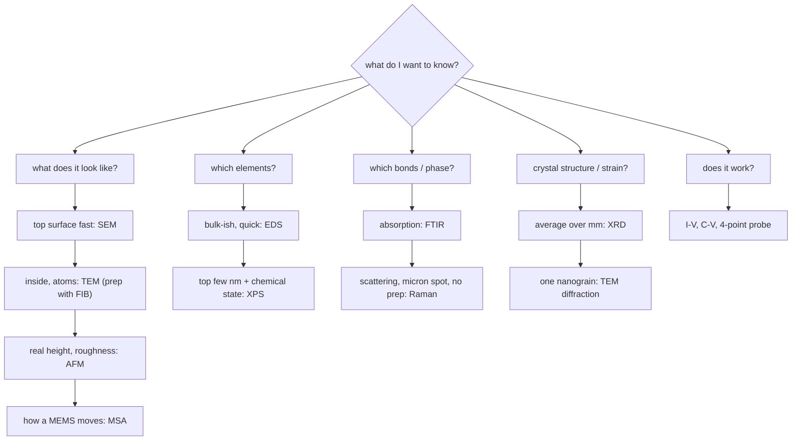

#vlsi #characterization #cheatsheet #revision
## technique comparison cheat sheet
one page to revise from. details are in each technique's note, formulas in [[Microscopy formulas]], [[Spectroscopy formulas]], [[Diffraction formulas]], [[Electrical formulas]]. part of [[Metrology and nano-characterization workshop]]

> [!important] the pattern
> ==every technique is: shoot something at the sample, see what comes out, and read the answer from its energy, angle or amount==

## side by side

| technique | probe in | what comes out | tells you | depth / area | vacuum? | the quantum idea |
|---|---|---|---|---|---|---|
| [[SEM]] | electrons | secondary / backscattered e⁻ | surface shape, composition contrast | surface, ~nm resolution | yes | electrons are waves |
| [[TEM]] | electrons | transmitted e⁻ | internal structure, atoms, diffraction | thin lamella (<100 nm) | yes | the lens does a Fourier transform |
| [[FIB]] | Ga⁺ ions | sputtered atoms, e⁻ | cut, image, make lamellae, deposit | µm to tens of µm | yes | placing single atoms as qubits |
| [[AFM]] | sharp tip | force | true 3D height, roughness | surface, ~nm lateral, <0.1 nm vertical | no (air OK) | STM tunnelling, Pauli repulsion |
| [[MSA]] | laser / white light | Doppler shifted / interfering light | MEMS motion, resonance, 3D shape | the device | no | interferometers, $Q$ |
| [[EDS]] | electrons | X-rays | elements | ~µm | yes (in SEM) | Bohr levels (Moseley) |
| [[XPS]] | X-rays | photoelectrons | elements + chemical state | top 1–10 nm | UHV | photoelectric effect, spin doublets |
| [[UPS]] | UV photons | valence electrons | work function, valence band | top few nm | UHV | Pauli exclusion (Fermi edge) |
| [[REELS and other XPS modes\|REELS]] | electrons | reflected e⁻ that lost energy | band gap of the surface | top few nm | UHV | energy lost in quanta |
| [[FTIR]] | IR | absorbed IR | bonds, functional groups | µm (ATR) to bulk | no | quantized vibrations |
| [[Raman spectroscopy]] | laser | inelastic light | bonds, phase, stress, crystallinity | ~1 µm spot | no | phonons |
| [[UV-vis spectroscopy]] | UV/visible | transmitted light | band gap, absorption | bulk film | no | particle in a box |
| [[XRD]] | X-rays | diffracted X-rays | crystal phase, strain, texture, thickness (XRR) | mm area, µm depth | no | Fourier transform, period finding |
| [[Electrical characterization]] | voltage | current | does it work: $V_{th}$, $R_{sh}$, leakage | the device | no | tunnelling, transmons, spin qubits |

## which technique answers my question?

## the pairs people confuse

| pair | difference |
|---|---|
| [[FTIR]] vs [[Raman spectroscopy]] | IR needs a change in **dipole**, Raman a change in **polarizability**. complementary |
| [[EDS]] vs [[XPS]] | EDS: electrons in, ~µm deep, no chemical state. XPS: X-rays in, top ~nm, gives oxidation state |
| [[XRD]] vs [[TEM]] diffraction | same Bragg idea. XRD averages over mm, TEM looks at one nanoscale spot |
| [[SEM]] vs [[AFM]] | SEM: fast, large area, 2D image. AFM: slow, real height, works on insulators in air |
| [[XPS]] vs [[UPS]] | X-rays reach core levels (composition), UV only valence levels (work function) |
| [[UV-vis spectroscopy]] vs [[REELS and other XPS modes\|REELS]] | both give a band gap: UV-vis through the whole film (photons), REELS from the surface (electrons) |
| contact vs non-contact vs tapping AFM | force vs amplitude feedback, damage vs gentleness ([[AFM#^afm-modes]]) |
| two-point vs four-point | four-point removes contact resistance, see [[Sheet resistance and contacts]] |
| low vs high frequency C–V | minority carriers follow / don't follow the AC signal ([[MOS capacitor C-V#low vs high frequency]]) |

## numbers worth remembering

| quantity | value |
|---|---|
| Cu $K_\alpha$ | 1.5406 Å, 8.05 keV (XRD, and EDS of Cu) |
| Al $K_\alpha$ | 1486.6 eV (XPS) |
| He I / He II | 21.22 / 40.81 eV (UPS) |
| electron λ at 200 kV | 2.51 pm (TEM) |
| crystalline Si Raman peak | 520.7 cm⁻¹ |
| Si 2p (Si⁰ / SiO₂) | ~99.4 / ~103.5 eV |
| C 1s reference | 284.8 eV |
| thermal limit of SS | 60 mV/dec at 300 K |
| four-point probe factor | $\pi/\ln2\approx4.532$ |
| FTIR range | 4000–400 cm⁻¹ |
| XPS information depth | ~3λ ≈ 5–10 nm |
| Si band gap | 1.12 eV |
| $E$ [eV] from λ [nm] | $1240/\lambda$ |
| resistance quantum | $h/e^2=25.8$ kΩ |

> [!exercise] quick fire
> ① you need to know if a 2 nm film on a wafer is oxidized. which technique?
> ② you need the strain in one 50 nm grain. which?
> ③ which two techniques give a work function?
> ④ which two give a band gap, and which only sees the surface?

> [!answer]-
> ① [[XPS]] (top few nm, chemical state)
> ② [[TEM]] diffraction (XRD averages over mm). or Raman if a ~1 µm average is OK
> ③ [[UPS]] and KPFM ([[AFM]])
> ④ [[UV-vis spectroscopy]] and [[REELS and other XPS modes|REELS]]. REELS is surface only

see also [[Glossary]], [[Metrology and nano-characterization workshop]]
