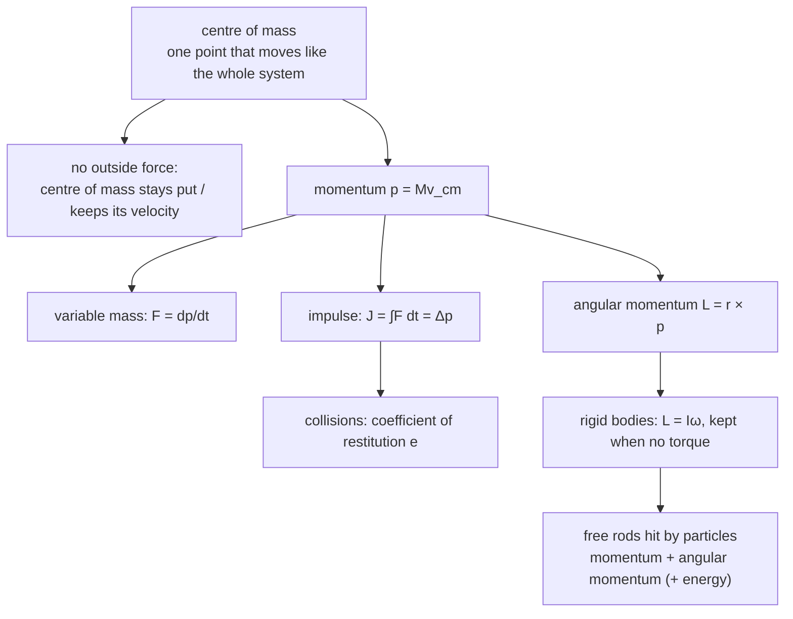

#mechanics #centre_of_mass #momentum #angular_momentum
## centre of mass, momentum and rotation
class 11 physics (IIT prep). how a whole system moves (its **centre of mass**), how momentum changes when mass is added or lost or a force acts for a short time (**impulse**), and how things **turn** (**angular momentum**)

## the notes
### centre of mass
- [[Centre of mass]]: position, velocity and acceleration of the centre of mass
- [[Centre of mass at rest]]: man on a boat, monkey on a plank, ball in a bowl, block on a free track, exploding shells
- [[Centre of mass of continuous bodies]]: the integrals, and the results for arcs, sectors, hemispheres, cones
### momentum
- [[Variable mass systems]]: $F=\frac{dp}{dt}$ with changing mass, bullets on a wall, pebbles in a pan, carts gaining and losing sand
- [[Impulse]]: $J=\int F\,dt$, from $x$–$t$ and $F$–$t$ graphs
- [[Coefficient of restitution]]: bouncing balls, moving walls, oblique hits
### angular momentum
- [[Angular momentum]]: $L=r\times p$, a projectile, $L=I\omega$, conservation, particles sticking to discs and rods
- [[Free rod collisions]]: rods on a smooth table hit by particles, the hockey puck, a rod picking up a particle

## also
- [[Rotational mechanics formulas]]: every formula on one page
- [[Work, energy and power]]: the chapter before (collisions start there)
