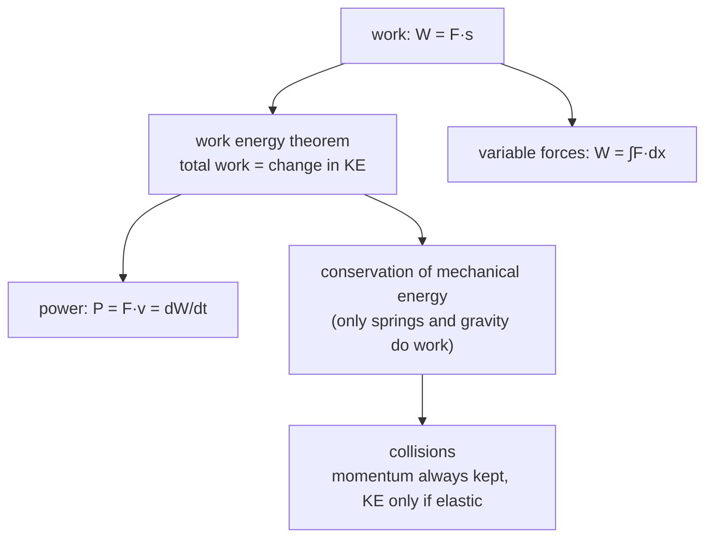

#mechanics #work #energy #power #collision
## work, energy and power
class 11 physics (IIT prep). how forces move energy around: **work** is energy put in or taken out by a force, **power** is how fast that happens, and **collisions** are where momentum is kept but kinetic energy might not be

## the notes
### work
- [[Work done by a force]]: the dot product, sign of the work, which forces do zero work
- [[Work-energy theorem]]: total work = change in KE, with 4 block problems (floor and slopes)
- [[Work by a variable force]]: the integral, $F(x)$ problems, the slowly lifted pendulum
### power
- [[Power]]: instantaneous and average power, $x=t^3/6$, the projectile
- [[Power in circular motion]]: only the tangential force does work, KE given as a function of $t$ or $s$
### energy
- [[Conservation of mechanical energy]]: springs between walls, springs on a ring, curved tracks, a rough patch, a block placed on a pan
- [[Leaving a circular track]]: $N=0$ at $\sin\theta=\frac23$, then the projectile part
- [[Chain sliding off a table]]: a chain with friction, done with integrals
### collisions
- [[Perfectly inelastic collisions]]: bullets in blocks, with horizontal and vertical springs
- [[Elastic collisions]]: $e=1$, equal masses swap velocities
- [[Two blocks and a spring]]: max compression when both move at the same speed, then SHM

## also
- [[Work energy and power formulas]]: every formula on one page
- [[Rotational mechanics]]: the next chapter (centre of mass, impulse, angular momentum)
