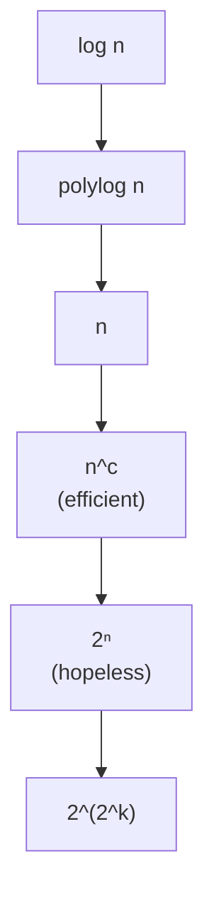

#math #complexity #logarithms
how to talk about how fast something **grows**, ignoring the details. used for run times ([[HHL algorithm]]), memory ([[Gottesman-Knill theorem]]) and the cost of fault tolerance ([[Cost of fault tolerance]])
## what $O(\cdot)$ means
$f(n)=O(g(n))$ means that for big $n$, $f$ grows **no faster** than $g$, up to a constant factor. you throw away constants and the smaller terms

eg. $3n^2+100n+7=O(n^2)$: for big $n$ the $n^2$ term wins, and the 3 doesn't matter
## the usual suspects, slowest to fastest

| name | looks like | doubling $n$ does | example in the notes |
|---|---|---|---|
| logarithmic | $\log n$ | adds a constant | qubits to hold $N$ numbers, $\log_2N$ |
| polylogarithmic | $(\log n)^c$ | adds a little | the fault-tolerance overhead $\text{polylog}(N/\epsilon)$ |
| linear | $n$ | doubles it | classical linear solvers in $N$ |
| polynomial | $n^c$ | multiplies by $2^c$ | Gottesman-Knill, $O(n^2m)$ |
| exponential | $2^n$ | **squares** it | a state vector, $2^n$ amplitudes |
| doubly exponential | $2^{2^k}$ | astronomically more | recursion error $(cp)^{2^k}$ shrinking |

^growth-table

> [!important] the one idea
> ==polynomial is "efficient", exponential is "hopeless"==. a quantum speed up usually means turning an exponential (or big polynomial) cost into a polynomial (or polylog) one
## logarithm rules
the ones the notes use ([[Probability and expectation values#log₂]] has the basics)
$$
\begin{aligned}
\log(ab)&=\log a+\log b\qquad\log(a^c)=c\log a\\
\log_ba&=\frac{\log a}{\log b}\qquad d^k=2^{k\log_2d}=(2^k)^{\log_2d}
\end{aligned}
$$
^log-rules

the last one is how [[Cost of fault tolerance#the total size]] turns $d^k$ gates into a power of $2^k$. changing the base of a log only changes it by a constant, so in $O(\cdot)$ the base doesn't matter
## exponential vs doubly exponential
> [!eg] why recursion wins
> each level of recursion multiplies the circuit by 6 (exponential in $k$) but squares $cp$ (doubly exponential in $k$). with $cp=0.1$:
>
> | $k$ | gates $6^k$ | error $\propto(0.1)^{2^k}$ |
> |---|---|---|
> | 1 | 6 | $10^{-2}$ |
> | 2 | 36 | $10^{-4}$ |
> | 3 | 216 | $10^{-8}$ |
> | 4 | 1296 | $10^{-16}$ |
>
> the cost grows by 6× a level, the error shrinks by more and more each level

> [!exercise] try these
> ① simplify $O(5n^3+n^2\log n)$
> ② how many qubits to hold $10^{12}$ numbers in amplitudes?
> ③ rewrite $6^k$ as a power of $2^k$

> [!answer]-
> ① $O(n^3)$
> ② $\log_2(10^{12})=12\log_2 10\approx39.9$, so 40 qubits
> ③ $6^k=(2^k)^{\log_26}=(2^k)^{2.58}$

see also [[Math]], [[Counting and the binomial distribution]], [[Cost of fault tolerance]]
