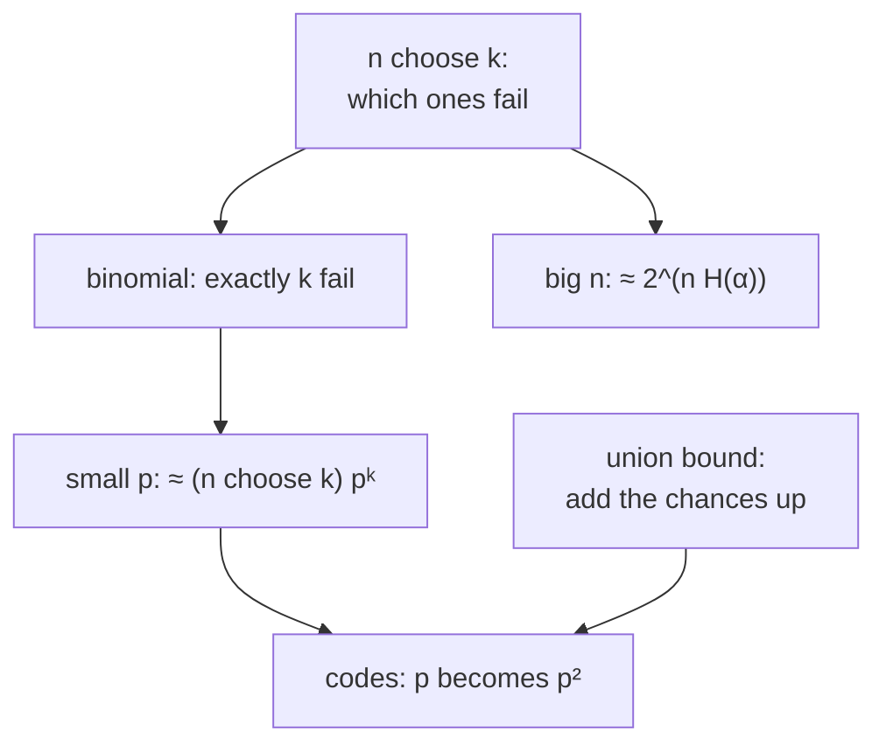

#math #probability #combinatorics
how to count the ways things can go wrong. behind every $3p^2$, $15p^2$ and $\binom{79}2$ in the error correction notes
## choosing
$\binom nk$ ("$n$ choose $k$") is the number of ways to pick $k$ things out of $n$, ignoring order
$$
\binom nk=\frac{n!}{k!\,(n-k)!}\qquad\binom n0=1,\quad\binom n1=n,\quad\binom n2=\frac{n(n-1)}2
$$
^binomial-coefficient

eg. $\binom31=3$ (which of 3 qubits flipped), $\binom62=15$ (which 2 of the 6 gates in the [[Fault-tolerant NAND gate]] failed), $\binom{79}2=3081$ ([[Quantum threshold estimate]])
## the binomial distribution
$n$ independent things (bits, qubits, gates), each going wrong with probability $p$. the chance that **exactly** $k$ go wrong is
$$
P(k)=\binom nk\,p^k(1-p)^{n-k}
$$
^binomial-distribution

pick which $k$ fail ($\binom nk$ ways), they fail ($p^k$), the rest don't ($(1-p)^{n-k}$). ([[Probability and expectation values]])

> [!eg] the 3 bit repetition code
> it fails if 2 or 3 bits flip
> $$
> P(2)+P(3)=\binom32p^2(1-p)+\binom33p^3=3p^2(1-p)+p^3=3p^2-2p^3
> $$
> which is [[Introduction to quantum error-correction#^repetition-error]]
## small $p$: keep the first term
when $p$ is small, $(1-p)^{n-k}\approx1$ and the smallest $k$ dominates, so
$$
P(\text{at least }k\text{ fail})\approx\binom nk\,p^k\qquad(p\ll1)
$$
^small-p

> [!important] the one idea
> ==a code that survives any $k-1$ failures fails with probability about $\binom nk\,p^k$==. the power of $p$ is what matters: going from $p$ to $p^2$ is huge when $p$ is small. that's the whole game in [[Bit flip code#when does the code fail?]] and the [[Threshold theorem]]
## the union bound
for any events, the chance that **at least one** happens is at most the sum of their chances
$$
P(A_1\text{ or }A_2\text{ or }\dots\text{ or }A_N)\leq P(A_1)+P(A_2)+\dots+P(A_N)
$$
^union-bound

it overcounts the times when several happen together, but it's always safe. it's why giving each of $N$ gates an error budget of $\frac\epsilon N$ keeps the whole circuit's error below $\epsilon$ ([[Cost of fault tolerance#how good each gate has to be]]), and why counting all $\binom62=15$ pairs gives a safe bound for the NAND gate
## counting with entropy
for big $n$, the number of strings with at most $\alpha n$ ones ($\alpha\leq\frac12$) is roughly $2$ to the power $n$ times the binary [[Shannon entropy]]
$$
\sum_{j=0}^{\alpha n}\binom nj\leq2^{nH(\alpha)}\qquad H(\alpha)=-\alpha\log_2\alpha-(1-\alpha)\log_2(1-\alpha)
$$
^entropy-count

this is how the [[Classical linear codes#the Gilbert-Varshamov bound|Gilbert-Varshamov bound]] gets its $H\big(\frac{2t}n\big)$

> [!exercise] try these
> ① 5 bits, each flips with $p=0.1$. chance of exactly 2 flips?
> ② a code survives any single failure among 7 gates, $p=10^{-3}$. roughly how often does it fail?
> ③ 1000 gates, each fails with $10^{-6}$. bound the chance that any fails

> [!answer]-
> ① $\binom52(0.1)^2(0.9)^3=10\times0.01\times0.729=0.0729$
> ② $\binom72p^2=21\times10^{-6}=2.1\times10^{-5}$
> ③ $1000\times10^{-6}=10^{-3}$ by the union bound

see also [[Math]], [[Probability and expectation values]], [[Big O notation]]
