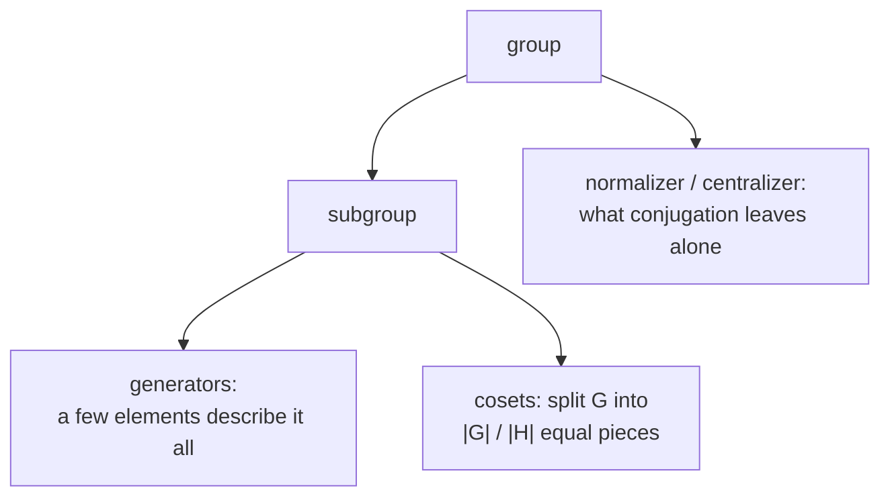

#math #group_theory
the bit of group theory the stabilizer notes use: groups, generators, subgroups and cosets. no more than that
## what a group is
a **group** is a set $G$ with a way to multiply two elements, such that
1. **closed**: multiplying two elements gives another element of $G$
2. **associative**: $(ab)c=a(bc)$
3. there's an **identity** $e$ with $ea=ae=a$
4. every element has an **inverse** $a^{-1}$ with $aa^{-1}=e$

if also $ab=ba$ for all elements, it's **abelian** (commutative)

| group | elements | multiply by | abelian? |
|---|---|---|---|
| bit strings $Z_2^n$ | all $n$ bit strings | bitwise XOR ([[Modular arithmetic#mod 2 and XOR]]) | yes |
| the Pauli group $G_1$ | $\pm I,\pm iI,\pm X,\dots,\pm iZ$ (16 of them) | matrix multiplication | no ($XZ=-ZX$) |
| a stabilizer $S$ | Pauli strings that all commute | matrix multiplication | yes |
| unitaries $U(2)$ | all $2\times2$ unitaries | matrix multiplication | no |

^group-examples

(the $\pm1,\pm i$ in the Pauli group are there so it's **closed**: $XY=iZ$ needs the $i$, see [[Pauli matrices#^pauli-products]])
## subgroups and generators
a **subgroup** is a subset that's a group by itself (closed, with the identity and inverses). eg. $\{I,Z_1Z_2,Z_2Z_3,Z_1Z_3\}$ inside the 3 qubit Pauli group

elements $g_1,\dots,g_l$ **generate** $G$ if every element is a product of them: $G=\langle g_1,\dots,g_l\rangle$. eg. $\{I,Z_1Z_2,Z_2Z_3,Z_1Z_3\}=\langle Z_1Z_2,Z_2Z_3\rangle$, since $Z_1Z_3=(Z_1Z_2)(Z_2Z_3)$ and $I=(Z_1Z_2)^2$

> [!important] the one idea
> ==a few generators describe a whole group==: if every element squares to $e$ and they commute, $l$ independent generators give $2^l$ elements. that's why a stabilizer code is described by $n-k$ operators instead of a huge list ([[The stabilizer formalism]])
## cosets
for a subgroup $H$ of $G$ and an element $a$, the **coset** $a+H$ (or $aH$) is everything you get by combining $a$ with each element of $H$. two cosets are either **identical** or **share nothing**, so the cosets split $G$ into equal pieces
$$
\text{number of cosets}=\frac{|G|}{|H|}
$$
^lagrange

(**Lagrange's theorem**: so $|H|$ always divides $|G|$)

> [!eg] cosets of a code
> $G=Z_2^3$ (8 strings), $H=\{000,111\}$. the cosets are $\{000,111\}$, $\{001,110\}$, $\{010,101\}$, $\{100,011\}$: $\frac82=4$ of them. these are exactly the bit flip code's four syndromes, each coset is "the code with one particular error added". in [[Calderbank-Shor-Steane codes]], the cosets of $C_2$ inside $C_1$ are the logical states
## conjugation, normalizer, centralizer
**conjugating** $h$ by $g$ means $ghg^{-1}$ (for unitaries, $ghg^\dagger$)
- the **normalizer** $N(S)$ of a subgroup $S$: the $g$ with $gSg^{-1}=S$ (conjugating sends $S$ to itself)
- the **centralizer** $Z(S)$: the $g$ that **commute** with every element of $S$ (conjugating leaves each one fixed)

for stabilizers they're the same set, and it's the set of **logical operators** ([[Stabilizer code constructions#which errors are a problem?]]). the normalizer of the whole Pauli group is the [[Clifford group]]

> [!exercise] try these
> ① is $\{I,X\}$ a subgroup of the Pauli group? what about $\{I,X,Z\}$?
> ② how many elements does $\langle Z_1Z_2,\ Z_2Z_3,\ Z_3Z_4\rangle$ have?
> ③ how many cosets does a $[7,3]$ code have inside a $[7,4]$ code?

> [!answer]-
> ① $\{I,X\}$: yes ($X^2=I$). $\{I,X,Z\}$: no, $XZ=-iY$ isn't in it
> ② 3 independent commuting generators that square to $I$: $2^3=8$
> ③ $\frac{2^4}{2^3}=2$: the two logical states of the Steane code

see also [[Math]], [[Pauli matrices]], [[Linear algebra mod 2]], [[Stabilizer codes]]
