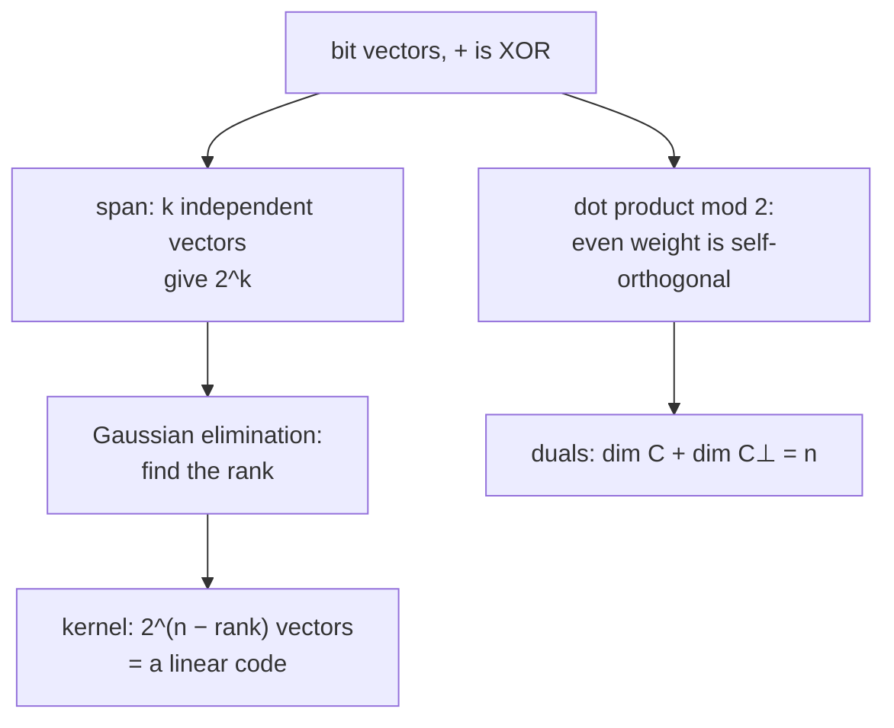

#math #linear_algebra #modular_arithmetic #linear_codes
the same linear algebra as usual (vectors, span, independence, kernels), but with bits, where $1+1=0$. it's the language of [[Classical linear codes]] and the check matrices of [[Stabilizer codes]]
## bit vectors
a vector is a string of bits, eg. $x=(1,0,1,1)$. adding is bitwise XOR ([[Modular arithmetic#mod 2 and XOR]]), and the only numbers to multiply by are 0 and 1
$$
(1,0,1,1)+(1,1,0,1)=(0,1,1,0)\qquad x+x=0
$$
^mod2-addition

so subtracting is the same as adding ($-1=1$), which is why the books write $-A=A$
## span and independence
the **span** of some vectors is everything you can get by adding some of them together. vectors are **linearly independent** if no non-empty set of them adds to $0$. $k$ independent vectors span exactly $2^k$ vectors (each one is either in the sum or not)
$$
k\text{ independent vectors}\ \longrightarrow\ 2^k\text{ vectors in their span}
$$
^mod2-span

> [!eg] are $110$, $011$, $101$ independent?
> $110+011=101$, so the third is the sum of the first two: **dependent**. the first two are independent, so the span has $2^2=4$ vectors: $000,110,011,101$ (all the even weight strings)
## Gaussian elimination
the usual row reduction works, just with XOR. to reduce a matrix
1. find a row with a 1 in the first column, and swap it to the top
2. add that row to every other row with a 1 in that column (XOR clears it)
3. move to the next column and repeat

> [!eg] reduce $\begin{bmatrix}1&1&0\\1&0&1\\0&1&1\end{bmatrix}$
> row 2 has a 1 in column 1, so add row 1 to it: $(1,0,1)+(1,1,0)=(0,1,1)$. now rows 2 and 3 are both $(0,1,1)$, add row 2 to row 3: $(0,0,0)$
> $$
> \begin{bmatrix}1&1&0\\0&1&1\\0&0&0\end{bmatrix}
> $$
> rank 2: only 2 independent rows

the number of nonzero rows left is the **rank**. it's how [[Standard form and stabilizer circuits|the standard form]] of a check matrix is found
## kernel and dimension
the **kernel** of a matrix $H$ is every $x$ with $Hx=0$. if $H$ has $n$ columns and rank $r$, the kernel has dimension $n-r$, so $2^{n-r}$ vectors. that's exactly a linear code: an $(n-k)\times n$ parity check matrix with independent rows has a $2^k$ element kernel ([[Classical linear codes#^parity-check]])

> [!eg] the repetition code
> $H=\begin{bmatrix}1&1&0\\0&1&1\end{bmatrix}$: $Hx=0$ needs $x_1=x_2$ and $x_2=x_3$, so $x=000$ or $111$. $n=3$, rank 2, kernel $2^{3-2}=2$ ✓
## dot products and orthogonality
$x\cdot y=x_1y_1+\dots+x_ny_n$ mod 2: the **parity** of the number of places where both are 1. $x$ and $y$ are **orthogonal** if $x\cdot y=0$

> [!important] the odd one
> ==a nonzero vector can be orthogonal to itself==: $x\cdot x$ is the parity of its weight, so every even weight string is self-orthogonal ($110\cdot110=1+1=0$). that's why a code can contain its own dual ($C^\perp\subseteq C$), which is the trick behind the Steane code ([[Calderbank-Shor-Steane codes#the Steane code]])

the **orthogonal complement** $C^\perp$ of a code $C$ is every vector orthogonal to all of $C$. if $C$ has dimension $k$, $C^\perp$ has dimension $n-k$
$$
\dim C+\dim C^\perp=n
$$
^mod2-dual-dimension

> [!exercise] try these
> ① find the kernel of $\begin{bmatrix}1&1&1&1\end{bmatrix}$
> ② is $1111$ orthogonal to itself? $111$?
> ③ $C=\{000,111\}$. what's $C^\perp$, and check $\dim C+\dim C^\perp=3$

> [!answer]-
> ① every even weight 4 bit string: $2^{4-1}=8$ of them
> ② $1111$: weight 4, even, yes. $111$: weight 3, no
> ③ the strings with $x\cdot111=0$, ie. even weight: $\{000,110,101,011\}$, dimension 2. $1+2=3$ ✓

see also [[Math]], [[Groups]], [[Classical linear codes]], [[Eigenvalues and eigenvectors]]
