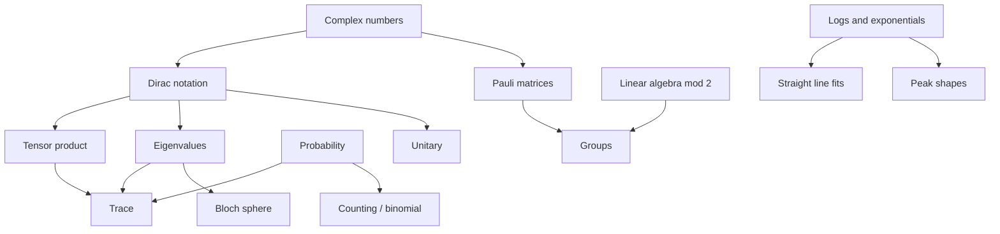

#math
the maths you need for the quantum notes. start at the top if something doesn't make sense
## the basics
- [[Complex numbers]] → $i$, conjugates, $|z|^2$, phases $e^{i\varphi}$
- [[Math/Dirac notation]] → kets $|\psi\rangle$, bras $\langle\psi|$, inner and outer products
- [[Probability and expectation values]] → distributions, averages $\langle x\rangle$, $\log_2$
- [[Modular arithmetic]] → mod $N$, XOR, periods, gcd
## linear algebra
- [[Eigenvalues and eigenvectors]] → the directions a matrix only stretches
- [[Hilbert space]] → the space states live in, why it doubles with every qubit
- [[Tensor product]] → combining qubits with $\otimes$, entanglement
- [[Trace]] → tr, purity, the [[Partial trace|partial trace]]
- [[Unitary Operation]] → $U^\dagger U=I$, what every gate is
## for error correction and fault tolerance
- [[Pauli matrices]] → $I,X,Y,Z$, how they multiply, commute or anticommute, Pauli strings, and why they're a basis for every $2\times2$ matrix
- [[Groups]] → groups, generators, subgroups, cosets, normalizers: the language of stabilizer codes
- [[Linear algebra mod 2]] → bit vectors, span, Gaussian elimination with XOR, kernels, and why a string can be orthogonal to itself
- [[Counting and the binomial distribution]] → $\binom nk$, the chance $k$ things fail, the small-$p$ shortcut, the union bound
- [[Big O notation]] → $O(\cdot)$, log vs polynomial vs exponential vs doubly exponential, log rules
## for measurements and data (the IISc notes)
- [[Logarithms and exponentials]] → $e^{-t/\tau}$, half-lives, $\ln$ vs $\log_{10}$ vs $\log_2$, absorbance, decibels, 60 mV/dec
- [[Straight line fits]] → slope and intercept, least squares, and the linearising tricks (TLM, $1/C^2$, Tauc, Williamson–Hall, $\ln I$ vs $V$)
- [[Peak shapes and FWHM]] → Gaussian vs Lorentzian, FWHM $=2.355\sigma$, lifetime ↔ linewidth, width and Fourier transforms
## pictures and transforms
- [[Bloch sphere]] → drawing a qubit as a point on a sphere
- [[Fourier Transform]], [[Discrete Fourier Transform]] → splitting a signal into frequencies (used in the [[Quantum Fourier Transform]])

(arrows = "learn this first")

see also [[Welcome]]
