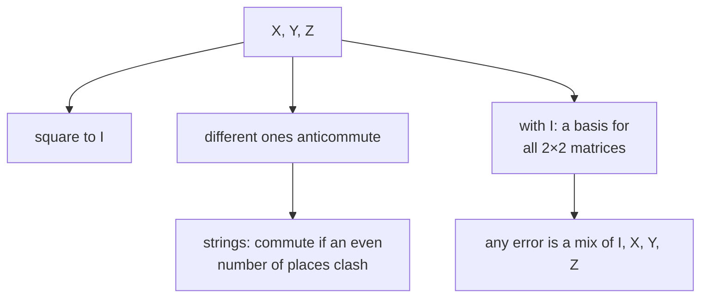

#math #pauli #commutator
the four $2\times2$ matrices that everything in error correction is written in: the errors, the stabilizers and the syndromes
## the four matrices
$$
I=\begin{bmatrix}1&0\\0&1\end{bmatrix}\quad X=\begin{bmatrix}0&1\\1&0\end{bmatrix}\quad Y=\begin{bmatrix}0&-i\\i&0\end{bmatrix}\quad Z=\begin{bmatrix}1&0\\0&-1\end{bmatrix}
$$
^pauli-matrices

(also written $\sigma_0,\sigma_x,\sigma_y,\sigma_z$). as gates: [[X gate]] is a bit flip, [[Z gate]] is a phase flip, and [[Y gate]] is both
## multiplying them
each one squares to the identity, and two different ones multiply to $\pm i$ times the third
$$
\begin{aligned}
X^2&=Y^2=Z^2=I\\
XY&=iZ\qquad YZ=iX\qquad ZX=iY\\
YX&=-iZ\qquad ZY=-iX\qquad XZ=-iY
\end{aligned}
$$
^pauli-products

go round the circle $X\to Y\to Z\to X$ and you get $+i$; go backwards and you get $-i$. a handy one: $Y=iXZ$ ("a $Y$ is a bit flip **and** a phase flip")
## commute or anticommute
the **commutator** is $[A,B]=AB-BA$ and the **anticommutator** is $\{A,B\}=AB+BA$. two different Paulis always **anticommute**: $XZ=-ZX$, so $\{X,Z\}=0$. every Pauli commutes with itself and with $I$

> [!important] the one idea
> ==two Paulis either commute or anticommute, nothing in between==. that's what makes a syndrome a clean yes/no: an error either flips the sign of a check or it doesn't
## Pauli strings
on many qubits, write a tensor product of Paulis as a string, eg. $XZZXI=X\otimes Z\otimes Z\otimes X\otimes I$ ([[Tensor product]]). its **weight** is the number of non-$I$ letters (here 4)

two strings commute if they **anticommute in an even number of places**: each place that anticommutes gives a $-1$, and an even number of them cancel
$$
\text{strings commute}\iff\#\{\text{places where the letters are different and neither is }I\}\text{ is even}
$$
^pauli-string-commute

> [!eg] does $XXI$ commute with $ZZZ$?
> place 1: $X$ vs $Z$, anticommute. place 2: $X$ vs $Z$, anticommute. place 3: $I$, fine. 2 places, even: they **commute**. (that's why the bit flip code's checks $Z_1Z_2$ and the logical $X_1X_2X_3$ get along)
## they're a basis
any $2\times2$ matrix is a combination of the four
$$
M=aI+bX+cY+dZ\qquad a=\tfrac12\text{tr}(M),\ b=\tfrac12\text{tr}(XM),\ c=\tfrac12\text{tr}(YM),\ d=\tfrac12\text{tr}(ZM)
$$
^pauli-basis

(using [[Trace|$\text{tr}$]] and the fact that every Pauli except $I$ has trace 0). this is why fixing $I,X,Y,Z$ on a qubit fixes **every** error on it ([[Discretization of the errors]]), and why a qubit's state can be drawn on the [[Bloch sphere]] ($\rho=\frac12(I+r_xX+r_yY+r_zZ)$)

> [!exercise] try these
> ① work out $XYZ$
> ② do $XZZXI$ and $IXZZX$ commute?
> ③ write $\begin{bmatrix}1&0\\0&0\end{bmatrix}$ as a combination of Paulis

> [!answer]-
> ① $XY=iZ$, then $iZ\cdot Z=iI$. so $XYZ=iI$
> ② places 2 ($Z$ vs $X$), 3 ($Z$ vs $Z$, same), 4 ($X$ vs $Z$): clashes at places 2 and 4, even, so yes (they're two of the 5 qubit code's checks, which must commute)
> ③ $\frac{I+Z}2$ (the projector onto $|0\rangle$)

see also [[Math]], [[Groups]], [[Clifford group]], [[Stabilizer codes]]
