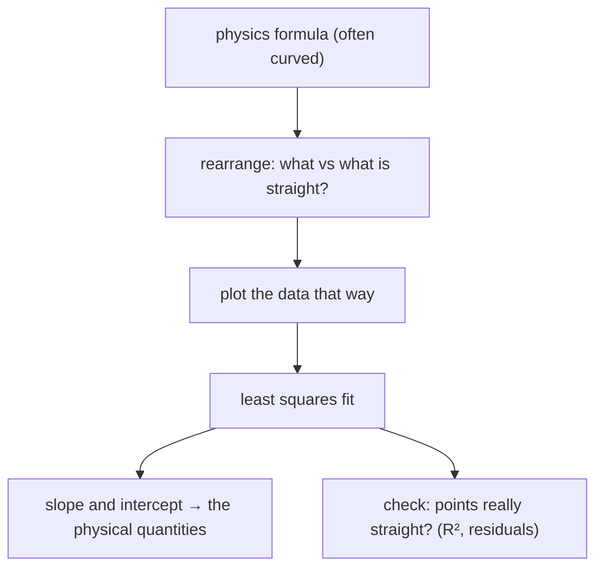

#math #data_analysis
most measurements in the characterization notes end the same way: rearrange the formula so the data should fall on a **straight line**, fit the line, and read off the **slope** and the **intercept**
## a line
$$
y=mx+c
$$
$m$ is the slope (how much $y$ changes per unit $x$), $c$ the intercept (the value of $y$ at $x=0$). the line hits the $x$ axis at $x=-c/m$
## the best line through noisy points: least squares
real data scatter. the **least squares** line is the one that minimises the sum of squared vertical gaps between the points and the line
$$
m=\frac{\sum_i(x_i-\bar x)(y_i-\bar y)}{\sum_i(x_i-\bar x)^2}\qquad c=\bar y-m\bar x
$$
^least-squares

($\bar x$, $\bar y$ are the averages). the best line always passes through the average point $(\bar x,\bar y)$. how straight the data really are is measured by $R^2$ (1 = perfectly on the line); a curve in the residuals means the formula doesn't hold there

> [!important] the one idea
> ==don't fit a curve: rearrange the physics until it predicts a straight line, then the slope and intercept **are** the quantities you want==. and never force the line through zero, the intercept usually carries information
## linearising: the tricks the notes use

| measurement | plot | slope gives | intercept gives |
|---|---|---|---|
| contact resistance, [[Sheet resistance and contacts#TLM: transfer length method\|TLM]] | $R_T$ vs spacing $L$ | $R_{sh}/W$ | $2R_c$ (at $L=0$), $-2L_T$ (on the $L$ axis) |
| doping, [[MOS capacitor C-V]] | $1/C^2$ vs $V$ | $\frac2{q\varepsilon A^2N}$ | flat band / built-in voltage |
| bandgap, [[UV-vis spectroscopy#Tauc plot (finding the bandgap)\|Tauc plot]] | $(\alpha h\nu)^{1/n}$ vs $h\nu$ | | $E_g$ (on the $h\nu$ axis) |
| size and strain, [[Diffraction formulas#size and strain together (Williamson–Hall)\|Williamson–Hall]] | $\beta\cos\theta$ vs $\sin\theta$ | strain | crystallite size |
| diode, [[Electrical characterization]] | $\ln I$ vs $V$ | $q/nk_BT$ → ideality $n$ | $\ln I_s$ |
| any decay, [[Logarithms and exponentials]] | $\ln y$ vs $t$ | $-1/\tau$ | $\ln y_0$ |

> [!eg] a TLM fit
> spacings $L=5,10,20,40$ µm give total resistances $R_T=22.6,\ 25.1,\ 29.8,\ 40.1\ \Omega$ (pad width $W=100$ µm)
> $$
> \begin{aligned}
> \bar L&=18.75\qquad\bar R=29.4\\
> m&=\frac{(-13.75)(-6.8)+(-8.75)(-4.3)+(1.25)(0.4)+(21.25)(10.7)}{13.75^2+8.75^2+1.25^2+21.25^2}=\frac{359.0}{718.75}=0.50\ \Omega/\text{µm}\\
> c&=29.4-0.50\times18.75=20.0\ \Omega
> \end{aligned}
> $$
> so $R_{sh}=mW=50\ \Omega/\text{sq}$, $R_c=c/2=10\ \Omega$, and $L_T=\frac c{2m}=20$ µm

> [!exercise] try these
> ① three points $(0,1)$, $(1,3)$, $(2,5)$. what's the least squares line?
> ② a $\ln I$ vs $V$ plot of a diode at 300 K has slope $19.3$ V⁻¹. what's $n$? ($k_BT/q=25.85$ mV)
> ③ why is a straight line on a log-log plot a power law?

> [!answer]-
> ① $\bar x=1$, $\bar y=3$, $m=\frac{(-1)(-2)+0+(1)(2)}{1+0+1}=2$, $c=3-2=1$: $y=2x+1$ (the points are exactly on it)
> ② slope $=\frac q{nk_BT}$ → $n=\frac1{0.02585\times19.3}=2.0$
> ③ $\log y=k\log x+c$ means $y=10^c\,x^k$: a power law with exponent $k$ equal to the slope

see also [[Logarithms and exponentials]], [[Peak shapes and FWHM]], [[Probability and expectation values]], [[Math]]
