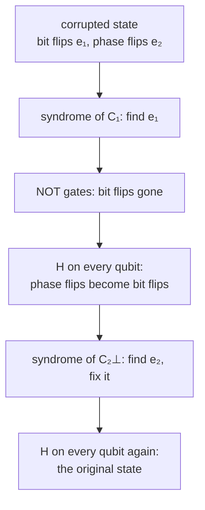

#textbook #css_codes #steane_code #quantum_error_correction
*Quantum Computation and Quantum Information* §10.4.2 (p. 450–453). the first big family of quantum codes, built from two classical linear codes. part of [[Quantum Computation and Quantum Information]], previous: [[Classical linear codes]], extra version: [[CSS codes]]
## the construction
CSS codes (after Calderbank, Shor and Steane) are an important subclass of the stabilizer codes in §10.5. take two classical linear codes
- $C_1$, an $[n,k_1]$ code, and $C_2$, an $[n,k_2]$ code, with $C_2\subset C_1$
- $C_1$ and $C_2^\perp$ both correct $t$ errors

for any code word $x\in C_1$ define
$$
|x+C_2\rangle\equiv\frac1{\sqrt{|C_2|}}\sum_{y\in C_2}|x+y\rangle
$$
^css-coset-state

($+$ is bitwise addition mod 2). the code $\text{CSS}(C_1,C_2)$ is the space spanned by all these states
- if $x-x'\in C_2$, then $|x+C_2\rangle=|x'+C_2\rangle$: the state only depends on which **coset** of $C_2$ the word $x$ is in (hence the notation)
- if $x$ and $x'$ are in **different** cosets, no $x+y$ equals any $x'+y'$, so the states are orthonormal
- the number of cosets of $C_2$ in $C_1$ is $|C_1|/|C_2|=2^{k_1}/2^{k_2}$

> [!important] the one idea
> ==$\text{CSS}(C_1,C_2)$ is an $[n,\ k_1-k_2]$ quantum code: $C_1$ corrects the bit flips, and $C_2^\perp$ corrects the phase flips==. the Hadamards turn phase flips into bit flips, and the cosets of $C_2$ turn into code words of $C_2^\perp$
## correcting the errors
write the bit flips as an $n$ bit vector $e_1$ (1s where a bit flipped) and the phase flips as $e_2$. the corrupted state is
$$
\frac1{\sqrt{|C_2|}}\sum_{y\in C_2}(-1)^{(x+y)\cdot e_2}\,|x+y+e_1\rangle
$$
^css-corrupted

**bit flips**: add an ancilla in $|0\rangle$ and reversibly compute the parity checks of $C_1$, $|x+y+e_1\rangle|0\rangle\to|x+y+e_1\rangle|H_1e_1\rangle$ (since $H_1$ kills $x+y\in C_1$). measure the ancilla to get the syndrome $H_1e_1$, work out $e_1$ ($C_1$ corrects up to $t$ errors), and apply NOT gates there
$$
\frac1{\sqrt{|C_2|}}\sum_{y\in C_2}(-1)^{(x+y)\cdot e_2}\,|x+y\rangle
$$
**phase flips**: Hadamard every qubit. with $z'=z+e_2$
$$
\begin{aligned}
&\frac1{\sqrt{|C_2|2^n}}\sum_z\sum_{y\in C_2}(-1)^{(x+y)\cdot(e_2+z)}|z\rangle\\
=&\frac1{\sqrt{|C_2|2^n}}\sum_{z'}\sum_{y\in C_2}(-1)^{(x+y)\cdot z'}|z'+e_2\rangle\\
=&\frac1{\sqrt{2^n/|C_2|}}\sum_{z'\in C_2^\perp}(-1)^{x\cdot z'}|z'+e_2\rangle
\end{aligned}
$$
the last step uses $\sum_{y\in C_2}(-1)^{y\cdot z'}=|C_2|$ if $z'\in C_2^\perp$ and $0$ otherwise (exercise 10.25). ==that's just a bit flip error $e_2$ on a code word of $C_2^\perp$==: compute its syndrome $H_2e_2$ with the parity check matrix of $C_2^\perp$, fix it, then Hadamard every qubit again to get back
$$
\frac1{\sqrt{|C_2|}}\sum_{y\in C_2}|x+y\rangle
$$
the original encoded state. detection and correction only need Hadamards and CNOTs, a number linear in the size of the code (encoding and decoding too: §10.5.8)

## the quantum Gilbert-Varshamov bound
CSS codes prove that good quantum codes exist: for large $n$ there's an $[n,k]$ quantum code correcting errors on up to $t$ qubits with
$$
\frac kn\geq1-2H\Big(\frac{2t}n\Big)
$$
^quantum-gv

(compare the classical [[Classical linear codes#^gilbert-varshamov]], which has $1-H$: here both $C_1$ and $C_2^\perp$ have to be good). ==good quantum codes exist, as long as you don't pack too many qubits $k$ into $n$==
## the Steane code
take the $[7,4,3]$ Hamming code $C$ ([[Classical linear codes#^hamming-7-4]]), with $C_1\equiv C$ and $C_2\equiv C^\perp$. the parity check matrix of $C_2=C^\perp$ is the transposed generator matrix of $C$
$$
H[C_2]=G[C_1]^T=\begin{bmatrix}1&0&0&0&0&1&1\\0&1&0&0&1&0&1\\0&0&1&0&1&1&0\\0&0&0&1&1&1&1\end{bmatrix}
$$
the rows of $H[C_2]$ span strictly more than the rows of $H[C_1]$, so the kernels go the other way: $C_2\subset C_1$. and $C_2^\perp=(C^\perp)^\perp=C$, so both $C_1$ and $C_2^\perp$ are distance 3 and correct 1 bit. $C_1$ is $[7,4]$ and $C_2$ is $[7,3]$, so ==$\text{CSS}(C_1,C_2)$ is a $[7,1]$ code correcting any error on one qubit: the **Steane code**==, used for most of the rest of the chapter
$$
\begin{aligned}
|0_L\rangle=\tfrac1{\sqrt8}\big[&|0000000\rangle+|1010101\rangle+|0110011\rangle+|1100110\rangle\\
+&|0001111\rangle+|1011010\rangle+|0111100\rangle+|1101001\rangle\big]\\
|1_L\rangle=\tfrac1{\sqrt8}\big[&|1111111\rangle+|0101010\rangle+|1001100\rangle+|0011001\rangle\\
+&|1110000\rangle+|0100101\rangle+|1000011\rangle+|0010110\rangle\big]
\end{aligned}
$$
^steane-book-codewords

$|0_L\rangle=|0+C_2\rangle$ is the 8 code words of $C_2$, and $|1_L\rangle$ uses $x=(1,1,1,1,1,1,1)$, an element of $C_1$ that isn't in $C_2$ (checked numerically: the stabilizer generators of [[The stabilizer formalism#^steane-generators-book]] leave both alone)

> [!exercise] try these
> ① a CSS code from $C_1=[15,11,3]$ and $C_2=C_1^\perp$. what are $n$ and $k$?
> ② in the Steane code, which coset is $|1101001+C_2\rangle$?
> ③ why does the quantum GV bound have $2H$ instead of $H$?

> [!answer]-
> ① $n=15$, $k=11-4=7$
> ② $1101001$ is itself in $C_2$ (it's in $|0_L\rangle$), so it's the coset $0+C_2$: $|0_L\rangle$
> ③ two classical codes have to be good at once, $C_1$ against bit flips and $C_2^\perp$ against phase flips, and each costs about $H(2t/n)$ of the rate

see also [[CSS codes]], [[Classical linear codes]], [[Transversal gates on stabilizer codes]]

next: [[The stabilizer formalism]]
