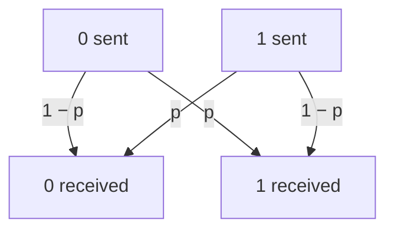

#textbook #quantum_error_correction #repetition_code #bit_flip_code
*Quantum Computation and Quantum Information* §10.1 and the start of §10.1.1 (p. 425–428). the start of chapter 10: how to process quantum information **reliably** when everything is noisy. part of [[Quantum Computation and Quantum Information]], course version: [[Quantum Error Correction]], [[Bit flip code]]
## what chapter 10 is about
three big topics
- **quantum error-correcting codes**: *encode* a state in a special way so noise can't hurt it, then *decode* it when you want it back
- **fault-tolerant quantum computation**: the gates doing the encoding and decoding are noisy too, so do the logic *on encoded states* in a way that tolerates faults in the gates
- **the threshold theorem**: if the noise in each gate is below a constant threshold, you can do an arbitrarily long quantum computation efficiently (course version: [[Threshold theorem]])

these pages cover the codes: §10.1 to §10.4.1. until fault tolerance (§10.6) the chapter assumes encoding and decoding are **perfect**, which is fine for eg. sending qubits down a noisy channel with good computers at each end
## the classical idea
modern computer parts fail less than once in $10^{17}$ operations, so we treat them as noiseless. but modems and CD players do have a noise problem, and they use error-correcting codes. the key idea:

> [!important] the one idea
> ==**encode** the message by adding redundant information==, so that even if some of it gets corrupted there's enough left to **decode** the original. the noisier the channel, the more redundancy you need

the simplest noise model is the [[Binary symmetric channel]]: each bit flips with probability $p>0$ and goes through untouched with probability $1-p$ (figure 10.1)

the simplest protection is the **repetition code**: send three copies
$$
0\to000\qquad1\to111
$$
$000$ and $111$ are the **logical 0** and **logical 1**. if $001$ comes out, the third bit probably flipped and a 0 was sent. this is **majority voting**: decode to whichever of 0 and 1 appears more. it fails when 2 or more bits flip
$$
\begin{aligned}
p_e&=3p^2(1-p)+p^3\\
&=3p^2-2p^3
\end{aligned}
$$
^repetition-error

without the code the error probability was $p$, so the code helps when $p_e<p$, which is whenever $p<1/2$ (the same idea as asking someone with a strong accent to repeat themselves: you put the attempts together)

![[Repetition_code_error.png]]

the curve is flat at the start ($p_e\approx3p^2$), which is the whole point: for small $p$ the code is far below the line

> [!eg] how much it helps
> - $p=0.1$: $p_e=0.03-0.002=0.028$, about 3.6× better
> - $p=0.01$: $p_e=3\times10^{-4}-2\times10^{-6}=2.98\times10^{-4}$, about 34× better
>
> the smaller $p$ is, the more it helps, because $p_e\approx3p^2$
## three problems for the quantum version
at first sight, three things make quantum error correction look impossible
1. **no cloning**: you can't copy $|\psi\rangle$ three times ([[No-cloning theorem]], Box 12.1). and even if you could, you couldn't measure and compare the three copies
2. **errors are continuous**: a qubit can suffer a continuum of different errors, so working out which one happened seems to need infinite precision, and infinite resources
3. **measurement destroys quantum information**: classically we look at the channel output and decide what to do. quantum mechanically, looking destroys the state

==none of these is fatal==, as the rest of the chapter shows
## the bit flip channel and the bit flip code
the **bit flip channel** leaves a qubit alone with probability $1-p$, and applies the bit flip $X$ with probability $p$ ([[Bit flip channel]]). to protect against it, encode $a|0\rangle+b|1\rangle$ as $a|000\rangle+b|111\rangle$, ie.
$$
|0\rangle\to|0_L\rangle\equiv|000\rangle\qquad|1\rangle\to|1_L\rangle\equiv|111\rangle
$$
^bitflip-codewords

where superpositions go to the matching superpositions. $|0_L\rangle$ and $|1_L\rangle$ are the **logical** zero and one, not the physical ones. the circuit (figure 10.2): the data enters on the top line, and two CNOTs copy its **basis value** onto two fresh $|0\rangle$s

![[Bit_flip_encoding_circuit.png]]

this isn't cloning: $a|000\rangle+b|111\rangle$ is entangled, not three copies of $a|0\rangle+b|1\rangle$ (exercise ③ below)

> [!exercise] try these
> ① show that $p_e<p$ exactly when $0<p<1/2$
> ② a **5** bit repetition code with majority voting. what's $p_e$, and what is it for $p=0.01$?
> ③ write out $(a|0\rangle+b|1\rangle)^{\otimes3}$. when is it equal to $a|000\rangle+b|111\rangle$?

> [!answer]-
> ① $p-p_e=p-3p^2+2p^3=p(1-p)(1-2p)$, which is $>0$ when $0<p<1/2$ (and the code makes it **worse** for $p>1/2$)
> ② it fails with 3 or more flips: $p_e=10p^3(1-p)^2+5p^4(1-p)+p^5\approx10p^3$. at $p=0.01$: $9.80\times10^{-6}+4.95\times10^{-8}+10^{-10}\approx9.85\times10^{-6}$
> ③ $a^3|000\rangle+a^2b(|001\rangle+|010\rangle+|100\rangle)+ab^2(|011\rangle+|101\rangle+|110\rangle)+b^3|111\rangle$. it only matches when $ab=0$, ie. for $|0\rangle$ or $|1\rangle$, which the no-cloning theorem allows

see also [[Binary symmetric channel]], [[Bit flip code]], [[No-cloning theorem]]

next: [[Syndrome diagnosis and recovery]]
