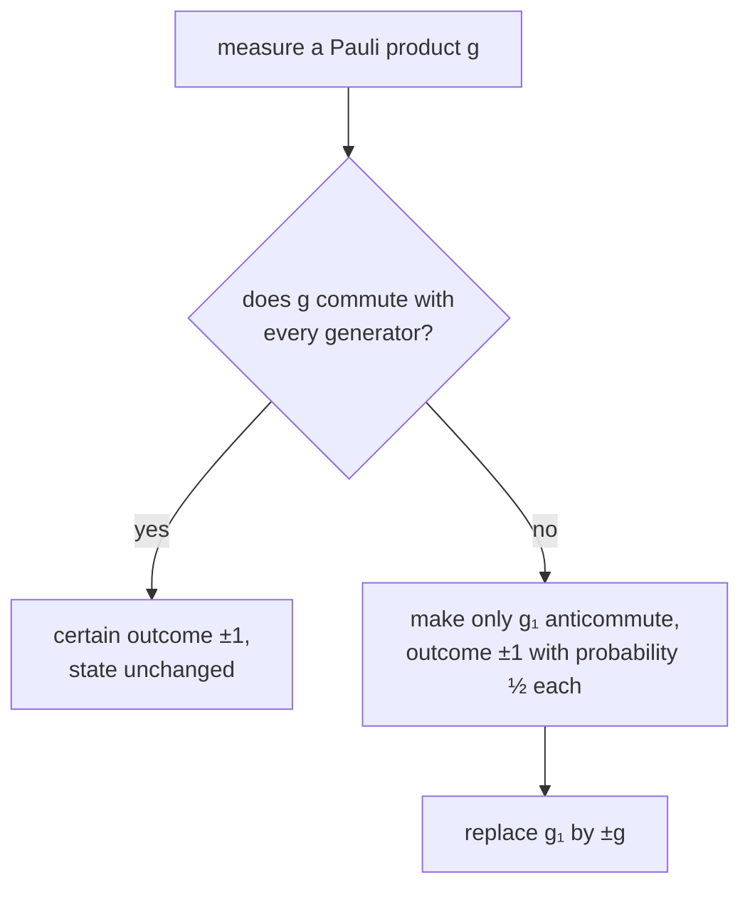

#textbook #stabilizer_codes #gottesman_knill #measurement
*Quantum Computation and Quantum Information* §10.5.3 and §10.5.4 (p. 463–464). measuring Pauli operators is easy in the stabilizer picture too, and together with the gates that gives a surprising theorem. part of [[Quantum Computation and Quantum Information]], previous: [[Unitary gates and the stabilizer formalism]], extra version: [[Gottesman-Knill theorem]]
## measuring a Pauli product
measure $g\in G_n$ ($g$ is Hermitian, so it's an observable; take it to have no $-1$ or $\pm i$ in front) on a state $|\psi\rangle$ with stabilizer $\langle g_1,\dots,g_n\rangle$. two cases

**$g$ commutes with every generator**: then $g_jg|\psi\rangle=gg_j|\psi\rangle=g|\psi\rangle$, so $g|\psi\rangle$ is in $V_S$, a one dimensional space, so it's a multiple of $|\psi\rangle$. $g^2=I$ makes that multiple $\pm1$, so $g$ or $-g$ is in the stabilizer. ==the outcome is certain, and the state doesn't change==

**$g$ anticommutes with some generators**: say $g_1$ (if it also anticommutes with $g_2$, replace $g_2$ by $g_1g_2$, which commutes with $g$; so only $g_1$ anticommutes). the outcome projectors are $\frac{I\pm g}2$, and using $g_1|\psi\rangle=|\psi\rangle$, $gg_1=-g_1g$
$$
\begin{aligned}
p(+1)&=\text{tr}\Big(\tfrac{I+g}2|\psi\rangle\langle\psi|\Big)=\text{tr}\Big(\tfrac{I+g}2\,g_1|\psi\rangle\langle\psi|\Big)\\
&=\text{tr}\Big(g_1\tfrac{I-g}2|\psi\rangle\langle\psi|\Big)=\text{tr}\Big(\tfrac{I-g}2|\psi\rangle\langle\psi|\Big)=p(-1)
\end{aligned}
$$
^random-outcome

(moving $g_1$ round the trace and absorbing it into $\langle\psi|$ with $g_1=g_1^\dagger$). since $p(+1)+p(-1)=1$, ==each outcome has probability $\frac12$==. after $+1$ the state is $|\psi^+\rangle=\frac{(I+g)|\psi\rangle}{\sqrt2}$, with stabilizer $\langle g,g_2,\dots,g_n\rangle$; after $-1$ it's $\langle-g,g_2,\dots,g_n\rangle$

## theorem 10.7: Gottesman-Knill
> [!important] the Gottesman-Knill theorem
> ==a quantum computation using only: preparing computational basis states, Hadamard, phase, CNOT and Pauli gates, measuring Pauli observables (which includes computational basis measurements), and classical control on those results, can be simulated efficiently on a classical computer==

we've already proved it: the classical computer just **keeps track of the generators** of the stabilizer. each of these operations (a gate, a preparation, a Pauli measurement) updates the $n$ generators in $O(n^2)$ steps, so
$$
m\text{ operations}\ \longrightarrow\ O(n^2m)\text{ classical steps}
$$
^gk-cost

> [!note] what it shows
> ==quantum computations with **highly entangled** states can still be easy to simulate classically==. [[Teleportation]] and [[Superdense coding]] use only $H$, CNOT and computational basis measurements, and many quantum codes live in the stabilizer formalism. there's much more to quantum computation than the power of entanglement

> [!eg] teleportation, the stabilizer way (exercise 10.42, for an input $|0\rangle$)
> qubit 1 is the input $|0\rangle$, and qubits 2, 3 are an EPR pair: $\langle Z_1,\ X_2X_3,\ Z_2Z_3\rangle$
> - CNOT $1\to2$: $Z_1\to Z_1$, $X_2X_3\to X_2X_3$, $Z_2Z_3\to Z_1Z_2Z_3$
> - $H_1$ turns every $Z_1$ into $X_1$: $\langle X_1,\ X_2X_3,\ X_1Z_2Z_3\rangle$
> - measure $Z_1$: it anticommutes with $X_1$ and $X_1Z_2Z_3$. replace $X_1Z_2Z_3$ by $X_1\cdot X_1Z_2Z_3=Z_2Z_3$ (which commutes), then $X_1$ by $\pm Z_1$: $\langle\pm Z_1,\ X_2X_3,\ Z_2Z_3\rangle$, outcome random
> - measure $Z_2$: anticommutes only with $X_2X_3$, so it's random, replace it by $m_2Z_2$ ($m_2=\pm1$): $\langle\pm Z_1,\ m_2Z_2,\ Z_2Z_3\rangle$
> - multiplying, $m_2Z_2\cdot Z_2Z_3=m_2Z_3$ is in the stabilizer: qubit 3 is $|0\rangle$ if $m_2=+1$ and $|1\rangle$ if $m_2=-1$. Bob applies $X$ when $m_2=-1$ and gets $|0\rangle$ ✓ (the input's $Z$ value, carried by the $X$ correction, just like [[Teleportation]])
>
> the formalism only handles stabilizer inputs, so it's not the whole story of teleportation, but it shows the dynamics

> [!exercise] try these
> ① on $|0\rangle$ (stabilizer $\langle Z\rangle$), measure $X$. what are the probabilities and the new stabilizer?
> ② on the EPR state $\langle X_1X_2,Z_1Z_2\rangle$, measure $X_1X_2$. what happens?
> ③ a 100 qubit circuit with $10^6$ Clifford gates and measurements: roughly how many classical steps?

> [!answer]-
> ① $X$ anticommutes with $Z$: $\frac12$ each, new stabilizer $\langle\pm X\rangle$, ie. $|+\rangle$ or $|-\rangle$
> ② it's in the stabilizer, so the outcome is $+1$ for certain and the state is unchanged
> ③ $O(n^2m)=10^4\times10^6=10^{10}$: a few seconds on a laptop. the state vector would need $2^{100}$ amplitudes

see also [[Gottesman-Knill theorem]], [[Clifford group]], [[Teleportation]], [[Projectors]]

next: [[Stabilizer code constructions]]
