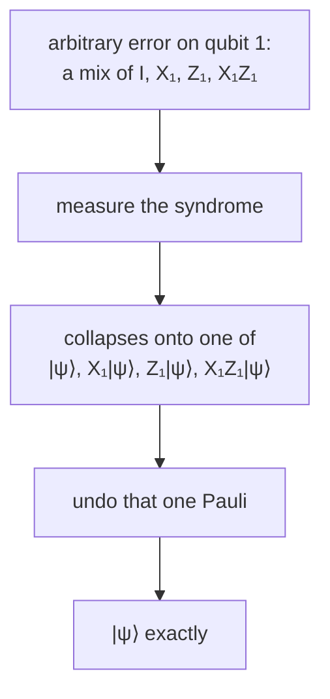

#textbook #quantum_error_correction #shor_code #concatenation
*Quantum Computation and Quantum Information* §10.2 (p. 432–434). one code that protects against an **arbitrary** error on a single qubit, and the surprising reason it works: correcting a few discrete errors corrects all of them. part of [[Quantum Computation and Quantum Information]], previous: [[Three qubit phase flip code]], course version: [[Shor code]]
## the code words
the Shor code (after Peter Shor) combines the two three qubit codes. first encode with the [[Three qubit phase flip code|phase flip code]], $|0\rangle\to|{+}{+}{+}\rangle$ and $|1\rangle\to|{-}{-}{-}\rangle$. then encode **each** of those qubits with the bit flip code: $|+\rangle\to(|000\rangle+|111\rangle)/\sqrt2$ and $|-\rangle\to(|000\rangle-|111\rangle)/\sqrt2$. the result is a nine qubit code
$$
\begin{aligned}
|0\rangle\to|0_L\rangle&\equiv\frac{(|000\rangle+|111\rangle)(|000\rangle+|111\rangle)(|000\rangle+|111\rangle)}{2\sqrt2}\\
|1\rangle\to|1_L\rangle&\equiv\frac{(|000\rangle-|111\rangle)(|000\rangle-|111\rangle)(|000\rangle-|111\rangle)}{2\sqrt2}
\end{aligned}
$$
^shor-nine-codewords

the circuit (figure 10.4): the first part is the phase flip encoder (compare [[Three qubit phase flip code]]), and the second part bit flip encodes each of qubits 1, 4 and 7

![[Shor_code_encoding_circuit.png]]

encoding with a hierarchy of levels like this is **concatenation**. it's a great trick for making new codes from old ones, and it comes back later to prove important results (course: [[Recursive fault tolerance]])
## bit flips
say qubit 1 flips. as for the bit flip code, measure $Z_1Z_2$: qubits 1 and 2 differ, so 1 or 2 flipped. then $Z_2Z_3$: they're the same, so it wasn't 2. flip qubit 1 back. the same works for a bit flip on any of the nine qubits (two checks per block of three)
## phase flips
say qubit 1 gets a phase flip. that flips the **sign** of the first block: $|000\rangle+|111\rangle\leftrightarrow|000\rangle-|111\rangle$. a phase flip on **any** of the first three qubits has exactly this effect, and the correction below works for all three

syndrome measurement compares the signs of the blocks, just like the phase flip code compared the signs of qubits. eg. $(|000\rangle-|111\rangle)(|000\rangle-|111\rangle)$ has the same sign ($-$) in both blocks, while $(|000\rangle-|111\rangle)(|000\rangle+|111\rangle)$ has different signs
1. compare the signs of blocks 1 and 2: they're different
2. compare the signs of blocks 2 and 3: they're the same, so block 1's sign flipped
3. flip block 1's sign back, eg. with $Z_1Z_2Z_3$

these comparisons are measurements of $X_1X_2X_3X_4X_5X_6$ and $X_4X_5X_6X_7X_8X_9$ (exercises 10.5 and 10.6, worked in [[Chapter 10 exercises]])
## both at once
if the error is $Z_1X_1$ (both on qubit 1), the bit flip procedure finds and fixes the bit flip on qubit 1, and the phase flip procedure finds and fixes the phase flip on block 1. so combined errors on one qubit are fine too
## completely arbitrary errors
> [!important] the one idea
> ==the Shor code corrects **any** error on one qubit with no extra work==: a tiny rotation by $\pi/263$ about the $z$ axis, or even ripping the qubit out and replacing it with garbage. correcting a **discrete** set of errors corrects the whole **continuum**

why: describe the noise on qubit 1 by a trace-preserving quantum operation $\mathcal E$ with operation elements $\{E_i\}$ ([[Operator-sum representation]]). the encoded state $|\psi\rangle=\alpha|0_L\rangle+\beta|1_L\rangle$ becomes $\sum_iE_i|\psi\rangle\langle\psi|E_i^\dagger$, so look at one term $E_i|\psi\rangle\langle\psi|E_i^\dagger$. as an operator on one qubit, $E_i$ is a combination of the identity, the bit flip, the phase flip, and both
$$
E_i=e_{i0}I+e_{i1}X_1+e_{i2}Z_1+e_{i3}X_1Z_1
$$
^error-expansion

so the (unnormalized) $E_i|\psi\rangle$ is a superposition of $|\psi\rangle$, $X_1|\psi\rangle$, $Z_1|\psi\rangle$, $X_1Z_1|\psi\rangle$. ==measuring the syndrome **collapses** that superposition onto one of the four==, and then the matching correction gives back $|\psi\rangle$. the same holds for every $E_i$

this **discretization of errors** is central to why quantum error correction works. compare classical error correction for **analog** systems, where nothing like it is possible (more in [[Discretization of the errors]])
## noise on more than one qubit
two ideas
- often the noise acts on qubits **independently**. if it's weak, expand its effect into terms with errors on 0 qubits, 1 qubit, 2 qubits, ..., with 0 and 1 dominating. correcting those leaves only the much smaller 2nd and higher order terms, so there's a **net suppression** of errors ([[Independent error models]])
- when the noise isn't independent, use codes that correct errors on more than one qubit, built along similar lines

> [!exercise] try these
> ① a $Z$ hits qubit 5. what do the two sign comparisons give, and what's the fix?
> ② $Y_1=iX_1Z_1$. what does the code do with a $Y_1$ error?
> ③ show that $Z_1Z_2$ does nothing at all to $|0_L\rangle$ and $|1_L\rangle$

> [!answer]-
> ① it flips block 2's sign: blocks 1 and 2 differ, blocks 2 and 3 differ, so block 2. fix with $Z_4Z_5Z_6$ (or just $Z_5$)
> ② the bit flip checks find qubit 1, and the phase checks find block 1: apply $X_1$ and $Z_1Z_2Z_3$. the leftover $i$ is a global phase, so it doesn't matter. (check: $XZ=\begin{bmatrix}0&-1\\1&0\end{bmatrix}$ and $iXZ=\begin{bmatrix}0&-i\\i&0\end{bmatrix}=Y$ ✓)
> ③ on $|000\rangle\pm|111\rangle$, $|000\rangle$ gets no signs and $|111\rangle$ gets $(-1)^2=1$, so the block is unchanged. two different errors, $Z_1$ and $Z_2$, have the **same** effect on the code words: this is a **degenerate** code ([[Degenerate codes and the quantum Hamming bound]])

see also [[Shor code]], [[Operator-sum representation]], [[Recursive fault tolerance]]

next: [[Quantum error-correction conditions]]
