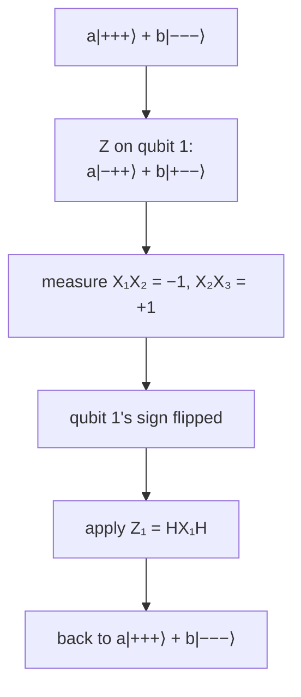

#textbook #quantum_error_correction #phase_flip_code #hadamard
*Quantum Computation and Quantum Information* §10.1.2 (p. 430–431). a channel with **no classical equivalent**, and how a basis change turns it into one we already know how to fix. part of [[Quantum Computation and Quantum Information]], previous: [[Syndrome diagnosis and recovery]], course version: [[Phase flip code]]
## the phase flip channel
the bit flip code doesn't look like much of an advance over classical codes, and real qubits get other errors too. in the **phase flip** model the qubit is left alone with probability $1-p$, and with probability $p$ the phase flip $Z$ is applied
$$
a|0\rangle+b|1\rangle\ \xrightarrow{\ Z\ }\ a|0\rangle-b|1\rangle
$$
classical channels have nothing like phase, so there's no classical equivalent ([[Dephasing channel]])
## turn it into a bit flip channel
work in the basis $|+\rangle\equiv(|0\rangle+|1\rangle)/\sqrt2$, $|-\rangle\equiv(|0\rangle-|1\rangle)/\sqrt2$. then
$$
Z|+\rangle=|-\rangle\qquad Z|-\rangle=|+\rangle
$$
so $Z$ acts **just like a bit flip** on the labels $+$ and $-$. that suggests the code words
$$
|0_L\rangle\equiv|{+}{+}{+}\rangle\qquad|1_L\rangle\equiv|{-}{-}{-}\rangle
$$
^phaseflip-codewords

> [!important] the one idea
> ==do everything the bit flip code does, but in the $|+\rangle,|-\rangle$ basis==. the Hadamard switches between the two bases, so just put Hadamards in at the right places

encoding is two steps (figure 10.3): encode exactly as for the bit flip code, then a Hadamard on each qubit

![[Phase_flip_textbook_encoding.png]]

$$
a|0\rangle+b|1\rangle\ \xrightarrow{\text{CNOTs}}\ a|000\rangle+b|111\rangle\ \xrightarrow{H^{\otimes3}}\ a|{+}{+}{+}\rangle+b|{-}{-}{-}\rangle
$$
(the course version puts an extra $H$ on qubit 1 first, which changes which states are called $|0_L\rangle$ and $|1_L\rangle$: see [[Phase flip code#^phase-codewords]])
## detecting and fixing the error
**detection**: the same projectors as before, conjugated by Hadamards, $P_j\to P_j'\equiv H^{\otimes3}P_jH^{\otimes3}$. or measure the conjugated observables
$$
H^{\otimes3}Z_1Z_2H^{\otimes3}=X_1X_2\qquad H^{\otimes3}Z_2Z_3H^{\otimes3}=X_2X_3
$$
^phase-observables

these compare the **sign** of qubits one and two (two and three): $X_1X_2$ gives $+1$ for $|+\rangle|+\rangle\otimes(\cdot)$ or $|-\rangle|-\rangle\otimes(\cdot)$, and $-1$ for $|+\rangle|-\rangle\otimes(\cdot)$ or $|-\rangle|+\rangle\otimes(\cdot)$

as a circuit: the bit flip syndrome circuit ([[Syndrome diagnosis and recovery#^z1z2-decomposition|the $Z_1Z_2$, $Z_2Z_3$ version]]) with Hadamards before and after on the data qubits. the first layer turns $|\pm\rangle$ into $|0\rangle,|1\rangle$, the CNOTs copy the parities onto $SA$ and $SB$, and the second layer puts the data back

![[Phase_flip_syndrome_circuit.png]]

**recovery**: the Hadamard conjugated bit flip recovery. eg. if the sign of qubit one flipped from $|+\rangle$ to $|-\rangle$, apply $HX_1H=Z_1$

## unitarily equivalent channels
the phase flip code has exactly the same properties as the bit flip code: the same minimum fidelity, and it helps under the same condition $p<1/2$

![[Syndrome diagnosis and recovery#^bitflip-fidelity]]

the two channels are **unitarily equivalent**: there's a unitary $U$ (here $H$) such that one channel is the same as the other with $U$ before it and $U^\dagger$ after. those extra gates just get absorbed into the encoding and the correction. ==any two unitarily equivalent channels are protected by the same code, up to that change of basis== (general $U$: problem 10.1)

> [!exercise] try these
> ① a $Z$ hits qubit 2 of $a|{+}{+}{+}\rangle+b|{-}{-}{-}\rangle$. what do $X_1X_2$ and $X_2X_3$ give, and what's the fix?
> ② check $HZH=X$, and use it to get $H^{\otimes3}Z_1Z_2H^{\otimes3}=X_1X_2$
> ③ what does a **bit** flip $X_1$ do to this code?

> [!answer]-
> ① $a|{+}{-}{+}\rangle+b|{-}{+}{-}\rangle$: both give $-1$, so apply $Z_2$
> ② $HZH=\frac12\begin{bmatrix}1&1\\1&-1\end{bmatrix}\begin{bmatrix}1&1\\-1&1\end{bmatrix}=\begin{bmatrix}0&1\\1&0\end{bmatrix}=X$. then $H^{\otimes3}(Z\otimes Z\otimes I)H^{\otimes3}=HZH\otimes HZH\otimes HH=X\otimes X\otimes I$
> ③ $X|+\rangle=|+\rangle$ and $X|-\rangle=-|-\rangle$, so it gives $a|{+}{+}{+}\rangle-b|{-}{-}{-}\rangle$: a logical phase flip that the syndromes can't see (both stay $+1$). this code only protects against phase flips, which is why we need the [[Shor nine qubit code]]

see also [[Phase flip code]], [[Phase flip code practice]], [[Hadamard Gate]], [[Dephasing channel]]

next: [[Shor nine qubit code]]
