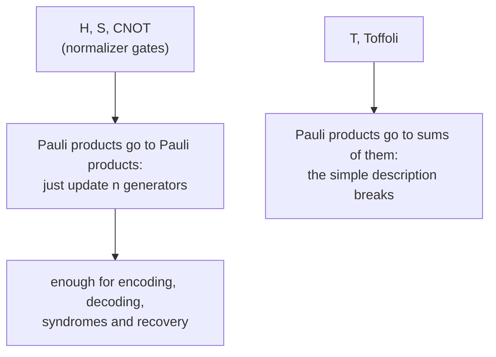

#textbook #stabilizer_codes #clifford #quantum_gates
*Quantum Computation and Quantum Information* §10.5.2 (p. 459–462). how a unitary changes a stabilizer, and which gates keep the description simple. part of [[Quantum Computation and Quantum Information]], previous: [[The stabilizer formalism]], extra version: [[Clifford group]]
## conjugate the generators
if $|\psi\rangle\in V_S$ and $g\in S$, then for a unitary $U$
$$
U|\psi\rangle=Ug|\psi\rangle=UgU^\dagger\,U|\psi\rangle
$$
^stabilizer-conjugation

so $U|\psi\rangle$ is stabilized by $UgU^\dagger$, and $UV_S$ is stabilized by $USU^\dagger\equiv\{UgU^\dagger\,|\,g\in S\}$. if $g_1,\dots,g_l$ generate $S$, then $Ug_1U^\dagger,\dots,Ug_lU^\dagger$ generate $USU^\dagger$, so ==to update the stabilizer you only update its generators==

> [!eg] Hadamards on everything
> $HXH^\dagger=Z$, $HYH^\dagger=-Y$, $HZH^\dagger=X$. so $|0\rangle$ (stabilized by $Z$) goes to $|+\rangle$ (stabilized by $X$). with $n$ qubits, $|0\rangle^{\otimes n}$ (stabilizer $\langle Z_1,\dots,Z_n\rangle$) goes to the state with stabilizer $\langle X_1,\dots,X_n\rangle$, the equal superposition of all $2^n$ basis states: $n$ generators instead of $2^n$ amplitudes. (no entanglement yet, but the CNOT changes that)
## the conjugation table
figure 10.7, with the CNOT controlled by qubit 1

| gate | input | output |
|---|---|---|
| CNOT | $X_1$ / $X_2$ / $Z_1$ / $Z_2$ | $X_1X_2$ / $X_2$ / $Z_1$ / $Z_1Z_2$ |
| $H$ | $X$ / $Z$ | $Z$ / $X$ |
| $S$ | $X$ / $Z$ | $Y$ / $Z$ |
| $X$ | $X$ / $Z$ | $X$ / $-Z$ |
| $Y$ | $X$ / $Z$ | $-X$ / $-Z$ |
| $Z$ | $X$ / $Z$ | $-X$ / $Z$ |

^conjugation-table

the CNOT row, eg. $UX_1U^\dagger=X_1X_2$, can be checked with $4\times4$ matrices (exercise 10.36). everything else follows by multiplying
$$
\begin{aligned}
UX_1X_2U^\dagger&=UX_1U^\dagger\,UX_2U^\dagger=(X_1X_2)X_2=X_1\\
UY_2U^\dagger&=iUX_2Z_2U^\dagger=iUX_2U^\dagger\,UZ_2U^\dagger=iX_2(Z_1Z_2)=Z_1Y_2
\end{aligned}
$$
## the swap circuit
three CNOTs, alternating control and target, swap two qubits (figure 10.8). follow the stabilizers through it
$$
\begin{aligned}
Z_1&\to Z_1\to Z_1Z_2\to Z_2\\
Z_2&\to Z_1Z_2\to Z_1\to Z_1
\end{aligned}
$$
and $X_1\to X_2$, $X_2\to X_1$: exactly what SWAP does. a two qubit unitary is fixed by what it does to $Z_1,Z_2,X_1,X_2$ (exercise 10.38), so the circuit **is** a swap
## the normalizer gates
the phase gate is the other important one
$$
S=\begin{bmatrix}1&0\\0&i\end{bmatrix}\qquad SXS^\dagger=Y\qquad SZS^\dagger=Z
$$
the set of $U$ with $UG_nU^\dagger=G_n$ is the **normalizer** of $G_n$, $N(G_n)$. $H$, $S$ and CNOT are called the **normalizer gates**, because

> [!important] theorem 10.6
> ==if $U$ is a unitary on $n$ qubits with $UgU^\dagger\in G_n$ for every $g\in G_n$, then up to a global phase $U$ can be built from $O(n^2)$ Hadamard, phase and CNOT gates==

(the proof is by induction, exercise 10.40: $H$ and $S$ do every one qubit normalizer operation, and an $n+1$ qubit one reduces to an $n$ qubit one plus a few gates)
## gates outside the normalizer
most gates aren't in it. two important ones: the $T$ ($\frac\pi8$) gate, and the Toffoli (controls 1, 2, target 3)
$$
\begin{aligned}
TZT^\dagger&=Z&TXT^\dagger&=\frac{X+Y}{\sqrt2}\\
UZ_1U^\dagger&=Z_1&UX_1U^\dagger&=X_1\otimes\frac{I+Z_2+X_3-Z_2X_3}2\\
UZ_2U^\dagger&=Z_2&UX_2U^\dagger&=X_2\otimes\frac{I+Z_1+X_3-Z_1X_3}2\\
UX_3U^\dagger&=X_3&UZ_3U^\dagger&=Z_3\otimes\frac{I+Z_1+Z_2-Z_1Z_2}2
\end{aligned}
$$
^outside-normalizer

the outputs aren't single Pauli products, so circuits with $T$ or Toffoli gates are much less convenient here (checked numerically for the Toffoli). luckily, ==encoding, decoding, error detection and recovery for stabilizer codes only need normalizer gates==, so the formalism is perfect for analysing codes

> [!exercise] try these
> ① what is $UY_1U^\dagger$ for the CNOT? (exercise 10.37)
> ② start from $\langle Z_1,Z_2\rangle$ and apply $H_1$ then a CNOT. what's the new stabilizer?
> ③ what do $X$ and $Z$ go to under $SH$ (first $H$, then $S$)?

> [!answer]-
> ① $Y_1=iX_1Z_1\to iX_1X_2Z_1=Y_1X_2$ (checked numerically)
> ② $\langle X_1,Z_2\rangle\to\langle X_1X_2,Z_1Z_2\rangle$: the EPR state $\frac{|00\rangle+|11\rangle}{\sqrt2}$
> ③ $X\xrightarrow{H}Z\xrightarrow{S}Z$ and $Z\xrightarrow{H}X\xrightarrow{S}Y$

see also [[Clifford group]], [[Gottesman-Knill theorem]], [[CNOT gate]], [[Hadamard Gate]]

next: [[Measurement and the Gottesman-Knill theorem]]
