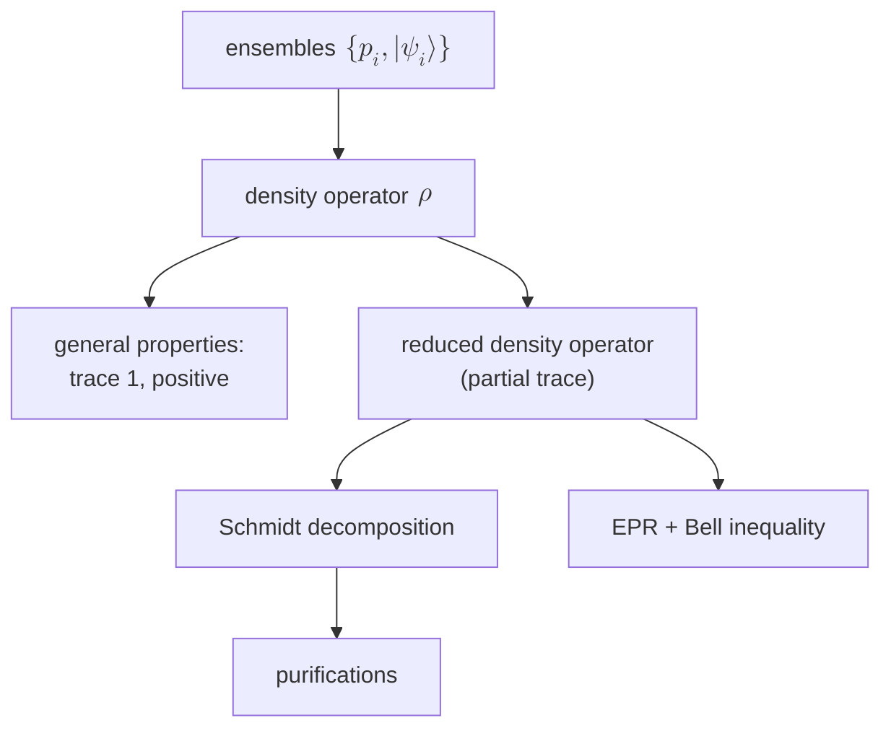

#textbook
notes from the book **Quantum Computation and Quantum Information** by Nielsen and Chuang (the standard textbook, "Mike and Ike"). these go deeper and more formal than the courses, so each note links to the course note on the same idea
## chapter 2: introduction to quantum mechanics
pages 98–115: the end of superdense coding, the density operator, the Schmidt decomposition, and EPR + Bell
- [[Ensembles of quantum states]] → §2.4.1: $\rho=\sum_ip_i|\psi_i\rangle\langle\psi_i|$, how $\rho$ evolves and gets measured, mixtures of mixtures
- [[General properties of the density operator]] → §2.4.2: trace 1 + positive = a density operator, the postulates rewritten with $\rho$, unitary freedom in ensembles, the Bloch vector
- [[Reduced density operator]] → §2.4.3: the partial trace, why it's the right definition (Box 2.6), why teleportation isn't faster than light
- [[Schmidt decomposition and purifications]] → §2.5: every pure 2 part state is $\sum_i\lambda_i|i_A\rangle|i_B\rangle$, and every mixed state is half of a pure one
- [[EPR and the Bell inequality]] → §2.6: the singlet, EPR's "elements of reality", and the common sense derivation of Bell's inequality
- [[Chapter 2 exercises]] → worked answers to exercises 2.69–2.82
- [[Chapter 2 formulas]] → every formula from these pages on one sheet

## the same ideas in the courses
- [[Density matrix]], [[Pure state]], [[Pure and mixed states]] (Course 3 Week 1)
- [[Partial trace]], [[Schmidt decomposition]], [[Schmidt number]], [[Purification]]
- [[Superdense coding]], [[Bell states]], [[Teleportation]]

see also [[Welcome]]
