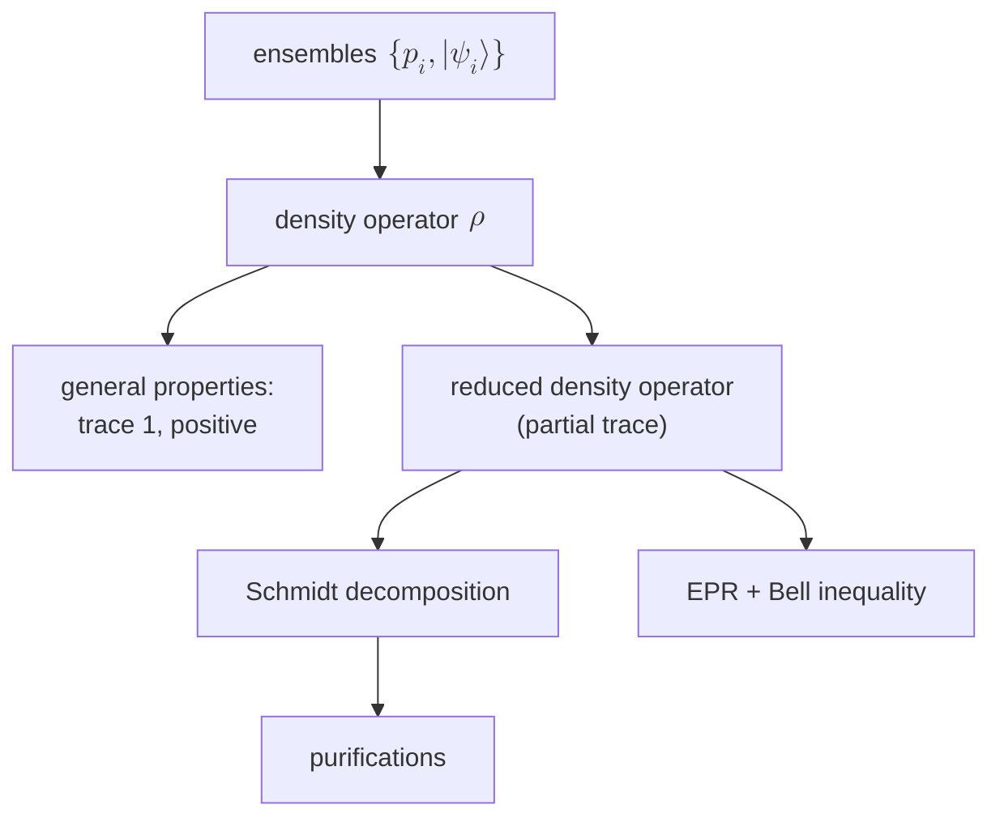
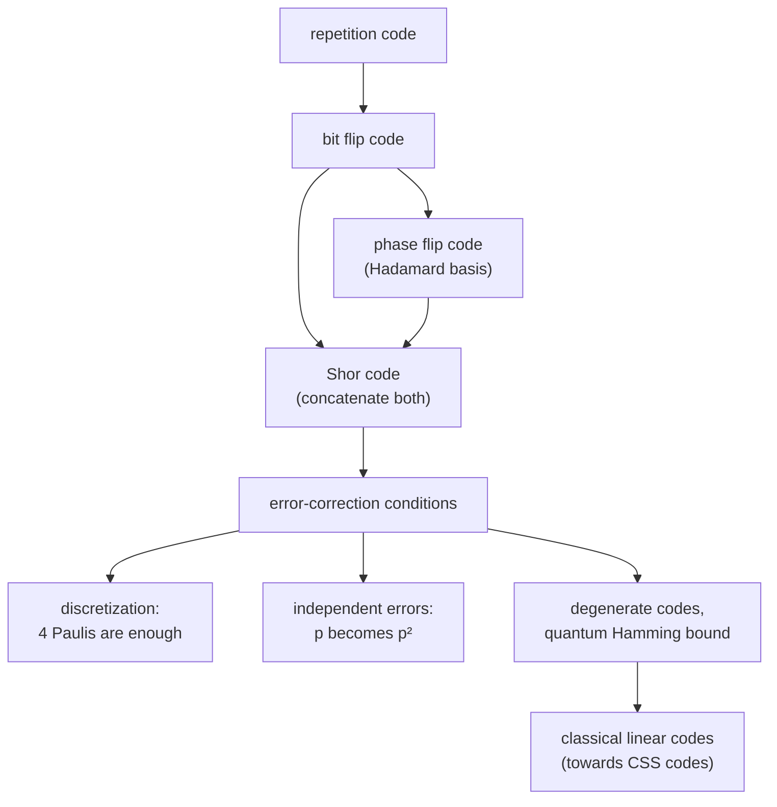

#textbook
notes from the book **Quantum Computation and Quantum Information** by Nielsen and Chuang (the standard textbook, "Mike and Ike"). these go deeper and more formal than the courses, so each note links to the course note on the same idea
## chapter 2: introduction to quantum mechanics
pages 98–115: the end of superdense coding, the density operator, the Schmidt decomposition, and EPR + Bell
- [[Ensembles of quantum states]] → §2.4.1: $\rho=\sum_ip_i|\psi_i\rangle\langle\psi_i|$, how $\rho$ evolves and gets measured, mixtures of mixtures
- [[General properties of the density operator]] → §2.4.2: trace 1 + positive = a density operator, the postulates rewritten with $\rho$, unitary freedom in ensembles, the Bloch vector
- [[Reduced density operator]] → §2.4.3: the partial trace, why it's the right definition (Box 2.6), why teleportation isn't faster than light
- [[Schmidt decomposition and purifications]] → §2.5: every pure 2 part state is $\sum_i\lambda_i|i_A\rangle|i_B\rangle$, and every mixed state is half of a pure one
- [[EPR and the Bell inequality]] → §2.6: the singlet, EPR's "elements of reality", and the common sense derivation of Bell's inequality
- [[Chapter 2 exercises]] → worked answers to exercises 2.69–2.82
- [[Chapter 2 formulas]] → every formula from these pages on one sheet

## chapter 10: quantum error-correction
pages 425–449: the three qubit codes, the Shor code, the general theory of quantum error correction, and classical linear codes
- [[Introduction to quantum error-correction]] → §10.1: the repetition code, the three problems for quantum codes, the bit flip code
- [[Syndrome diagnosis and recovery]] → §10.1.1: the syndrome projectors, fidelity with and without the code, $Z_1Z_2$ and $Z_2Z_3$
- [[Three qubit phase flip code]] → §10.1.2: the bit flip code in the $|\pm\rangle$ basis, unitarily equivalent channels
- [[Shor nine qubit code]] → §10.2: concatenation, and why fixing 4 errors fixes all of them
- [[Quantum error-correction conditions]] → §10.3: theorem 10.1, $PE_i^\dagger E_jP=\alpha_{ij}P$, with the proof, and correction without measurement (Box 10.1)
- [[Discretization of the errors]] → §10.3.1: theorem 10.2, why the four Paulis are enough
- [[Independent error models]] → §10.3.2: depolarizing and amplitude damping noise on every qubit, $1-O(p)\to1-O(p^2)$
- [[Degenerate codes and the quantum Hamming bound]] → §10.3.3–10.3.4: no non-degenerate code under 5 qubits
- [[Classical linear codes]] → §10.4.1: generator and parity check matrices, distance, Hamming codes, the Gilbert-Varshamov bound, dual codes
- [[Chapter 10 exercises]] → worked answers to exercises 10.1–10.23
- [[Chapter 10 formulas]] → every formula from these pages on one sheet

## the same ideas in the courses
- [[Density matrix]], [[Pure state]], [[Pure and mixed states]] (Course 3 Week 1)
- [[Partial trace]], [[Schmidt decomposition]], [[Schmidt number]], [[Purification]]
- [[Superdense coding]], [[Bell states]], [[Teleportation]]
- chapter 10: [[Bit flip code]], [[Parity measurement]], [[Decoding the bit flip code]], [[Phase flip code]], [[Shor code]] (Course 4 Week 1), and the channels [[Bit flip channel]], [[Depolarizing channel]], [[Amplitude damping channel]] (Course 3 Week 1)

see also [[Welcome]]
