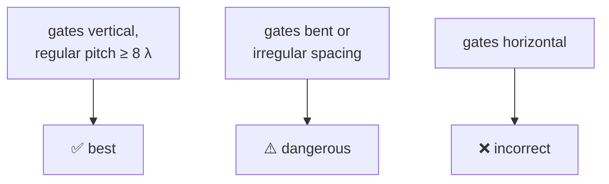

#vlsi #FinFET #layout #cell_design
drawing logic cells with [[FinFET|FinFETs]] in [[Microwind]]. part of [[Microwind course]]

## inverter
![[CMOS_inverter.png|300]]

- 2-fin (high density) n and p FinFETs
- one shared gate line for the input
- **dummy gates** on both sides for manufacturability
- $V_{DD}$ rail at the top, $V_{SS}$ at the bottom, output on metal between them

![[FinFET_inverter_layout.png|450]]

## bigger gates
- **NOR3**: 3 p-FinFETs in series (top), 3 n-FinFETs in parallel (bottom)
- **AND3** = NAND3 + inverter
- **RS latch**: generate 2 NAND gates with the cell compiler, cross-couple them with metal, add input pulses, simulate

### XOR, 2 ways

| version | built from | transistors | |
|---|---|---|---|
| "safe" | 2 inverters + 3 NAND2 | 16 | big but robust, every output is driven by a full gate |
| 6-transistor | 2 inverters + 2 pass transistors (a transmission gate) | 6 | efficient, but the $B$ signal passes through **without being amplified** |

for the 6T version: one inverter makes $\bar A$, then if $A=0$ the transmission gate passes $B$, and if $A=1$ the second inverter (powered by $A$ and $\bar A$) passes $\bar B$. switching delays come out at a few ps

## converting old layouts
old planar MOS layouts don't work in a FinFET process. **Edit → Convert into FinFET** reshapes the diffusions into fins. it more or less works (eg. a 4-bit adder), but watch out: $V_{DD}$ is lower, $I_{on}$ is higher and the thresholds are different, so re-check the timing

## layout rules
FinFET processes are very strict about **regular** patterns. ==irregular layouts print badly and give a spread of currents==

- **fins**: horizontal, aligned with each other across the cell, on a regular pitch of 6 λ (1 + 5). misaligned fins distort the gate and spread out $I_{on}$ and $I_{off}$
- **gates**: vertical, aligned, on a regular pitch of at least 8 λ (2 + 6). no horizontal gates, no bends or jogs

![[Fin_alignment.png]]

## the metal stack
the wires above the transistors (the **back end of line**, BEOL). lower layers are thin and dense for short hops, upper layers wide for long distances and power

![[Metal_stack.png]]

at 14 nm (λ = 8 nm)

| layers | relative pitch | width (λ) | width (nm) | used for |
|---|---|---|---|---|
| M7, M8 | 4 | 24 | 192 | supply |
| M5, M6 | 3 | 18 | 144 | long routing |
| M3, M4 | 2 | 12 | 96 | medium routing |
| M1, M2 | 1.4 | 8 | 64 | short routing |
| gate, local interconnect | 1 | 6 | 48 | inside the cell |

^metal-stack

## 7 nm vs 5 nm cells
7 nm cells mix 4, 3 and 2 fins. at 5 nm the fins are taller, so **3 and 2 fins** are enough. a 5 nm cell is 7 metal tracks tall with a 10-fin pitch

> [!exercise] try this
> why does the 6T XOR "not amplify $B$"? when is that a problem?

> [!answer]-
> when $A=0$ the output is connected straight to the $B$ wire through the transmission gate, so whatever drives $B$ also has to drive the XOR's load, and any weakness in $B$ goes straight through. chaining many of these (eg. in a long adder) adds up delay, so you put a buffer (inverter) after a few stages

see also [[Nanosheet cell design]], [[Ring oscillator]], [[FinFET]]
