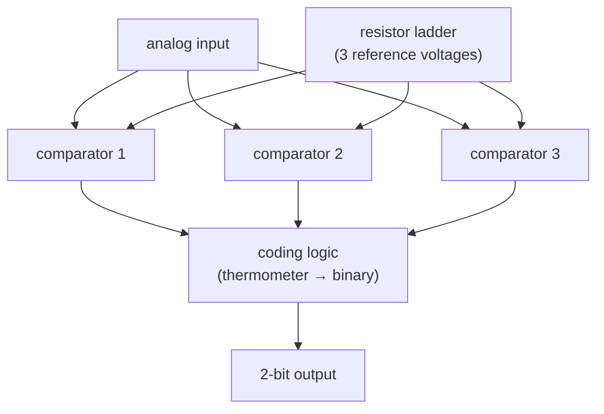

#vlsi #nanosheet #layout #cell_design
drawing logic cells with [[Nanosheet FET|nanosheet FETs]] in the 3 nm rules of [[Microwind]] (λ = 4 nm). part of [[Microwind course]]

## no wells
in older processes the p-transistors sit in an **n-well** that has to be tied to $V_{DD}$ with its own contact. nanosheet devices don't need it: ==no n-well, no well contact, no polarization==, so the layout is simpler and smaller

## 5 metal tracks
cells are measured in **tracks**: how many horizontal metal lines fit in the cell's height

| | old style | 3 nm |
|---|---|---|
| tracks | 7 | **5** (shared $V_{DD}$ + 4 signal tracks + shared $V_{SS}$, rails shared with neighbouring cells) |
| metal pitch | | 24 nm (6 λ) |
| cell height | | **120 nm** |
| contacted gate pitch | | 40 nm (10 λ) |

![[Cell_tracks.png]]

the catch: less room for routing inside complex cells (D-latch, complex gates), and no room for very wide devices (4–8 λ, not more)

the general rule
$$
\text{cell height}=\text{tracks}\times\text{metal pitch}
$$
^track-count

## inverter
![[CMOS_inverter.png|260]]

the slow inverter: an n- and p-nanosheet of width 4 λ sharing a gate line, between the shared rails. the cross section through the gate shows the 3 stacked sheets of each device

## examples
- **basic gates**: NAND2, NOR2, NAND3, OR3, AND3
- **RS latch** from NOR gates
- **6T SRAM**: a regular student design that tiles in X and Y, and an expert one that shares every possible signal and contact (data, $\overline{\text{data}}$, BL, $\overline{\text{BL}}$, select) to save area
- **edge-sensitive register** from transmission gates (about 800 × 500 nm). simpler designs sometimes don't work
- **4-bit counter** (0–15) from 3-stage D registers: very compact (320 × 270 nm per stage, 75% smaller), but full of DRC errors, so not manufacturable
- **2-bit ADC**: a resistor ladder, 3 open-loop amplifiers (comparators) and coding logic. it almost works: one output doesn't switch properly until the resistor scale is adjusted and the lowest reference voltage raised

> [!important] from a teacher's point of view
> nanosheet design is **like old MOSFET design**, and even simpler, because the n-well constraints are gone. the current is continuous (any width) instead of FinFET's 1, 2, 3, 4 fins. ==nanosheets are easier to design with than FinFETs==, and students like working with state-of-the-art performance

> [!exercise] try this
> a 2-bit flash ADC needs 3 comparators. how many does an $n$-bit one need, and why is that a problem?

> [!answer]-
> $2^n-1$ (one per threshold between output codes). 8 bits already needs 255 comparators, so flash ADCs are only used for small, very fast converters

see also [[FinFET cell design]], [[Buried power rails and CFET]], [[Ring oscillator]]
