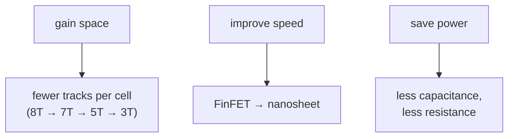

#vlsi #scaling #technology_node #roadmap
what you get from each new technology node, and why it's getting harder. part of [[Microwind course]]

## what shrinking gives you
- **smaller**: the same chip in less area (65 → 28 → 14 nm)
- **faster**: 8 cores in the space of 1, about 3× faster (65 nm dual core vs 22 nm octa core, same max die size)
- **less power**: about −50% at 28 nm and −80% at 14 nm compared with 65 nm, and 10× less overall going from 65 to 22 nm
- **cheaper**, but only if you make millions of chips

## the node name isn't a size any more
"the node = the smallest feature" used to be true. ==now it's just a name==: the 3 nm node's smallest feature is about **8 nm**, and layers thinner than about 5 nm (50Å, ~30 silicon atoms) are nearly impossible to make

so the industry gains space in other ways, without really shrinking:

the **contacted gate pitch** (horizontal) has saturated around 40 nm, but the **cell height** keeps falling

![[Cell_height_scaling.png]]

## the node table
![[Transistors_3D.png]]

| parameter | 7nm | 5nm | 3nm | 2nm / 20Å | 1nm / 10Å | 5Å | 3Å |
|---|---|---|---|---|---|---|---|
| device | FinFET | FinFET | nanosheet | nanosheet | CFET | stacked CFET | stacked CFET |
| nanosheets | | | 3 | 3 | 3 + 3 | 4 + 4 | 4 + 4 |
| tiers | | | | | | 2 | 4 |
| λ (nm) | 4 | 4 | 4 | 4 | 3.5 | 3.5 | 3.0 |
| metal 1 pitch (λ) | 6 | 6 | 6 | 5 | 5 | 5 | 5 |
| metal 1 pitch (nm) | 24 | 24 | 24 | 20 | 17 | 17 | 15 |
| gate pitch (nm) | 40 | 40 | 40 | 40 | 35 | 35 | 30 |
| routing tracks | 7 | 7 | 5 | 5 | 3 | 3 × 2 | 3 × 2 |
| buried power rail | | | | yes | yes | yes | yes |
| cell height (nm) | 192 | 192 | 120 | 100 | 50 | 50 | 50 |
| $V_{DD}$ (V) | 0.7 | 0.65 | 0.65 | 0.65 | 0.65 | 0.60 | 0.60 |

^node-table

## when each node came

| node | year | key innovation |
|---|---|---|
| 180 nm | 2000 | Cu interconnect, MOS options, 6 metal layers |
| 130 nm | 2002 | low-K dielectric, 8 metal layers |
| 90 nm | 2003 | SOI substrate |
| 65 nm | 2004 | strained silicon |
| 45 nm | 2008 | 2nd generation strain, 10 metal layers |
| 32 nm | 2010 | high-K metal gate |
| 20 nm | 2013 | replacement metal gate, double patterning, 12 metal layers |
| 14 nm | 2015 | FinFET |
| 10 nm | 2017 | FinFET, double patterning |
| 7 nm | 2019 | FinFET, quadruple patterning |
| 5 nm | 2021 | FinFET, EUV lithography |
| 3 nm | 2022 | nanosheet FET |
| 2 nm / 20Å | 2024–25 | nanosheet + buried power rails |
| 1.4 nm / 14Å | 2027 | improved nanosheet + BPR |
| 1 nm / 10Å | 2030 | stacked n & p (CFET) |
| 5Å | 2035 | stacked tiers |

India's first fab (Tata–PSMC) starts at **28 nm** in 2025

## supply voltage
the core voltage fell from 3.3 V to about 0.65 V, but the I/O voltage stays higher (around 1 V) so chips can talk to the outside world

![[Supply_voltage_scaling.png]]

| era | supply | noise margin |
|---|---|---|
| 180 nm | 3.3 V outside, 1.8 V inside | 180 mV |
| 20 nm | 1.2 V outside, 0.9 V inside | 90 mV |
| 5 nm | 1 V outside, 0.65 V inside | **65 mV** |

lower voltage saves power (dynamic power goes as $V_{DD}^2$), but the **noise margin** shrinks too, so tiny disturbances can flip a bit

## the cost explosion
every new trick (strain, eSiGe, high-K, metal gate, low-K, FinFET, local interconnects, double patterning) adds cost: the relative cost of a technology went up about **6×** over 6 generations. new fabs cost $12–20 billion each (TSMC and Intel in Arizona, Samsung's 1.4 nm plans)

> [!extra]- why dynamic power goes as $V^2$
> every time a node switches, its capacitance $C$ charges to $V_{DD}$ and discharges again, taking energy $CV_{DD}^2$ from the supply. at a clock of $f$ with a fraction $\alpha$ of nodes switching
> $$
> P=\alpha CV_{DD}^2f
> $$
> so going from 1 V to 0.65 V cuts the power by $1-0.65^2\approx58\%$ on its own

> [!exercise] try this
> using the node table, by what factor does the cell area shrink from 7 nm to 1 nm, if the cell is (gate pitch) wide and (cell height) tall?

> [!answer]-
> 7 nm: $40\times192=7680$ nm². 1 nm: $35\times50=1750$ nm². about **4.4×** smaller, almost all of it from the cell height

see also [[Transistor evolution]], [[Buried power rails and CFET]], [[Semiconductor market]]
