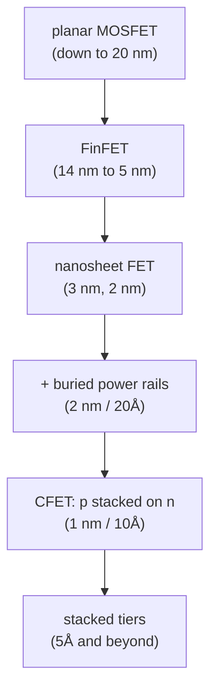

#vlsi #microwind #workshop
online workshop **"FinFET, Nano-Sheet cell design, Now & Road Ahead"**, an educational look at designing logic cells with the newest transistors, using the [[Microwind]] layout tool. 11–13 Sep 2025, 5:30 pm IST

## the big question
transistors can't really shrink any more. so how do chips keep getting **smaller, faster and lower power**?
==by changing the **shape** of the transistor (MOSFET → FinFET → nanosheet → stacked CFET) and by squeezing the **cells** (fewer metal tracks, power rails buried under the transistors)==

![[Transistors_3D.png]]

## schedule

| day | topic |
|---|---|
| **Thu 11 Sep** | intro to [[Microwind]], the semiconductor boom, the Indian 28 nm node, hands-on |
| **Fri 12 Sep** | trends and applications with [[FinFET]] cell design |
| **Sat 13 Sep** | future trends in 3 nm [[Nanosheet FET\|nanosheet]] cell design |

## notes
### transistors
- [[Transistor evolution]] → MOSFET vs FinFET vs nanosheet, equivalent width
- [[FinFET]] → fins, fin count, device options, 7 nm vs 5 nm
- [[Nanosheet FET]] → stacked sheets, slow vs fast devices, continuous width
- [[Buried power rails and CFET]] → the 2 nm and 1 nm road ahead

### the tool
- [[Microwind]] → what it is, its modules, lambda design rules
- [[MOS models and BSIM]] → how the simulator turns voltages into currents

### designing cells
- [[FinFET cell design]] → inverter, NOR3, RS latch, XOR, layout rules, metal stack
- [[Nanosheet cell design]] → no wells, 5 tracks, SRAM, counter, ADC
- [[Ring oscillator]] → the standard speed and power benchmark

### the industry
- [[Technology scaling]] → what a "node" means now, supply voltage, cost, the node table
- [[Semiconductor market]] → where the money goes, who can still make chips, India

### also
- [[Microwind formulas]]

![[Cell_height_scaling.png]]

see also [[Metrology and nano-characterization workshop]] (how you check the chips once they're made), [[MOS capacitor C-V]]
