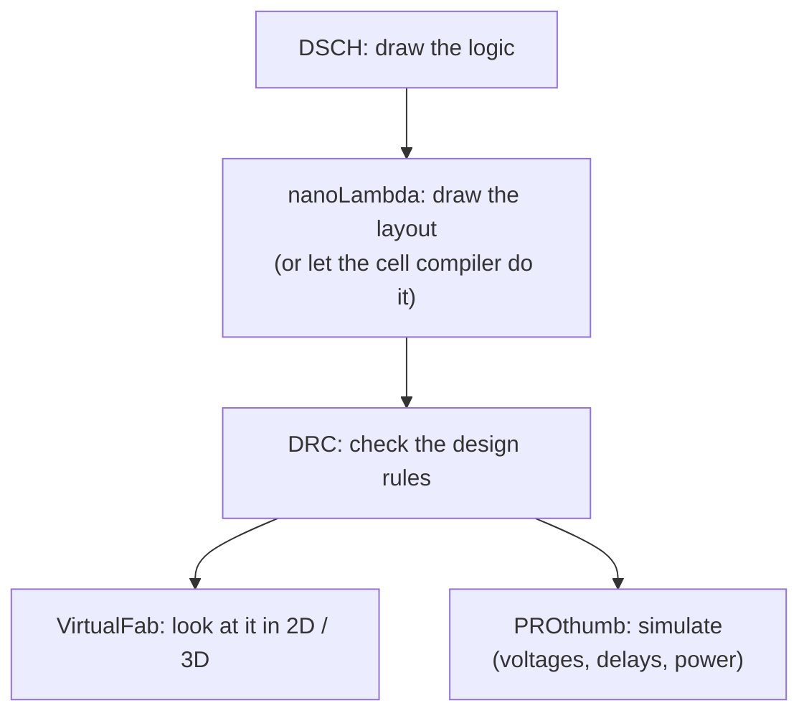
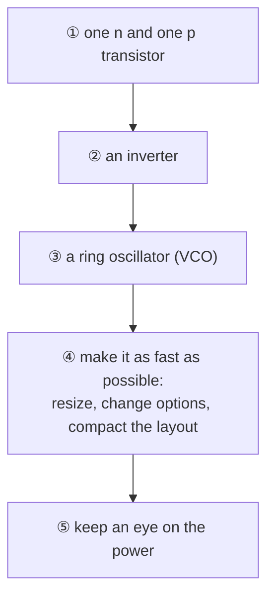

#vlsi #microwind #EDA
an educational tool for **drawing and simulating** nano-CMOS cells, from 1.2 µm technology down to 3 nm (MOSFET, FinFET and nanosheet). made at INSA Toulouse (France), used in most Indian university VLSI labs. part of [[Microwind course]]

## what's in it

| module | what it does |
|---|---|
| **nanoLambda** | the layout editor: draw the layers of a cell |
| **PROthumb** | the built-in SPICE-like simulator |
| **VirtualFab** | 2D cross sections and 3D views of the layout |
| **PROtutor** | play with transistor models and see their curves |
| **DSCH** | a digital schematic editor (logic gates, then simulate) |

version 3.9 added the 3 nm nanosheet FET, new 7 / 5 / 3 nm rule files, and control of external SPICE simulators. a prototype version 4.0 has the 2 nm buried power rail and 1 nm CFET nodes ([[Buried power rails and CFET]]), and there's a rule file for India's 28 nm node

the **cell compiler** turns an equation into a layout, eg. `Nand2=~(A&B)` (`~` = invert, `&` = and, `|` = or), in high density (2 fin) or high performance (4 fin) style, with dummy gates on both sides

## lambda units
everything is drawn in **λ** (lambda) units, not nm. the rules have stayed nearly the same for 20 years, and changing the technology just changes what λ is in nm

| rule | in λ | 14 nm (λ = 8 nm) | 3 nm (λ = 4 nm) |
|---|---|---|---|
| channel length | 2 λ | 16 nm | 8 nm |
| contacted gate pitch | 8 λ (14 nm), 10 λ (3 nm) | 64 nm | 40 nm |
| metal pitch | 6 λ (3 + 3) | 48 nm | 24 nm |

^lambda-rules

- not the most compact layout possible, but **independent of technology**: the same drawing works at any node
- λ used to be about **half the node** (8 nm at 14 nm). that's no longer true: at 3 nm, λ = 4 nm

## design rule checks (DRC)
[[Microwind]] checks about **100** basic rules. a real 14 nm design kit has more than **2500** (130 nm had ~500, 65 nm ~1000). ==a layout that passes Microwind's DRC still can't be sent to a fab== without the full check

## the 2D view
a cross section shows everything a modern process adds: strained n and p channels (SiGe for p), metal gate, high-K oxide, pocket implants, low-K dielectric between the 8 metal layers, double patterning, 2 supplies (core and I/O)

## teaching with it
a typical lab goes

then logic gates (interconnects, compact layout, speed vs power), analog blocks (amplifiers, voltage references), and a small project: an ADC, an ALU, an op-amp, a Bluetooth power amplifier

it's also used for research: 800+ papers cite it, and its application notes for new nodes have come out **ahead** of industry (3 nm nanosheet a year early, 2 nm buried power two years early)

> [!exercise] try this
> a gate drawn with a 10 λ contacted gate pitch is moved from the 3 nm rules to a 14 nm rule file that uses 8 λ. what happens to the real pitch?

> [!answer]-
> at 3 nm: $10\times4=40$ nm. at 14 nm the layout is still 10 λ, now $10\times8=80$ nm, wider than the 14 nm minimum (64 nm) but still legal. that's the point of λ: the drawing doesn't change, only the scale

see also [[MOS models and BSIM]], [[FinFET cell design]], [[Nanosheet cell design]]
