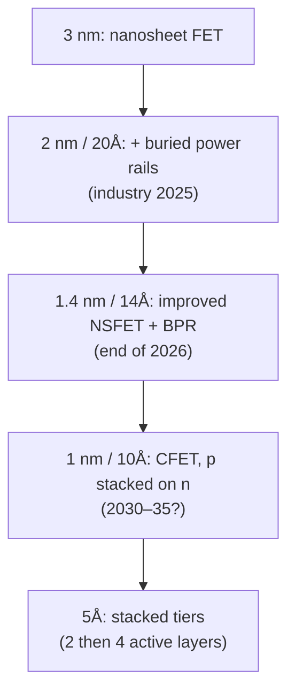

#vlsi #transistor #nanosheet #CFET #roadmap
the road after 3 nm: move the power wires **under** the transistors, then stack the n and p transistors **on top of each other**. part of [[Microwind course]]

## buried power rails (2 nm / 20Å)
normally $V_{DD}$ and $V_{SS}$ run as wide metal lines at the top and bottom of every cell. with a **buried power rail** (BPR) they go **into the substrate**, under the transistors

- no upper metal tracks needed for the supply → more room for signals
- the cell height nearly **halves**: 192 nm (7 nm FinFET, 7 tracks of 24 nm) → **100 nm** (2 nm NSFET, 5 tracks of 20 nm)
- lower supply resistance
- a first step towards 3D chips

![[Cell_tracks.png]]

### back-side power delivery
the rails connect through the back of the wafer with **nano through-silicon vias** (n-TSVs)

![[Backside_power.png]]

- the wafer should be **ultra thin** (about 0.5 µm) for the best electrical and thermal behaviour
- total resistance about 200 Ω/µm
- the n-TSV pitch lines up with 2 rail pitches
- Intel calls its version **PowerVia** (20A, 2024)

## CFET (1 nm / 10Å)
stack the **p-FET on top of the n-FET** (complementary FET), each with 3 nanosheets, sharing **one gate**

![[CFET_inverter.png]]

- n-FET (bottom) to $V_{SS}$: a short via (vBPR) down to the buried rail
- n to p (the output): one via P/N
- p-FET (top) to $V_{DD}$: stacked vias (vBPR + via P/N) down to the rail
- ==an inverter takes about the footprint of one transistor==, so it's a completely new way of drawing cells

with only 3 routing tracks the cell is about **50 nm** tall. a NAND2 switches in under a picosecond (unloaded), and a 3-stage [[Ring oscillator]] gives around 535 GHz at only 17 µW per stage (not yet checked against publications)

## stacked tiers (5Å)
whole layers of active devices on top of each other: 2 tiers first, 4 later (3Å). the idea already works for memory: **V-NAND flash** stacks 128 layers (at 65 nm)

## the numbers

![[Technology scaling#^node-table]]

the gate pitch barely moves, metal pitch shrinks a little, but the cell height falls from 192 to 50 nm

> [!extra]- why put power underneath?
> power lines carry big currents, so they have to be wide (low resistance, no electromigration). on the front they eat routing tracks and sit at the top of a long via stack. underneath, they can be wide and thick without stealing anything from signals, and the supply drop ("IR drop") across the chip gets smaller

> [!exercise] try this
> going from a 7-track cell with 24 nm metal pitch to a 5-track cell with 20 nm pitch, by what factor does the cell height shrink (ignore the power rails)?

> [!answer]-
> $7\times24=168$ nm → $5\times20=100$ nm, a factor of about **1.7**. the real 192 → 100 nm (≈ 1.9×) is a bit more, because the old cell also needed room for its top and bottom power rails, and buried rails remove those

see also [[Nanosheet FET]], [[Technology scaling]], [[Nanosheet cell design]]
