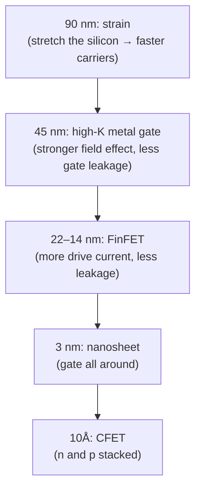

#vlsi #transistor #FinFET #nanosheet
how the transistor changed shape to keep giving **more current in the same space**. part of [[Microwind course]]

## what we want
- lots of current when it's **on** ($I_{on}$) → fast switching
- almost no current when it's **off** ($I_{off}$, leakage) → low power
- in as little silicon area as possible

plot $\log I$ against gate voltage: each new transistor gets a **higher** on current and a **lower** off current, with the same footprint

![[Id_Vg_three_devices.png]]

## the 3 shapes

![[Transistors_3D.png]]

and cut through the gate:

![[Weq_cross_sections.png]]

| | gate touches the channel on | idea |
|---|---|---|
| **MOSFET** (planar) | 1 side (the top) | a flat channel under the gate |
| **FinFET** | 3 sides | stand the channel up as a thin **fin**, wrap the gate over it |
| **nanosheet FET** | all 4 sides (**gate all around**) | stack thin horizontal **sheets** of silicon, gate fills the gaps |

more gate around the channel → the gate controls it better → it turns **off** properly (less leakage) and you can pack more channel into the same footprint (more current)

## equivalent width
the simulator still uses the old MOSFET equations. the trick is to feed it the **total length of gate wrapped around the channel** as if it were a flat width $W$

| device | $W_{eq}$ |
|---|---|
| MOSFET | $W$ |
| FinFET (per fin, height $H$, thickness $T$) | $2H+T$ |
| nanosheet (3 sheets, width $W$, thickness $T$) | $3\times2(W+T)=6W+6T$ |

^weq-table

for a FinFET with $N_{fin}$ fins
$$
W_{eq}=(2H_{fin}+W_{fin})\,N_{fin}
$$
^weq-finfet

> [!eg] 7 nm FinFET, 14 fins
> $H_{fin}=35$ nm, $W_{fin}=4$ nm: $W_{eq}=(70+4)\times14=1036\text{ nm}\approx1\,\mu\text{m}$. so 14 tall thin fins act like a 1 µm wide planar transistor, in a much smaller footprint

## why it had to change
up to 20 nm, the planar MOSFET kept getting better by tricks on top of shrinking:

current drive went from about 0.7 mA/µm at 130 nm to over 2 mA/µm at 5 nm, and each step also offers 3 flavours: **high performance** ($I_{off}\approx100$ nA/µm), **general purpose** (10 nA), **low power** (1 nA)

the inside of a nanosheet, with the gate cut open:

![[Nanosheet_3D.png|500]]

> [!important] the same current in less space
> for 1 mA of drive current, a FinFET needs about **30% less** area than a MOSFET, a nanosheet about **50% less**, and a stacked 3D nanosheet about **75% less**

> [!extra]- why a gate on more sides leaks less
> in a short channel the drain's field reaches through and starts pulling current even when the gate says "off" (short channel effects, like **DIBL**). a thin channel with gate on 3 or 4 sides has no part far from the gate, so the gate wins the tug of war. the measure is the **subthreshold slope**: the gate voltage needed to change the off current by 10×. it can't beat about 60 mV/decade at room temperature, and gate all around gets close to that

> [!exercise] try this
> a nanosheet device has 3 sheets, 16 nm wide and 5 nm thick. what's its equivalent width? how many 7 nm fins ($H=35$, $T=4$ nm) give the same?

> [!answer]-
> $W_{eq}=6(16+5)=126$ nm. one fin is $2(35)+4=74$ nm, so about $126/74\approx1.7$ fins: you'd have to pick 1 or 2, you can't have 1.7 (see [[Nanosheet FET#width is continuous again]])

see also [[FinFET]], [[Nanosheet FET]], [[Buried power rails and CFET]], [[MOS models and BSIM]]
